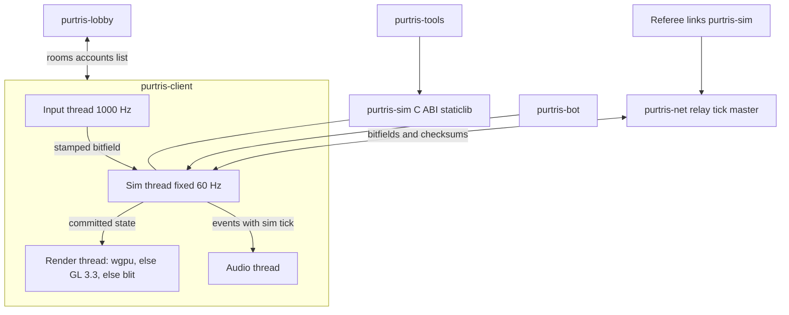
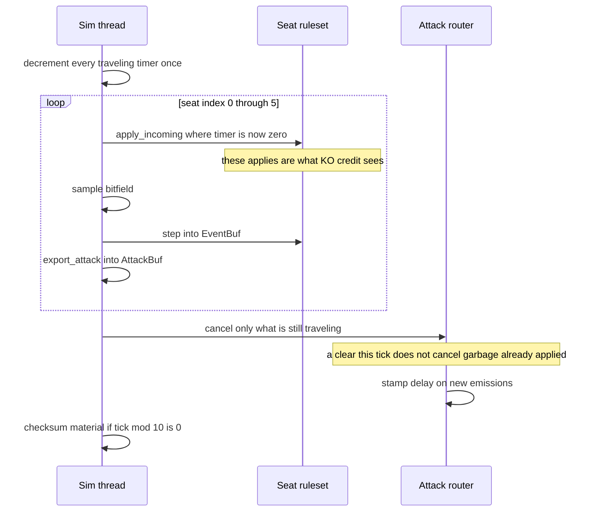
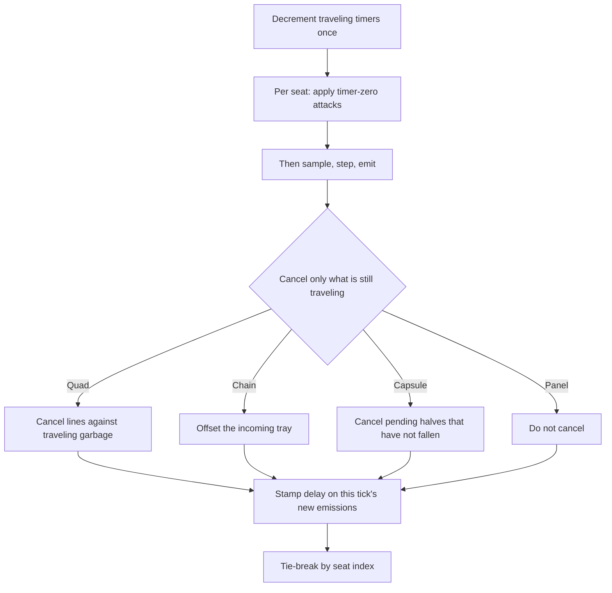
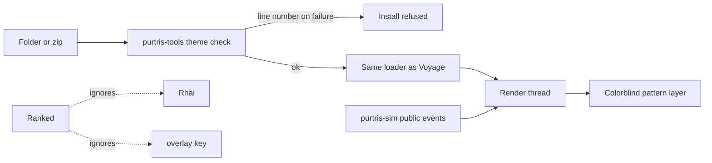
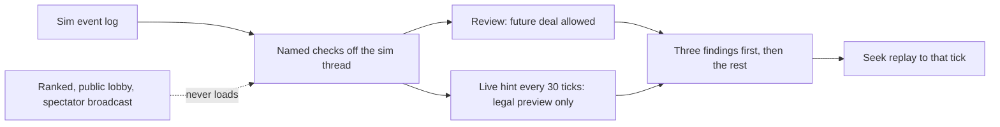
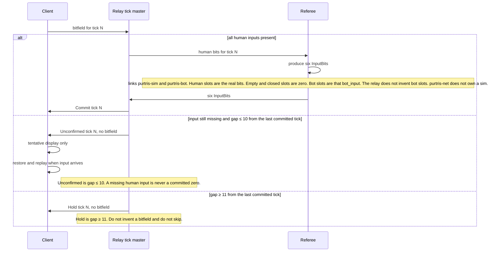
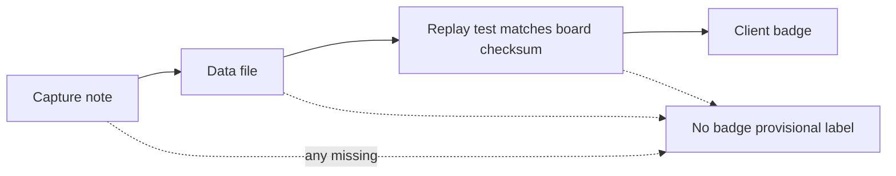

# DR-PURTRIS: Competitive Puzzle Platform and Training Tool

| Field | Value |
| --- | --- |
| Author | DR-PURTRIS design |
| Date | 2026-11-15 |
| Status | Draft |
| Audience | Senior engineers building the client, the sim, and the referee |
| Product | DR-PURTRIS |

This is a greenfield design. There is no game repository yet, and this document does not pretend to cite one. The crate names, data paths, and file names below are the contract to build. Paths that the plan marks as capture-filled are named here and left empty of invented digits. Where a number is a derived estimate (replay size, snapshot count), it is labeled derived. Where a number is a requirement (tick rate, budgets, seed counts, attack tables that the plan already printed), it is a requirement.

Two promises sit on top of every feature:

1. **The rules match the source game.** Same-style ranked play is accepted only after a recorded corpus matches the original, tick for tick, on the cases that define that game.
2. **The app feels better than practicing on the original hardware in the cases where software can honestly win.** Those cases are named below. The engine does not "improve" gravity, rotation, or attack power to feel better.

## Overview

DR-PURTRIS is a competitive puzzle platform and a training tool for people who already play these games seriously. Four play styles share one match of up to six seats. Each player picks their own style. A Capsule player, a Chain player, a Quad player, and a Panel player can sit in the same room and attack each other.

The styles:

| Player-facing name | What it is | Authentic target |
| --- | --- | --- |
| Capsule | Dr. Mario | NES Dr. Mario, plus a measured versus-attack layer |
| Chain | Puyo Puyo | Tsu rules, with Fever and the modern competitive package as their own profiles |
| Quad | Tetris | Guideline / Puyo Puyo Tetris versus as the cross-play default; NES Tetris and TGM as their own profiles |
| Panel | Panel de Pon, released in the US as Tetris Attack | Super Famicom Panel de Pon, with the US Tetris Attack measured as the same profile or a sibling if any rule differs |

Panel is not a Tetris mode. The US box borrowed the Tetris name. The game is a rising stack of colored panels, a two-cell cursor, and horizontal swaps. Calling it Quad inside this client would be the wrong game. The mode select shows **Panel**, with the line "Panel de Pon / Tetris Attack" under it.

The game is multiplayer first. Solo, lessons, and bots exist so a player can practice at 3 a.m. and so an empty seat in a six-player room can be filled. They are not a side thought.

Public rooms are listed. Closed rooms are unlisted and joined by code, password, or invite.

The client is a custom engine built for this game. No general-purpose engine owns the tick, the input path, or the renderer. Language is Rust for the sim, net, bots, and lobby. The renderer is Rust, and it is not wgpu-only. Voyage and Balanced use wgpu when that device comes up. Launch does not require Vulkan. If wgpu cannot be created, or the preset is Potato, the client draws OpenGL 3.3 sprites, and if that also fails it blits those same sprites in software. The sim is also built as a C ABI static library so the referee server and the tools link the same object the client links. The sim thread never waits on the renderer.

Same-style matches are 1:1 with the source game: original attack, timing, and randomizer, nothing converted. Mixed matches, and any room that forces the cross path, pass attacks through an Attack IR. The attack path is fixed at match create. Count every seat that is not empty and not closed, including bots and seats that later die. One profile and `force_cross_path` clear: authentic native for the whole match. Otherwise, or if the flag is set: cross path for the whole match. A death does not recompute it. Rollback netplay does not guess. Unconfirmed is gap ≤ 10 from the last committed tick. Hold is gap ≥ 11. A wrong board is a worse failure than a hitch.

The intended look is cinematic, in the spirit of Tetris Effect, via an original theme named Voyage. Voyage is not a copy of Tetris Effect's scenes, soundtrack, or Zone rules. Zone is not a ruleset here. Nothing in Voyage changes gravity, rotation, attack, or the tick. Voyage is the default only after the first-launch bench passes. If the device cannot be created, or the bench misses its frame bar, the stored preset is Potato. Tournament is a flat theme one key away, not the first boot. Phosphor is a CRT theme included but not default. Themes are data folders. The same loader reads Voyage and a zip a player dropped in. The draw preset is not in the replay hash.

Training is a curriculum, not only a sandbox. It teaches advanced competitive method for every style, including three tap skills that must not be collapsed into one, and a cross-style reading course. Lessons do not gate ranked. A gameplay analyzer runs deterministic checks over the sim log in training only. Review of a finished replay may see the rest of the deal. A live hint may see only the profile's legal preview. Ranked never loads it.

An account is a player card and a friends list inside the client. Local play does not require one. The card's country never decides matchmaking. A closed room does not leak its join path through presence.

## Background & Motivation

These four games are solved sports with hostile timing budgets. Players who compete already own the cartridges, the ports, or the modern clients. They will leave those only for reasons this client can demonstrate.

A CRT's scanout is still the lowest-lag picture in the world. This design does not pretend otherwise. It names the cases where DR-PURTRIS is the better place to play:

- They are training. Rewind, frame advance, seeds, calculators, and "take over this replay" do not exist on a cartridge.
- They are online. Rollback 1v1 is the match they cannot have on a SNES.
- More than two people are playing. These games are two-player on hardware. This client is six.
- They are switching styles in one session and want one input path and one replay format.
- They want a sharp, stable picture for a long session: no sprite flicker, no composite dot crawl, integer scale or a sharp non-integer scale, a board big enough to read.
- They want the next event to land on the sim tick they earned, every time, with a hitch treated as a bug.

A serious player is not asked to trust a slogan. The client shows a latency meter and a corpus badge. The badge is absent while a profile is missing its capture note, its data file, or its replay test. Rooms show "provisional" on any attack number that is still a tuning pass.

### Current state

There is no engine, no rules code, and no captured timing corpus in a repository yet. Public write-ups disagree on several digits this game needs in order to be fair. Those disagreements are not resolved by taste:

- Capsule's later versus half-capsule table is **not** fixed in this document. `rules/capsule/vs/attack.toml` is filled by capturing the Wii or 3DS game.
- Quad's combo column on the Hard Drop Puyo Puyo Tetris page was corrupted in the left column of the fetched table. It is transcribed from the live page, not typed from memory.
- Panel's garbage chart and RNG have no crowned URL. They come from project captures.
- Chain's per-frame pop delays, hidden-row count, lose cell, double-rotate window, and per-row drop bonus are measured per profile.

Until those files exist, the implementation teaches the method and labels the gap. It does not ship a rounded guess as if it were the console.

### Pain this design refuses to accept

- A general engine's frame clock, garbage collector, or scene tree stepping the sim.
- A house randomizer or a "better" rotation in any queue whose badge says authentic.
- Folding a later official game's rule change into the authentic profile without a new profile id.
- DAS settings that can desync, or NES DAS that is not the console's DAS.
- Guessed inputs past the rollback window.
- A host with a shorter input path than the other seats.
- Gameplay information (longer next queue, seed readout, attack calculator, garbage-column preview) smuggled into ranked through a theme.
- Panel implemented as Tetris, or Panel versus Panel given a Puyo-style offset tray.
- Ripped sprites, boards, fonts, music, voice, characters, or a decompiled commercial function pasted into the repo.
- The pre-2017 Puyo rotate-mash score glitch. Faithful Tsu means the intended rule.

### Prior art that is not a balance reference

Dr. Mario & Puzzle League is prior art for putting Capsule and Panel in one product. It is not a balance reference. We measure; we do not inherit its tuning. Puyo Puyo Tetris is the source of the Quad-versus-Quad and Quad-versus-Chain tables cited below, and of swap and Quad+Chain fusion behavior. It is not a license to copy assets, character skills, or item lists.

## Goals & Non-Goals

### Goals

- One match, six seats, four styles, each seat on its own profile.
- Same-style play that is tick-for-tick with the authentic profile once the corpus passes, and visibly provisional before that.
- Mixed play through a versioned Attack IR, with native units preserved on the same-style path.
- A custom Rust sim with no per-tick allocation, no floating point, and two tick bars on the same rules: 2 ms for six mixed boards on the 2020 desktop reference, 4 ms on the potato floor with the Potato preset. A late GPU drops pictures. It never skips a sim tick.
- Rollback netplay whose committed state never contains a guessed bitfield, plus a referee that links the same sim object.
- A training curriculum with equal depth for Capsule, Chain, Quad (guideline track and NES track), and Panel, plus cross-style reading.
- An original overworld that teaches each style and then mixed matches, including 1v1, 2v2, 3v3, and a three-seat free-for-all, with three difficulties and objectives per node.
- A gameplay analyzer: deterministic checks over the sim log, training only. Review may see the rest of the deal. Live hints may see only the profile's legal preview. Ranked never loads it.
- A player card and an in-client friends list. Identity does not block local play. Country never decides matchmaking. Closed rooms do not leak a join path through presence.
- A cinematic theme (Voyage) on the same loader as community themes. Voyage is the default only after the first-launch bench passes; otherwise the stored preset is Potato. The flat Tournament theme is one key away.
- Data-only modding that is ranked-legal when it adds no gameplay information.
- Deterministic bots and bit-identical replays.
- Original art, audio, and fonts only.

### Equal depth, every style

Panel is not a guest mode. Each style gets this checklist:

1. An authentic profile whose geometry, randomizer, movement, clear rules, attack, and frame delays are data, tested against recordings.
2. Named alternate profiles where a later official game actually differs. Differences are never folded into the authentic profile silently.
3. A seed or sequence identity tool in the same spirit as the NES virus seed: the player can see, share, and replay the deal.
4. Incoming garbage does not consume that deal.
5. A frame-timing corpus checked into the repo.
6. A calculator overlay that shows the attack the player just created, in that game's own units.
7. A board editor.
8. A drill library of community setups, authored as lab files, not ripped from commercial ROMs.
9. A versus ruleset and a solo objective (clear, score, or race).
10. Deterministic bots with more than one personality.
11. An explicit statement of whether handling lives inside the sim (hardware rules) or outside it (player DAS / ARR settings).
12. A ranked queue that stays closed until that profile's corpus passes.
13. Replays that resimulate bit-identically.
14. An authentic palette and a colorblind palette. Ranked can require the authentic palette be available. Color is never the only signal: shapes and patterns exist on every piece.

### Non-goals

Explicitly out:

- Commercial characters, voice clips, music, and sprites.
- Touch play for Panel DS.
- A story adapted from Dr. Mario, Puyo Puyo, Tetris, Tetris Attack, or Panel de Pon. The original overworld in Story mode is in the product.
- The Puyo rotate-mash score glitch.
- Invented "better" rotation or a house randomizer in any queue whose badge says authentic.
- Unity, Unreal, Godot, and GameMaker. Their frame clocks, garbage collectors, and scene trees fight the timing budget.
- A kernel anti-cheat driver.
- Zone, or any Tetris Effect mechanic, as a ruleset. Voyage does not change the sim.
- Copying Tetris Effect scenes, soundtrack, or trade dress.

Phase 2 is specified now so the architecture does not block it, and it is not in the competitive core:

- A web spectator that consumes a replay stream. The sim stays native.
- Extra profiles already named (`quad.tgm`, `panel.n64`, `panel.ds`, `capsule.rx`) if they are not finished in the core.
- A mod slot for training rules. A modded room is marked modded, cannot be ranked, and cannot appear as a clean public room.

Party and study features (Swap, Fusion, Big Bang, party items, puzzle books, daily seeds) ship after the competitive core. They do not reopen the sim tick or the net protocol.

### Handling, stated per family

| Family | Where handling lives |
| --- | --- |
| Modern Quad (`quad.guideline`, `quad.ppt`) | Outside the sim. Player DAS, ARR, and SDF run on the client and emit left, right, and soft-drop bits. The sim obeys the bit that tick and does not run a second DAS. The interpreter emits hard drop only on the key's rising edge. The sim never sees DAS numbers. Different handling cannot desync. |
| `quad.nes`, `quad.nes.vs`, `quad.tgm` | Inside the sim. Player DAS settings do not apply. |
| `capsule.nes`, `capsule.vs`, and NES movement on `capsule.rx` | Inside the sim. The console's own repeat is the rule. |
| `chain.*` | Movement rules of the profile are inside the sim. There is no player DAS to tune. Quick drop is off in ranked `chain.tsu`. No hard drop on `chain.tsu`. |
| `panel.*` | Cursor repeat is the original DAS, inside the sim. The client does not add cursor acceleration. Player DAS settings do not apply. |

Training displays in-sim repeat in frames and in milliseconds so the player can learn it. The settings screen says which model the current profile uses, in frames and in milliseconds. Frame counts are read from the profile timing file. This document does not invent them.

## Proposed Design

### Engine processes

The engine is the product. Six parts:

| Process | Responsibility |
| --- | --- |
| `purtris-sim` | Rules, match, attack routing. No window, no audio, no clock from the OS. |
| `purtris-net` | Relay, rollback, checksums, reconnect. |
| `purtris-lobby` | Accounts, public list, closed rooms, matchmaking. Does not generate piece deals. |
| `purtris-bot` | Deterministic AI. Same state and seed produce the same inputs on every machine. |
| `purtris-client` | Window, input, audio, render, UI. |
| `purtris-tools` | Fuzz, replay diff, seed browser, corpus runner, `theme check`. Headless. |

`purtris-sim` is a Rust library and a C ABI static library. The client, the referee, and `purtris-tools` link that same object. There is one sim binary in the logical sense: one compiled rules implementation, not a reimplementation on the server.

C++ is the only acceptable substitute for the sim, and only if the sim stays free of undefined behavior, globals, and static constructors that could change init order. The default is Rust. This document does not approve a mixed C++/Rust sim.

The lobby never generates a deal. Deals are a pure function of the match seed, the stream name, and the seat scope, inside `purtris-sim`.

### Repository map

There is no existing tree. These crates are the map. Paths below are the contract, not a claim that the directories already exist.

| Crate | Owns | Must not own | Created in |
| --- | --- | --- | --- |
| `purtris-sim` | Rules, match step, attack routing, serialization, checksums, the C ABI. Plain `MatchHeader` and seat state. | A window, audio, the OS clock, the GPU, the network, account records, bot policy code. | PR 1 creates the crate and the tick loop. PRs 2–13 fill rules. |
| `purtris-net` | Relay, tick master, rollback delivery, hold, reconnect snapshots, desync reports. | Piece deals, rule code, a second sim, the room password, the room code in logs. | PR 14. |
| `purtris-lobby` | Accounts, player cards, friends, public list, closed rooms, matchmaking, rate limits. | Piece deals, sim steps, bot bitfields. | PR 15. Identity fields land in PR 16 on this crate. |
| `purtris-bot` | `bot_input` from published state, bot profile, and bot seed. | Network sends, the GPU, hidden opponent inputs, any allocation on the sim tick. | PR 18. The sim calls it. Clients do not send its bits. |
| `purtris-client` | Window, HID, latch, audio, render presets, UI screens, theme loader. | A second rules implementation. It links `purtris-sim`. It does not block the sim thread on the GPU. | PR 1 is the shell. M0's client is the rectangle blit. wgpu joins at M6, which is presentation PR 20. PR 20 remains the presentation PR: bench, presets, and the potato path. |
| `purtris-tools` | Fuzz, replay diff, seed browser, corpus runner, `theme check`, `image check`, coach-file check. Headless. | A window requirement, a forked sim, a second image tool. | PR 1 for the headless runner. Later PRs add corpus and theme checks. |

The referee process links the same `purtris-sim` static library and the same `purtris-bot` static library as the client. The referee produces the six `InputBits` for tick N. The relay broadcasts that Commit and does not invent bot slots. Human slots are the real bits. Empty and closed slots are zero. Bot slots are that `bot_input`. `purtris-net` does not own a sim. `sim_hash` is BLAKE3-256 of the sim library bytes. `bot_hash` is BLAKE3-256 of the bot library bytes. Those two hashes are the library identities. `pack_hash` is BLAKE3-256 of the serialization version and the rules files in sorted path order. It does not include library bytes. A rules-file change bumps `pack_hash` only. A library rebuild bumps `sim_hash` or `bot_hash` only. A match needs all three, plus `engine_version`. Pack hash alone is not enough.



### Threads and memory

- **Input thread** reads HID at 1000 Hz and stamps each edge with a monotonic timestamp.
- **Sim thread** runs the match. It never waits on the GPU, the disk, the audio device, or the renderer. A late present does not stall this thread and does not skip a tick.
- **Render thread** draws the last committed sim state on whichever path came up: wgpu, OpenGL 3.3 sprites, or a software blit. It may interpolate for the pro-feel timing profile on the wgpu path. Interpolation is not fed back into the sim. If a frame misses its present slot, that image is discarded. The next successful present jumps to the latest committed state.
- **Audio thread** mixes from a lock-free queue of sim events. Each event carries the sim tick it belongs to.

A six-board match allocates its boards, queues, event buffers, attack buffers, and rollback ring at match start. The sim does not allocate on a tick. The Rust trait in Ruleset interface is not an exception: `step`, `export_attack`, and `restore` only write into those buffers. A tick that overruns 2 ms on the desktop reference (a 2020 desktop-class CPU, six mixed boards) is a failed test. A tick that overruns 4 ms on the potato floor with the Potato preset is a failed test. Neither miss is a stutter to be hidden.

The render thread may allocate for a theme load between matches. Ranked locks the theme for the duration of the match so a player cannot hitch the sim by reloading assets mid-round. The sim thread still does not perform that load.

### The tick

Cross-play and every online match run at a fixed 60 Hz. One tick is one step. There is no delta time in the sim. One tick is 1/60 s, about 16.67 ms. That figure is the clock, not a measured panel lag.

Hardware timings that were not designed at exactly 60.00 Hz are stored as the original frame counts and played back on this 60 Hz clock, with a written rounding note per profile. The rounding note is part of the profile's capture file. This document does not invent the remainder.

Solo and local training for Capsule NES and Panel de Pon can switch to a **hardware clock** profile that uses the original frame period (NES ≈ 60.0988 Hz, SFC as measured) so a speedrun comparison against a console capture is fair. The SFC period is written into the hardware-clock note when it is measured. It is not guessed here. The hardware clock is never used in a mixed-style or online match, because all seats must share one clock.

Rendering may run at the monitor's refresh. That refresh does not step the sim.

### What a tick does

Seats are processed in index order, 0 through 5. The order is part of the rules and never depends on who clicked ready first. `apply_incoming` is called from this list. It is not an orphan trait method.

Once per tick, before seat 0:

1. Decrement every traveling timer by one. The decrement happens once, not again inside a seat. A timer already at zero stays at zero until step 2 applies it.

Then, for each seat from 0 through 5:

2. Apply every attack aimed at this seat whose timer is now zero. Call `apply_incoming` once per such attack, in ascending source-seat order. Those applies are what KO credit sees. An attack that applied here is no longer traveling.
3. Sample that seat's input bitfield.
4. Step that seat's ruleset into the reserved `EventBuf`. Clears that take many frames are a phase counter inside the ruleset, not a renderer animation.
5. Emit this seat's attack events into the reserved `AttackBuf`.

After every seat has finished step 5:

6. Cancel only what is still traveling. A clear emitted this tick does not cancel garbage that already applied in step 2. Quad cancels lines against traveling garbage. Chain offsets the tray. Capsule cancels pending halves that have not fallen. Panel does not cancel.
7. Stamp the travel delay on what remains of this tick's new emissions. Seat index is the tie-break when two emissions need a sequence.
8. If `tick % 10 == 0`, fold the checksum material.

Same-style Panel uses its captured delay instead of the shared cross delay. The phase order is the same. Authentic same-style Chain, Quad, and Capsule use their own profile delays where the profile's data says so. The shared cross delay stays the 30-tick starting value already stated under Attack IR, and it changes only when a new table version ships.



### Input bit layout

`InputBits` is a `u16`. The bit order is part of the replay format. Reserved bits must be 0.

| Bit | Name |
| --- | --- |
| 0 | left |
| 1 | right |
| 2 | up |
| 3 | down |
| 4 | soft drop |
| 5 | hard drop |
| 6 | rotate clockwise |
| 7 | rotate counter-clockwise |
| 8 | rotate 180 |
| 9 | hold |
| 10 | swap (Panel) |
| 11 | raise (Panel) |
| 12 | target next |
| 13 | target previous |
| 14–15 | reserved, must be 0 |

Pause is the Pause wire message (`seat u8`, `paused u8`), not a gameplay bit. Ranked ignores it. Training freezes the sim only when every human seat agrees. A single pause request does not stop the tick.

SOCD neutral is applied on the input thread before the latch. If left and right are both down, neutral clears both. If up and down are both down, neutral clears both. The sim never sees the SOCD mode, only the cleaned edges. The modern Quad DAS / ARR / SDF interpreter also runs before the latch, and it emits left, right, and drop edges. Console profiles do not run that interpreter. Their repeat is inside the sim.

The latch, which is what a tick samples:

- A press edge is latched onto the single tick whose edge it falls before. A press at the start of a tick waits for that tick edge and no longer. That wait is the "at most one tick" (16.67 ms) budget. It is a latency bound. It is not permission to drop the press.
- A release inside that same tick must not clear the bit. The bit stays set for that one tick even if the button is already up at the tick edge.
- A short tap that starts and ends inside the tick is latched. It is not discarded.
- Two press edges inside one tick collapse to one bit. The replay cannot represent both. That is a format limit on a second press, not a dropped single tap.
- Sub-tick edges are not stored in the replay. The replay stays one bitfield per seat per tick. A future profile that needs two committed edges inside one tick requires a format version bump, not a side channel.
- A press whose stamp falls after this tick's edge is latched onto the next tick only.

Hypertap and rolling depend on this latch. A rolling or hypertap strike that is down only between tick edges still sets the direction bit for the tick it falls in, so the sim sees a fresh press. Console repeat lives inside the sim and advances only while the direction bit stays set across ticks. A latched tap that is not still held on the next tick does not charge that repeat. Frame counts come from the timing file. This section does not invent them.

#### Press versus level

The latched value is a level for one tick. The sim also stores the previous tick's bitfield on the seat. That previous bitfield is part of the seat serialization and part of the checksum. At tick 0 the previous bitfield is 0. An accepted press is a bit that is set this tick and was clear last tick.

Accepted presses only. The ruleset fires these when the bit rises, and a held bit does not fire them again:

| Bit | Name |
| --- | --- |
| 6 | rotate clockwise |
| 7 | rotate counter-clockwise |
| 8 | rotate 180 |
| 9 | hold |
| 5 | hard drop |
| 10 | swap |
| 12 | target next |
| 13 | target previous |

Both target bits set in one tick: neither fires. That is not an SOCD rule. SOCD still covers only left/right and up/down, and it still runs before the latch.

Levels, acted on every tick the bit is set:

- Console-profile directions (left, right, and, where that profile uses them, up and down). In-sim repeat charges only while the bit stays set, as the latch section already says.
- Panel raise (bit 11).
- Soft drop (bit 4) when that profile's handling is inside the sim.

Modern Quad left, right, and soft drop are commands the client interpreter already resolved. The sim obeys the bit on that tick and does not run a second DAS. The interpreter emits hard drop only on the key's rising edge, not on every tick the key is held. Chain double-rotate counts accepted rotate presses. The frame window stays in the timing file.

### Determinism

- No floating point in the sim. Puyo's nuisance leftover is an integer numerator over the target-point denominator. Panel's sub-cell rise is an integer counter. The renderer may use floats to draw. Those floats are never fed back.
- Every random stream has a name and a seed derived from the match seed plus the stream id. A garbage-color roll cannot change the next piece.
- Serialization is a versioned, field-ordered, little-endian byte layout. Checksum is xxh3-64 of that layout, with seed 0. The seed and the endianness are part of the serialization version. Changing either changes the version and `pack_hash`. The previous tick's bitfield is in that layout. A rules-file change bumps `pack_hash` only. A library rebuild bumps `sim_hash` or `bot_hash` only.
- The file is `b"PURTRIS"`, then `MatchHeader` in the field order written under Sim tick, then six `InputBits` per tick. Magic is not part of the sim checksum. The header-plus-inputs rule is the resimulated payload, not a claim that the file has no prefix. If a metadata chunk exists, it is a `u32` byte length and then bytes after the inputs, and the sim ignores it. Replaying the header plus the inputs reproduces the checksums. A bot slot that disagrees with recomputed `bot_input` means the file does not resimulate.
- Bots are a pure function of the published state, the bot profile, and the bot seed. Clients do not send bot inputs over the network. They all compute them. The relay discards a client bitfield aimed at a bot seat. The referee produces the six `InputBits` before the relay broadcasts Commit. The relay does not invent bot slots. Human slots are the real bits. Empty and closed slots are zero. Bot slots are that `bot_input`.

Match seed is a `u64` in the start message. The header stores a flag per stream. It does not store a seat index in `seat_scope`. `seat_scope[stream]` is `SHARED_SCOPE` (`0xFFFF`) or `PER_SEAT` (`0`). Any other value fails match create. The mix-in is what the seed hashes:

```text
stream_seed = xxh3_64(
    le_u64(match_seed) || utf8(stream_name) || le_u16(mix_in)
)
```

- When the flag is `SHARED_SCOPE`, `mix_in` is `0xFFFF`. Every seat that consumes that stream draws the same sequence.
- When the flag is `PER_SEAT`, `mix_in` is the consuming seat's index. Private deals differ per seat. Hashing the stored `0` for every seat is not the rule.
- An unused stream still has a flag. It does not advance.

`capsule.pills` and `capsule.virus` share or not together. Match create rejects a header that sets one of that pair to `SHARED_SCOPE` and the other to `PER_SEAT`. `panel.rows` and `panel.transform` share or not together the same way. `bot.mistakes`, `capsule.garbage_color`, `chain.garbage_color`, and `quad.garbage_hole` each keep their own flag and use the same mix-in rule. They are not required to match the pills pair or the rows pair. The stream name set is part of the ruleset pack. Initial names:

| Stream | Consumed by |
| --- | --- |
| `capsule.pills` | The 128-capsule deal or the fair window |
| `capsule.virus` | Bottle placement |
| `capsule.garbage_color` | Half-capsule colors on the defender |
| `chain.dropset` | Puyo pairs |
| `chain.garbage_color` | Nuisance colors, if the profile rolls them |
| `quad.bag` or `quad.nes` | Piece sequence, profile picks the name |
| `quad.garbage_hole` | Hole column rolls |
| `panel.rows` | Initial stack and rising rows |
| `panel.transform` | Colors a cracked garbage block becomes |
| `bot.mistakes` | Seeded choice among legal moves |
| `party.items` | Seeded item schedule, party only |

Incoming garbage reads the defender's garbage or transform stream. It does not advance `capsule.pills`, `quad.bag`, `quad.nes`, `chain.dropset`, or `panel.rows`.

#### Design-default RNG step

This step is a design default. It is not a console generator. NES LFSR, and any generator a capture file owns, do not use it. Captured Panel RNG and captured dropset weights stay in those files.

The cursor for a stream starts at `stream_seed`. Each draw is `state = xxh3_64(le_u64(state))` with seed 0. Integers in a range use rejection sampling: for `n > 0`, let `zone = (u64::MAX / n) * n`. Draw again while `state >= zone`. The result is `state % n`. Do not use `state % n` alone.

Fair Capsule (`nes_seeds = false`) is Fisher-Yates of the nine types, drawn from `capsule.pills` with that step. The window is 9, one of each type. An empty window is filled again the same way. A fair Panel row is six independent draws from `0..color_count` on `panel.rows`, not a permutation of `color_count` colors. The initial fair stack is the bottom 6 rows. That height is a default, the same way the window of 9 is.

The 7-bag, `bot.mistakes`, garbage colors, and `party.items` use this step. Until `rules/quad/ppt/garbage_holes.toml` exists, each garbage line's hole is one uniform column from `quad.garbage_hole` through this step, and the room stays provisional. Do not code 70 or 10.

### Ruleset interface

Each profile implements the trait below. These lines are the same signatures, not a second API:

- geometry and lose condition
- `spawn(state)`
- `step(state, input, out: &mut EventBuf)`
- `apply_incoming(state, attack)`, called from the numbered tick, in this profile's own units
- `export_attack(events, out: &mut AttackBuf)`
- `serialize` and `restore` into caller buffers, and a checksum of just this seat. The checksum includes the previous tick's bitfield.

```rust
// purtris-sim. This sketch is not an exception to the no-allocation rule.
// EventBuf, AttackBuf, and SeatState slots are reserved at match start.
pub trait Ruleset {
    fn id(&self) -> ProfileId;
    fn geometry(&self) -> Geometry;
    fn lose(&self, state: &SeatState) -> bool;
    fn spawn(&mut self, state: &mut SeatState);
    fn step(&mut self, state: &mut SeatState, input: InputBits, out: &mut EventBuf);
    fn apply_incoming(&mut self, state: &mut SeatState, attack: &NativeAttack);
    fn export_attack(&self, events: &EventBuf, out: &mut AttackBuf);
    fn serialize(&self, state: &SeatState, out: &mut [u8]) -> usize;
    fn restore(&self, bytes: &[u8], state: &mut SeatState);
    fn checksum(&self, state: &SeatState) -> u64;
}
```

`step` writes events into `out`. The audio thread, the theme loader, and `export_attack` read that buffer. Clears that take many frames are a phase counter on `SeatState`, advanced inside `step`. The renderer fills those ticks. It does not add one. `export_attack` writes into an `AttackBuf` reserved at match start. `restore` writes into the live `SeatState` slot. Rollback inside the 10-tick window calls `restore`. It does not construct a new `SeatState`. None of these functions allocate. If a reserved buffer would overflow, match create fails. The tick does not grow the buffer.

Profiles are data plus code. A **ruleset pack** has `pack_hash`, BLAKE3-256 of the serialization version and the rules files in sorted path order. `pack_hash` does not include library bytes. `sim_hash` is BLAKE3-256 of the `purtris-sim` static library the referee links. `bot_hash` is BLAKE3-256 of the `purtris-bot` static library. Those two are the library identities. A rules-file change bumps `pack_hash` only. A library rebuild bumps `sim_hash` or `bot_hash` only. Clients that differ on `engine_version`, `sim_hash`, `bot_hash`, or `pack_hash` cannot sit in the same match. Ranked pins all four. Pack hash alone is not enough. The relay refuses the seat. See the room screen.

The C ABI exports the same operations the Rust trait does: create match, step one tick with six bitfields, checksum, serialize, deserialize. No globals. No static constructors. The referee and `purtris-tools` call that ABI or the Rust crate built from the same sources. They do not reimplement a rule.

### Authentic path and cross path

The attack path is fixed at match create. Count every seat that is not empty and not closed, including bots and seats that later die. One profile among those seats and `force_cross_path` clear: authentic native for the whole match. That profile's original attack, timing, and randomizer are used. Nothing is converted. Otherwise, or if the flag is set: the cross path for the whole match. Attacks pass through the Attack IR and the conversion tables. A death does not recompute it. Empty seats and closed seats are not counted. `quad.guideline` and `quad.ppt` are different profiles. Two different Quad profiles in one room take the cross path.

This split is how 1:1 play and mixed play coexist. A Quad versus Quad room on `quad.ppt` is Tetris. A Quad versus Panel room is DR-PURTRIS.

Same-profile matches deliver `native` and ignore `gauge`. Cross matches convert `gauge` at the defender with the defender's table. Conversion tables are versioned. A replay records the table version.

`quad.guideline` solo modes that this document starts (`QuadSprint`, `QuadTwenty`, `QuadMarathon`) do not need a garbage table. This document does not invent a guideline-versus-guideline attack table and does not silently alias the PPT tetris-versus-tetris table. Same-style `quad.guideline` versus stays closed until `rules/quad/guideline/attack.toml` is either a cited table or an explicit, reviewed alias. Cross-play Quad seats load `quad.ppt`. That profile is the cross-play default.

### Attack IR

```rust
pub struct Attack {
    pub source_seat: u8,
    pub source_profile: ProfileId,
    pub tick: u32,
    pub gauge: u32,          // common currency, cross path only
    pub native: NativeAttack, // lines, nuisance puyos, half-capsules, or a panel rectangle
    pub tags: AttackTags,    // tetris, t-spin, b2b, combo, chain, all-clear,
                             // perfect-clear, virus, thickness
}
```

Apply and cancel are the numbered list under What a tick does. This section does not add a second phase. Step 2 of that list calls `apply_incoming` for timers that are already zero. Step 6 cancels only what is still traveling. Step 7 stamps the new delay. A clear emitted this tick does not cancel garbage that already applied this tick.



Cross-play travel delay is one shared duration so six-player delivery feels consistent. It starts at 30 ticks on the 60 Hz clock, the same starting value as Capsule's half-capsule travel, and it changes only when a new table version ships. Authentic same-style Panel does not use this delay. Panel versus Panel uses the captured game's own timing. Authentic same-style Chain, Quad, and Capsule Race use their own profiles, not this shared cross delay, except where the profile's own data says otherwise. Capsule versus travel before halves fall is data, starting at 30 ticks, tuned only by shipping a new table version.

### Six seats

A match has six seats. A seat is empty, human, bot, or closed. Spectators do not take a seat. Spectators run 180 ticks behind the live sim so a ghost cannot be whispered to a player. The host can disable spectating. 180 ticks at 60 Hz is 3 seconds. That delay is the anti-ghost rule, not a suggestion.

Layouts: free-for-all, 2v2, 2v2v2, 3v3, 4v2, 5v1, and a custom team assignment.

Targeting, chosen by the room, with a per-player control where the mode allows it.

A legal target is a living opponent seat: not self, not empty, not closed, not dead, and not a teammate when any seat has a non-zero team. In-flight attacks keep the seat they were stamped with. They still resolve if that seat dies before they apply. A new emission does not follow a dead stamp. If the legal set is empty, the emission is dropped.

Target bits 12 and 13 retarget only in Direct, and in Team when `team_follow` is Direct. Other rules ignore them. Both bits set: neither fires.

| Mode | Behavior |
| --- | --- |
| Direct | Cycles legal targets by ascending seat index and wraps. `initial_target == 0xFF` means the lowest legal seat at tick 0. Any other `initial_target` must be a legal seat at tick 0 or match create rejects the header. If Direct's stored seat is not legal at emit time, replace it with the next legal seat in ascending index, wrapping, and emit to that seat. If none remain, drop the emission. |
| Split | Divides an integer native amount, or a cross-path gauge, evenly. Remainder goes to the lowest legal seat index. Same-style Panel does not invent a new rectangle. It splits cell mass (`width * height * thickness`) into that many single-cell thickness-1 panels. Remainder cells go to the lowest legal seat, unless the captured same-style chart already defines a split. |
| All | The full attack goes to every legal target. `TargetRule::All` is rejected unless the mode is Swap, Fusion, or Big Bang, and ranked rejects it even then. |
| Leader | Every living seat is sorted by KO count descending, then seat index ascending. The attack goes to the first legal seat in that list. If that seat is the attacker, take the next legal seat. If none remain, drop the emission. |
| Team | Every legal seat on every team but the attacker's, then `team_follow`: split or direct, using the rows above. |

Leader and KO credit are match rules. Themes do not decide them. Coach files do not decide them. The styles do not share a score, so the leader is not a Chain score, a Quad line count, a Panel chain, or a rating.

- Leader order is every living seat sorted by KO count descending, then seat index ascending. Before anyone has a KO, that is seat index ascending. Dead seats are not leaders. The attack goes to the first legal seat in that list. If that seat is the attacker, take the next legal seat.
- When several senders' garbage is applied on the death tick, the KO goes to the living sender with the lowest seat index among those whose garbage was applied that tick.
- If two seats kill each other on the same tick, they draw with each other. Neither takes a KO from the other for that exchange.
- Two seats that die on the same tick with no sender relationship also draw with each other. A death with no garbage applied on that tick awards no KO.

KO rules:

- Quad, Chain, and Capsule lose when a spawn or lock is blocked, under that profile's lose test.
- Panel loses when the rising stack forces a panel through the top line.
- `Mode::CapsuleRace` forces `WinRule::CapsuleRace`. It ignores garbage and ends when one Capsule player clears their viruses. Versus reads `WinRule`. The default is KO versus. `VirusClearAlsoWins` is legal only on Versus with at least one Capsule seat, off by default, and it means KO versus plus a virus clear wins. Modes that do not read `WinRule` store `KoVersus` and reject every other value. The endings are the match-create rule under Modes.
- Last seat, or last team, standing wins under `KoVersus`, including Swap and Fusion. The 25-second timer only changes which board is live.

### Latency budget

Reference targets, measured by the in-client calibration screen on the reference machine and a low-lag monitor:

| Stage | Budget |
| --- | --- |
| HID edge to the sim tick that consumes it | At most one tick (16.67 ms). The stamp is latched onto that tick. A press at the start of a tick waits for that tick edge and no longer. A release before the edge does not clear the latched bit. |
| Sim tick, six mixed boards | ≤ 2 ms on the 2020 desktop reference. ≤ 4 ms on the potato floor with the Potato preset. Both bars are tested. The sim thread is never blocked by the renderer. |
| Present, desktop path | Flip on the next vblank. One image in flight. No triple buffering. This row is the desktop path, not a Vulkan requirement. If the GPU is late, discard the missed image and present the latest committed state. Do not skip a sim tick. |
| Input to photon, tournament timing, 60 Hz | One frame plus the panel's own lag, which the calibration screen states it cannot remove |
| Input to photon, pro feel, 144 Hz low-lag panel | ≤ 20 ms as measured to the client's present timestamp, plus the panel |
| Audio event | Mixed within 5 ms of its sim tick, before the user offset |

Calibration: a screen tells the player to press a button in time with a flash. It reports the app's input-to-present number and explains that the display's processing lag sits outside the app. The screen is reachable before the first online match, and the result is stored. Exclusive fullscreen is the default on Windows and Linux. The compositor is not in the path when the platform allows a bypass. macOS is a first platform and uses the closest bypass that platform allows. The calibration screen still reports only the app's number. It does not claim to have removed the panel.

### Two presentation profiles

Timing profile and theme are different switches. The timing profile decides when the sim speaks. The theme decides how that moment looks and sounds. Ranked uses tournament timing even when the skin is Voyage.

**Tournament timing.** The picture snaps to the sim grid. Refresh is 60 Hz, or the desktop refresh with no interpolation. Audio events line up with the sim tick. Extra information the original game hid (a future garbage column, a ghost the original lacked, a longer next queue than the profile allows) is off. This is the timing profile ranked play uses.

**Pro feel.** The sim is the same object as tournament timing. The renderer interpolates in-flight falls, Panel's sub-cell rise, and the cursor between ticks so a 144 Hz or 240 Hz monitor updates every refresh. Locks, swaps, clears, and spawns still happen on sim ticks only. The interpolator never shows a piece in a cell it has not legally entered. Audio stays on the sim clock, with a user offset of ±50 ms so the player can line sound up with their panel. Screen shake, full-screen flash, and hit-stop that is not already a sim delay are off.

Party mode may enable shake and flash. Ranked and training default them off.

### Input

- Keyboard and gamepad at 1000 Hz, rebinding per style so a Panel cursor and a Quad game can have different hands on the same device.
- Six gamepads for local play. Local play on one machine uses zero network, 0 delay, and no relay.
- Hitbox and leverless are first-class. SOCD cleaning is an input option defaulting to neutral. Neutral is applied before the latch, as specified in Input bit layout. The sim never sees the SOCD mode, only the latched bits, so the setting cannot desync.
- Analog stick is off for gameplay by default. These games are digital.
- The modern Quad handling interpreter (DAS, ARR, SDF) runs on the client and emits left / right / drop bits.
- Capsule NES, Quad NES, and Panel cursor repeat live **inside** the sim. Player DAS settings do not apply.
- Panel cursor speed is the original speed. The client does not add cursor acceleration.

### Picture and sound

- Integer scale is the default. A sharp non-integer scale exists for large monitors. A CRT shader exists and is off by default. Phosphor is the theme that turns the CRT look on. It is not the default theme.
- Original art only. No ripped sprites, boards, or fonts.
- Chain, clear, and lock sounds are short and dry, fired by the sim event, so a player can count a chain by ear. The sound does not wait for an animation timeline.
- Music is original and ducked under the chain cues while a chain is resolving. The duck is presentation. It does not change the mix the sim hears, because the sim does not hear.

### Information ethics

Pro feel improves response, pacing, and clarity of information the original already showed. It does not add competitive information in ranked. A longer next queue, a seed identity readout, an attack calculator, and a garbage-column preview are training and private-room tools. Each one has a flag. Ranked authentic rooms force the flags to the original game's information set. The gameplay analyzer is not one of those flags. Ranked never loads it. A live hint inside training may see only the profile's legal preview, the legal seed overlay if the room turned it on, and the board. A live hint that reads a hidden bag is a bug.

Cinematic presentation is the skin when the bench passes and the preset is Voyage or Balanced. It sits on top of either timing profile. It does not replace tournament timing or pro feel. A failed bench stores Potato.

### Default look: Voyage

The first boot looks cinematic, in the spirit of Tetris Effect: a board floating in a deep scene, luminous pieces, light that follows the music, and a background that changes over a session. This is an original theme named **Voyage**. It is not a copy of Tetris Effect's scenes, soundtrack, or Zone rules. Zone is not a ruleset here. Nothing in Voyage changes gravity, rotation, attack, or the tick.

What the player sees on a local board:

- The board sits in a 3D space with depth. The grid is visible and readable. It is not a flat diagram on a black void, and it is not buried in fog.
- Pieces, capsules, puyos, and panels are physical materials with a soft light of their own. A lock leaves a short trail. A clear throws particles scaled to that clear's power. Particle count is capped so six boards cannot melt the frame. The cap is a render-thread budget. It is not a sim constant, and this document does not pick a vanity particle number. The test is that six boards still present on the next vblank on the reference machine.
- The background is a journey of original scenes. A scene can advance on a timer or on a match boundary. It never advances because of a sim event in a way that hides the next piece.
- Music is stems. A base layer always plays. Extra layers enter on lock streaks, chains, danger, and a KO, and they leave when play calms. The chain-cue sound effects stay dry and in front of the music. Music ducks under those cues.
- The camera drifts slowly. The player can lock the camera. A theme may request a small camera impulse on a KO. Impulse is clamped so it cannot move the board off the read of the next piece. There is no hit-stop beyond the sim's own delays.
- In a 2-player match both boards get the full theme, including faces. In a 3-to-6-player match the local board stays cinematic and the other boards use a reduced draw of the same theme: same materials, far fewer particles, no full-screen background replacement, and no faces. Those boards keep the silhouette, the color, and the colorblind pattern. A spectator can pick a broadcast theme.

The 5–6 player layout keeps the local player's board larger than the other five. Text size scales with the board.

Three themes ship with the client:

| Theme | Role |
| --- | --- |
| Voyage | Default. Cinematic journey, reactive stems, materials, particles. |
| Tournament | Flat, high-contrast, no particles, no camera motion. Keeps the piece shapes and drops the faces, the menu host, and the sparkle. One key away. |
| Phosphor | CRT shader and scanline audio color. Included, not the default. |

The one-key switch is a single rebindable binding, `theme.flat.toggle`, shown on the pause screen and on first boot. It swaps the skin to the Tournament theme. It does not by itself change the timing profile. Ranked has already selected tournament timing. The player-facing name of the flat theme remains Tournament.

Colorblind patterns are a layer on top of every theme, including mods. A theme does not get to turn that layer off in ranked. The layer defaults on. Authentic palette is one toggle. Ranked can require the authentic palette be available. Color is never the only signal.

Danger is a shape and a position, not only a red tint:

| Style | Danger signal |
| --- | --- |
| Capsule | Spawn row |
| Chain | The X cell |
| Quad | Top rows |
| Panel | Top line |

### Modding

Adding a theme is dropping a folder or a zip. No compiler. No account.

```text
mods/<theme-id>/
  theme.toml
  preview.png
  music/            # ogg stems
  scenes/           # background images or short looping meshes the client already knows how to draw
  pieces/           # per-style meshes or sprites: capsule, chain, quad, panel, garbage
  sfx/
  ui/
  particles/
  potato/           # optional. Sprites, one background, one music file, card frames, two-frame host.
  cast/             # optional. Menu host, corner reactions, win and lose poses.
```

`theme.toml` names the theme, the author, the styles it covers, the stem list, and which public sim event starts each stem and each particle. The public events are the ones the sim already emits: lock, clear, chain step, attack sent, attack landed, danger, KO, all-clear, rise, stop-time start, stop-time end. A theme cannot subscribe to another player's raw input.

Schema the validator accepts, illustrative values only:

```toml
name = "Example"
author = "player"
styles = ["capsule", "chain", "quad", "panel"]

[[stem]]
id = "base"
file = "music/base.ogg"
always = true

[[stem]]
id = "danger"
file = "music/danger.ogg"
on = "danger"
off = "lock"          # leaves when play calms; the clamp list is printed by theme check

[[particle]]
on = "clear"
scale_with = "clear_power"
# count is clamped by the client; a theme cannot raise the cap

[overlay]
# calculator, longer next queue, opponent garbage column
# ranked ignores this key entirely
calculator = false
```

`purtris-tools theme check <folder>` validates the manifest, rejects unknown hooks, and prints the clamp list. The client runs the same check on install. Drag a zip onto the window to install. A bad theme fails install with the validator's line number. It does not crash the match.

The in-game picker shows `preview.png`, the author, and which styles the theme can draw. A missing style falls back to Voyage's pieces for that style only. Switching theme is live between matches and from the pause menu in local and training play. Ranked locks the theme for the duration of the match.

Two mod classes:

| Class | What it may do | Ranked |
| --- | --- | --- |
| Theme | Art, stems, particles, camera clamps, UI chrome | Allowed, if the validator passes and it adds no gameplay information |
| Rules mod | Alternate tables, drills, fun variants | Training and private rooms marked modded only |

A theme that draws a calculator, a longer next queue, or an opponent's upcoming garbage column is a rules-or-overlay mod, not a theme, and ranked refuses it. The validator treats those overlays as a separate manifest key, `overlay`, which ranked ignores.

A theme cannot add analyzer checks. A theme may reskin the frame around a player card. It may not replace another player's picture, rewrite their bio, or hide their country when they chose to show it. Training mods may drop `coach/*.toml` beside a lab, as specified under Gameplay analyzer. Ranked never loads those files.

Scripting is optional and sandboxed. A theme may ship a Rhai file that maps events to the same clamped presentation calls. It cannot allocate on the sim thread, touch the network, or write the board. Ranked ignores scripts even if the rest of the theme is legal. The data-only folder is the easy path and is enough for almost every theme.

Official themes and mods share one loader. Voyage is not a special case in code. It is the first folder. A theme with no `potato/` set warns at `theme check` and falls back, as specified under Potato hardware. The missing set does not reject the theme. A theme may ship `cast/`: the menu host, the corner reactions, and the win and lose poses. If `cast/` is missing, the loader uses Voyage's cast. A theme cannot turn off another player's picture on a card.



### Art direction

Voyage is a cinematic stage with cute, anime-inspired actors. The depth, the light, and the journey backgrounds stay. The pieces, the viruses, the garbage, the menu host, and the frames around the UI are original characters drawn in a soft anime style: big readable shapes, warm highlights, thick friendly outlines, and a face that reads in one glance. Nothing in that style changes a tick.

The cast is original. It does not look like Mario, a named Puyo character, Yoshi, a Panel de Pon fairy, or a creature from Tetris Effect. A fan should not be able to point at a silhouette and name someone else's character. Original art only still holds.

What each style looks like on the local board:

| Style | Actor | Read at a glance |
| --- | --- | --- |
| Capsule | Each half of a capsule has a tiny face. Viruses are round chibi germs. | Color and shape first. The face is decoration. |
| Chain | Blob creatures that squash a little when they land and pop into a small puff. | The group of four reads as a group. |
| Quad | Chunky gems. One face on the center cell of the piece, not a face on every cell. | The tetromino silhouette is the information. |
| Panel | Charm tiles with a face. A swap is a small hop. Garbage is a sleepy stone that wakes into colored tiles when it cracks. | The color and the garbage's thickness read before the face. |

Faces are a decoration layer.

- On the local board, and in a two-player match, faces are on.
- On the other boards in a three-to-six-player match, faces are off. Those boards keep the silhouette, the color, and the colorblind pattern. A face that is four pixels wide is noise.
- The Tournament theme keeps the shapes and the colors and drops the faces, the menu host, and the sparkle. A player who wants the cute set during a serious match uses Voyage. The shapes match, so switching theme does not mean relearning the pieces.
- Decorations defaults on for Voyage and off for Tournament. Reduce-motion keeps the faces and stops the hops, the squash, and the poses.

The menu has one host character, original, who stands beside the buttons and never covers one. The host changes pose when a sim event fires: a chain step, an all-clear, a KO, a personal best in a lesson. The pose is a portrait in the corner, timed to the event the audio already uses. It is not a cutscene, and it does not add hit-stop. Potato mode uses a two-frame version of the same portraits. If the player turns decorations off, the host is not drawn.

Player cards use the same frame language: a soft anime card border from the theme's `cast/` or `ui/` art. The picture inside the frame is the player's own picture. The theme does not replace it. Default portraits, for a player who has not uploaded one, are original chibi busts from the same cast, one per favorite style, plus a neutral one.

Colorblind patterns are drawn on the piece, under or beside the face, in every theme. A cute face is never the only difference between two colors.

The Potato sprites are the same designs, simplified: flat colors, the same silhouette, a face only on the local board. Voyage's `potato/` set includes those sprites and the two-frame host. A community theme that skips them gets Voyage's potato sprites for the missing pieces. The validator warns. It does not reject the theme.

### Potato hardware

The same client runs on a weak machine. Cinematic Voyage is the default only when the machine can hold it. The sim does not get a simpler ruleset on a slow computer. A Capsule seed, a chain, and a six-player match are the same function on both.

The potato reference machine, used as a test target, is:

| Part | Floor |
| --- | --- |
| CPU | 2 cores at about 2 GHz, the class of a low-end laptop from 2012 to 2015 |
| RAM | 4 GB, shared with the graphics chip |
| GPU | Integrated graphics of Intel HD 4000 class, or no discrete GPU at all |
| Display | 1280×720 or 1366×768 |
| Disk | A spinning disk is allowed. An SSD is not required. |

On that machine, with the Potato preset, six local boards in a match:

- A sim tick finishes in 4 ms or less. The 2 ms budget remains the bar for the 2020 desktop reference. Both bars are tested.
- The picture is locked at 60 Hz and a two-minute soak drops no more than one frame in a hundred.
- The process stays at or under 700 MB resident.
- Cold start reaches the main menu in 8 seconds or less from the spinning disk.
- Music is one stereo stream. Extra Voyage stems are not decoded.

The renderer is not allowed to hold the sim. If the GPU is late, the picture jumps to the latest committed state and the missed image is discarded. Input is still sampled on the sim tick. A hitch in the picture is not a hitch in the rules, and it is not a desync.

#### Presets

| Preset | What it draws |
| --- | --- |
| Voyage | The full cinematic theme. Default when the bench passes. |
| Balanced | Voyage materials, no bloom, a low particle cap, still backgrounds, camera locked. |
| Potato | Sprites only. One background image. No bloom, no particles, no camera drift, no lit meshes, no post-process. Every board, including the local one, uses this draw. Integer scale. Present capped at 60 Hz. |

First launch runs a two-second bench off the sim thread. If the graphics device cannot be created, or the bench misses the frame bar, the stored preset is Potato. The player can switch presets in settings. Choosing Voyage on a machine that failed the bench is allowed, and the settings screen says the picture may hitch while the match stays on the sim clock. The client does not silently switch them back.

#### Two draw paths

Launch does not require Vulkan.

1. The wgpu path, used for Voyage and Balanced when the device comes up.
2. A 2D sprite path, used for Potato, and used for every preset if wgpu cannot be created. OpenGL 3.3 is enough for that path. If that also fails, a software blit of the same sprites still presents the match. Cell size may be small. The match still runs.

Voyage ships a `potato/` set: piece sprites, one background, one music file, card frames, and the two-frame host from Art direction. Faces on those sprites are drawn only on the local board. A community theme may ship the same folder. If it does not, the loader builds a flat board from that theme's palette and uses Voyage's potato sprites for any piece the theme did not draw. The validator warns. It does not reject the theme. Ranked play on Potato is the same match as ranked play on Voyage. The preset is not a rules flag and is not in the replay hash. Replays record inputs and seeds, and the watcher can draw them with any preset.

### Capsule (Dr. Mario)

#### Profiles

| Id | Rules |
| --- | --- |
| `capsule.nes` | NES movement, one next, no quick drop, NES generator available |
| `capsule.vs` | NES movement plus the versus half-capsule attack |
| `capsule.rx` | Three next, optional quick drop, Flash mode, versus attack. Labeled as the later Wii / DS-era handling, not as NES |

The NES-seed toggle is a generator switch. It is orthogonal to the movement profile. A player can run RX handling on an NES deal, or NES handling on the fair deal. The client shows both choices in the room.

#### Board and pieces

- 8 columns by 16 rows.
- A capsule is two halves. Colors are yellow, red, and blue. Nine types: YY, YR, YB, RY, RR, RB, BY, BR, BB.
- A clear is four or more of one color in a straight horizontal or vertical line. Halves and viruses both count. Diagonals do not.
- After a clear, pieces fall, then the board checks again, with the original delays between detect, remove, and fall. Those delays are `rules/capsule/nes/timings.toml`, each value taken from NES capture. The design does not approximate them. The file is filled by capture. This document does not print fake frame counts.
- Rotation succeeds only when both destination cells are empty. The NES profile has no wall kick. If the turn is blocked, the capsule does not turn.
- Lose when the spawn cells are occupied.
- Speeds are Low, Med, and Hi, the three NES speeds, as frame tables in that same file. Training may add a labeled non-authentic gravity slider. Ranked Capsule uses Low, Med, or Hi only.

#### NES seeds only

When the toggle is on, the generator is the NES 16-bit LFSR, as documented by Josiah Winslow's write-up and checked against a second source (the public disassembly description) before the corpus is accepted:

- Feedback bit = `(seed >> 9) XOR (seed >> 1)`, low bit only.
- `seed = ((seed >> 1) | (feedback << 15))` masked to 16 bits.
- Seeds `0x0000` and `0x0001` are rejected. They collapse the generator.
- The top 15 bits identify the state. The UI shows one canonical seed per state.
- 128 capsules are generated backward: `next = (low_byte % 16 + previous) % 9`. Play starts at the **second** capsule, because the original primes the generator twice, then loops.
- Virus count is 4 at level 0 and grows by 4 per level, 84 at level 20. For levels 0 through 20 that is `4 * (level + 1)`. Maximum virus row height uses the original lookup, which has entries past level 20. The lookup is data in the rules pack. This document does not invent its entries. The authentic menu offers levels 0 through 20. Training may offer the lookup's higher levels up to the point the generator is known to be safe. The generator can fail near 89 viruses. Above 84, generation that fails aborts with an error. It does not spin. A failure at virus count 84 or below fails the corpus. It is a bug, not a player-facing abort.
- Placement follows the original loop: random cell inside the height cap, color cycle yellow / red / blue / table-random, reject a cell whose two-away neighbors already cover every legal color, walk colors until one fits. The 16-entry color table is data. It is not printed here, because the plan does not list the sixteen values. The corpus locks the bytes once the second source agrees.
- The next level's seed is the NES successor, the community seed map, not a fresh roll. Boot preset is `0x8988`. The successor map is data confirmed against Winslow and the second source. This document does not invent a closed form for it.
- Inputs do not change the rest of the 128 or the next level's seed.

```rust
fn nes_lfsr_step(seed: u16) -> u16 {
    let feedback = ((seed >> 9) ^ (seed >> 1)) & 1;
    ((seed >> 1) | (feedback << 15)) & 0xFFFF
}
```

The corpus hashes all 32,767 states: bottle plus 128 capsules. The repo stores hashes, not a ROM.

Fair Capsule is the bool, not a profile. `nes_seeds = false` means the window of 9 on `capsule.pills`: Fisher-Yates of the nine types, one of each, using the design-default step. Viruses still obey the two-away rule. The window size is this default. It is not a header field. `profile_id` stays `capsule.nes`, `capsule.vs`, or `capsule.rx`. Match create rejects `profile_id == CapsuleFair`. The discriminant may remain in the enum. A seat never stores it. `capsule.pills` and `capsule.virus` share or not together: both `SHARED_SCOPE`, or both `PER_SEAT`. A private bottle uses `PER_SEAT`, so each Capsule seat's mix-in is that seat's index.

Ranked Capsule sets `nes_seeds` true. A private room may set it false without changing `profile_id`. Other styles do not have a bottle.

#### Versus attack

NES two-player is a race: same deal, first to clear every virus wins, top-out loses, no garbage. That mode ships as **Capsule Race**. It is the NES game.

`capsule.vs` adds the later games' attack, because a race cannot hit a Quad player. The published behavior (Dr. Mario Online Rx and the Miracle Cure manuals) is that a multi-line clear sends half-capsules, and chains send more. The exact table is **not** in this plan, because the public write-ups disagree on the digits. `rules/capsule/vs/attack.toml` is filled by capturing the Wii or 3DS game and is reviewed before that profile opens for ranked. Until the file is filled, cross-play uses the provisional gauge below, labeled provisional in the room.

Provisional Capsule gauge, version `cross.capsule.v1`, original to this game because Nintendo never published a Dr. Mario versus Tetris table:

| Clear | Gauge |
| --- | --- |
| 1 line, no virus removed | 0 |
| 1 line, at least one virus removed | 1 |
| 2 lines | 1 |
| 3 lines | 2 |
| 4 lines | 4 |
| Each extra fall-chain step | +1 |
| All viruses cleared, in a mode that continues after the clear | 6 |

Incoming garbage becomes half-capsules: 1 gauge that survives produces 2 halves. Colors come from the defender's garbage-color stream (`capsule.garbage_color`). They are not drawn from the 128-capsule buffer. The NES deal stays intact. Travel delay before the halves fall is data, starting at 30 ticks, and is tuned only by shipping a new table version.

Flash mode (clear three flashing viruses, one of each color) ships on `capsule.rx` as in Dr. Mario 64 and Online Rx. `capsule.rx` timings that this plan does not list are capture files under that profile. They are not copied from NES and silently renamed.

#### Fan tools

- Seed browser for all 32,767 seeds: bottle, full pill buffer, next-level chain.
- Seed identify: the player marks viruses they can see; the tool returns the seed and the rest of the buffer, the way Granivore does, implemented from our generator.
- Pill overlay and a scrubber for the 128.
- Bottle painter. A painted bottle is marked edited and loses seed identity.
- Speedrun-oriented level chain from a chosen seed.

Ranked forces the pill overlay, the seed readout, and the scrubber off. The browser is a tool, not a ranked HUD.

### Chain (Puyo)

#### Profiles

| Id | Rules |
| --- | --- |
| `chain.tsu` | Versus Tsu. Margin 96 seconds. Target points 70. Classic offset. All clear gives +30 nuisance on the **next** chain. Double rotate. Default 4 colors. Room may set 3 or 5. No hard drop. Quick drop off in ranked. |
| `chain.opp` | Original Puyo Puyo rules: no offset, no all-clear bonus. Margin follows the arcade table where that table existed, and a no-margin option exists for the home ports that had none. |
| `chain.fever` | Offset seven times to enter Fever. Preset chain boards. All clear gives a preset chain and time. |
| `chain.champions` | The current competitive package: Tsu and Fever as separate rules inside one game, with that game's measured delays. It does not replace `chain.tsu` if the delays differ. |

Ranked Chain default is `chain.champions` Tsu once its corpus passes, because that is what competitive players queue today. `chain.tsu` stays available and is the arcade reference. If measurement shows the two Tsu delays are identical, the client says so and still keeps both ids.

Fever preset boards, the meaning of the seven offsets in frames, and Fever's all-clear preset are capture data in the Fever pack. This document does not invent the boards.

#### Board

- 6 columns, 12 visible rows, hidden rows above for spawn. The exact hidden-row count and the lose cell are data. The lose cell is the historical X: third column from the left on the top row, confirmed by capture before the constant is frozen. Until that capture lands, the constant is not frozen and the client does not display a fake row index as authoritative.
- A pair of colored puyos. Four or more of one color connected on edges pop. Diagonals do not.
- Pop, fall, and the next link are separate sim phases with measured tick counts. The renderer fills those ticks. It does not add one. The tick counts live in the profile timing file. They are not printed here.
- Next window is 2 on Tsu. Ranked preview count is the profile's original count. Training can show more.
- Double rotate counts accepted rotate presses. A second accepted rotate of a pair that cannot turn 90 degrees because it is wedged flips it 180. The frame window is measured. It is not invented here.

#### Score and nuisance

Per link, classic scoring, from the Puyo Nexus scoring page:

```text
score = (10 * puyosCleared + pointBonus) * clamp(chainPower + colorBonus + groupBonus, 1, 999)
```

`pointBonus` includes the drop bonus where the profile counts it. The per-row drop-bonus amount is measured per profile and stored in that profile's data file. This document does not invent the per-row digit. Drop bonus counts toward nuisance on Tsu, on 15th Anniversary, on 7, on 20th Anniversary, on Puyo Puyo Tetris, and on Chronicle. The pre-2017 rotate-mash bug that inflated drop bonus is not implemented.

Color bonus, classic, by distinct colors in the chain: 1 → 0, 2 → 3, 3 → 6, 4 → 12, 5 → 24. Tsu also defines 6 → 48. Fever uses its own column from that page (0, 2, 4, 8, 16). Binding those five Fever values onto color counts is a transcription of the Nexus column into `rules/chain/fever/bonuses.toml` when Fever is implemented. This document does not add a sixth Fever color-bonus digit.

Group bonus, classic, by size, summed across groups: 4 → 0, 5 → 2, 6 → 3, 7 → 4, 8 → 5, 9 → 6, 10 → 7, 11 or more → 10. Fever uses 0, 1, 2, 3, 4, 5, 6, 8 on the same size steps. A pop threshold other than 4 rebases this table the way the Nexus page describes.

Versus Tsu chain power (a power of 0 is treated as 1):

`0, 8, 16, 32, 64, 96, 128, 160, 192, 224, 256, 288, 320, 352, 384, 416, 448, 480, 512, 544, 576, 608, 640, 672` for links 1 through 24, then +32 per link until 999.

Single-player Tsu uses a different table (`4, 20, 24, 32, 48, 96, 160, 240, 320, 480, 600, 700, 800, 900`, then 999). Versus rooms use the versus table. The client never mixes them.

Nuisance, integer arithmetic:

- Target points start at 70.
- Carry a numerator `leftover` in seventieths.
- `numer = score + leftover`
- `sent = numer / targetPoints`
- `leftover = numer % targetPoints`

No floating point. The denominator is the current target, which margin time can change.

Margin time: after the margin (96 seconds on Tsu), `target = max(1, target * 3 / 4)` using integer division, then again every 16 seconds, up to 14 reductions or until the target is 1. If a capture shows a lookup table instead of this multiply, the lookup replaces the formula and the test locks it. The implementation ships the formula only as the default pending that capture. A mismatch against capture is a bug in the formula, and the lookup wins.

All clear: the field contains no puyos, including nuisance. The bonus is +30 nuisance attached to the next chain, under Tsu. It is not sent by itself.

Offset: a chain reduces the incoming tray before anything is sent. `chain.opp` has no offset.

Display groups nuisance into rocks at 30, because an all-clear rock is 30. Grouping is cosmetic. The sim counts puyos.

#### Fan tools

- The rule card is on screen and in the match header: margin, target points, colors, offset, all-clear, and dropset. Those are `ChainRuleCard` fields. They are not a second hash. A replay that omits one of them does not resimulate.
- Chain calculator: length, score, nuisance, leftover in seventieths, and the value after the next margin step.
- Leftover is visible in training and togglable in private rooms.
- The tray shows each sender in a six-player match and an offset preview: cancel X, send Y, if you fire now.
- All-clear tracker, including the pending +30.
- Margin clock and the upcoming target-point steps.
- Dropset editor in training. Ranked uses the profile's real random dropset.
- Lab files for stairs, sandwich, GTR, hellfire, side-2, tailing, and other community shapes. We author the shapes. We do not extract them from a ROM.
- Pop-phase tick table visible in frame advance. The table is the captured timing file. Frame advance shows "waiting on the timing file" until capture fills it.

### Quad (Tetris)

#### Profiles

| Id | Rules |
| --- | --- |
| `quad.guideline` | 10×40 matrix, 20 rows visible. 7-bag. SRS kicks as data. Hold. Hard drop. Lock delay and reset cap measured. Ghost is visual on this profile. |
| `quad.ppt` | The Tetris side of Puyo Puyo Tetris versus, including that game's attack tables, lock behavior, garbage-hole behavior, and the attack gauge used against a non-Quad opponent. This is the cross-play default. |
| `quad.nes` | NES Tetris. 10×20. Classic randomizer: one reroll if the piece matches the previous. No hold. No ghost in the sim. NES DAS and the level gravity table, including the level 29 behavior, as measured frames. Solo and same-seed race. |
| `quad.nes.vs` | NES movement and randomizer, plus a simple send table (single 0, double 1, triple 2, tetris 4, no t-spins) for mixed rooms. Labeled as a bridge. NES Tetris had no versus mode, and the client does not pretend it did. |
| `quad.tgm` | Arika rotation, IRS, IHS, sonic drop, 20G option, that game's randomizer history. Own ranked queue. |

Lock delay, reset cap, NES DAS charge, NES DAS repeat, the level gravity table, and the level 29 behavior are measured frames in the profile timing files. This document does not print them. TGM's IRS window, IHS window, and history length are the same kind of captured data. They land with the alternate-profile work, not as guessed constants in the core.

`QuadSprint` ends at 40 lines. `QuadTwenty` ends at 20. `QuadMarathon` ends on Quad's lose condition. Score is recorded. There is no line cap. That is the M0 marathon. `QuadUltra`, `QuadBlitz`, `QuadDig`, and `QuadPerfectClear` are rejected at match create until a mode file names the end. Do not invent a commercial clock. These are modes on top of a profile, not new rotation systems.

#### Attack tables that are known

Same-style `quad.ppt` versus uses the Tetris-versus-Tetris table from the Hard Drop Puyo Puyo Tetris page:

| Clear | Lines |
| --- | --- |
| Single | 0 |
| Double | 1 |
| Triple | 2 |
| Tetris | 4 |
| T-spin single | 2 |
| T-spin double | 4 |
| T-spin triple | 6 |
| Perfect clear | 10 |
| Mini t-spin | +0 on top of the line clear |
| Back-to-back | +1 |

Perfect clear sends 10 and does not also add the line-clear's normal send. Back-to-back and combo still need a capture confirmation where the page is ambiguous; the corpus wins.

Combo indexing on that page: the second consecutive clear is combo 1. The fetched table was corrupted in the left column. Do not type it in from memory. Transcribe it from the live Hard Drop page while checking the combo index against Tetris Online Japan, which that page says is the same table, and lock it with tests. The same warning applies to the Tetris-versus-Puyo combo column. The file is `rules/quad/ppt/combo.toml`. Until that transcription is reviewed, the combo column is unmarked and the room shows provisional on combo sends. The line-clear table above is not a substitute for the combo column.

Tetris versus a Chain player, from the same page, after the nerf:

| Clear | Gauge |
| --- | --- |
| Single | 0 |
| Double | 1 |
| Triple | 2 |
| Tetris | 4 |
| T-spin single | 2 |
| T-spin double | 3 |
| T-spin triple | 4 |
| Perfect clear | 6 |
| Mini t-spin | +0 |
| Back-to-back | +1 |

The gauge is held until the combo ends. A placement that does not clear releases it. Summed gauge converts through the nuisance table, so two tetrises released together send more nuisance than two tetrises released apart. Perfect-clear line clears that built the clear are not also counted; combo bonus still applies. A perfect clear keeps back-to-back when the clear itself was a tetris.

Gauge to nuisance, transcription of the Hard Drop table with the broken first-column labels repaired from the parallel four.lol table. Confirm against the live page before freezing `rules/cross/ppt_gauge.toml`:

| Gauge | Nuisance | Gauge | Nuisance | Gauge | Nuisance |
| --- | --- | --- | --- | --- | --- |
| 1 | 4 | 11 | 33 | 21 | 102 |
| 2 | 5 | 12 | 38 | 22 | 113 |
| 3 | 6 | 13 | 43 | 23 | 125 |
| 4 | 8 | 14 | 49 | 24 | 138 |
| 5 | 10 | 15 | 55 | 25 | 152 |
| 6 | 13 | 16 | 61 | 26 | 167 |
| 7 | 16 | 17 | 68 | 27 | 183 |
| 8 | 20 | 18 | 75 | 28 | 200 |
| 9 | 24 | 19 | 83 | 29 | 218 |
| 10 | 28 | 20 | 92 | 30 | 237 |

Extend past 30 only with a cited rule or further rows from the same source. Do not extrapolate a formula.

Garbage holes, Tetris versus Tetris, are captured into `rules/quad/ppt/garbage_holes.toml`. The live page describes shared holes and a repeated bottom hole. Those weights are the capture. They are not code. Until that file exists, each garbage line's hole is one uniform column from `quad.garbage_hole` through the design-default step, and the room stays provisional. Do not code 70 or 10. Perfect clears are cleaner than doubles. That sentence is a property of the captured table, not a roller.

There is countering and there is no blocking: incoming lines cancel against outgoing lines, and garbage may insert during a combo.

Margin time applies to Tetris versus Chain and does not apply to Tetris versus Tetris.

SRS kick data, the 3-corner t-spin test, mini versus regular, and the down-2 kick exception are data taken from the guideline tables and the Hard Drop definitions already quoted in the source notes. They live in `rules/quad/srs.toml`. The kick rows are transcribed from those sources into that file. They are not re-derived from memory in this document. Tests lock the transcribed rows.

`quad.nes.vs` send table, the bridge, is fully specified and is not provisional: single 0, double 1, triple 2, tetris 4, no t-spins. The room labels the profile as a bridge.

#### Fan tools

- Seed browser for the classic randomizer: the full piece sequence from a seed, and a same-seed race.
- Drought display.
- Gravity table by level, including level 29 practice. The table widget reads the timing file. Before the file exists it shows "waiting on the timing file".
- DAS trainer that uses the sim's NES repeat, with the charge frames on screen. Charge frames come from the timing file, not from this document.
- Finesse trainer and opener labs (DT cannon, TKF, STSD, PCO, SDPC) on the guideline profiles. Labs are authored. They are not extracted from a commercial client.
- Kick-table viewer in training.
- 7-bag share code so two Quad players race one sequence. Ranked preview count is the profile's original count. Training can show more. The original count is a field on the profile. This document does not assume a next-queue length the plan did not state.

#### Handling split

Modern Quad DAS, ARR, and SDF are player settings outside the sim. NES and TGM handling are inside the sim. The settings screen says which one the current profile uses, in frames and in milliseconds. Milliseconds are `frames * 1000 / clock_hz` using the match clock (60 Hz online, or the hardware clock in the solo comparison profile). The frame counts themselves are data.

### Panel (Panel de Pon / Tetris Attack)

#### What the game is

Panel de Pon (パネルでポン) is a 1995 Super Famicom game by Intelligent Systems, published by Nintendo. The 1996 US SNES release is Tetris Attack: the same kind of game, a Yoshi-themed skin, and a Tetris license on the box. Later games in the same sport are Pokémon Puzzle League (N64), Pokémon Puzzle Challenge (Game Boy Color), Dr. Mario & Puzzle League (GBA), and Panel de Pon DS / Planet Puzzle League. Dr. Mario & Puzzle League is prior art for putting Capsule and Panel in one product. It is not a balance reference. We measure; we do not inherit its tuning.

The sport, so nobody on the team builds Tetris by mistake:

- The stack rises from the bottom.
- The player moves a cursor that covers two side-by-side cells and swaps those two panels.
- There is no vertical swap and no falling piece the player rotates.
- Three or more of the same color in a straight line, horizontal or vertical, clear.
- Panels above a clear fall. A match caused by that fall is the next chain step.
- Several groups clearing on the same step are a combo.
- The opponent receives garbage. Garbage does not match. A clear next to it cracks it. At zero thickness it becomes ordinary colored panels, which can chain.
- The player loses when the rising stack forces a panel through the top line.
- A button raises the stack faster so the player can set up at the bottom. That button is part of the sim. It is input bit 11 (`raise`).

#### Profiles

| Id | Rules |
| --- | --- |
| `panel.pdp` | Super Famicom Panel de Pon. This is the ranked authentic target. |
| `panel.attack` | US Tetris Attack. Same sim as `panel.pdp` if capture shows the same rules, timings, and RNG, and the client says they are the same. A sibling profile if any rule, delay, or table differs. Skins are not a reason to fork the sim. |
| `panel.n64` | Pokémon Puzzle League timings and any rule delta, as an alternate. Not the default. |
| `panel.ds` | Panel de Pon DS / Planet Puzzle League button rules, as an alternate. Touch controls are out of scope. |

#### Geometry and time

Constants live in `rules/panel/pdp/geometry.toml` and `rules/panel/pdp/timings.toml` after capture. The design target, to be confirmed by that capture and not guessed past this sentence:

- 6 columns.
- 12 visible rows, plus the rows above the frame that count toward the lose line.
- Rise is a sub-cell counter, not a whole-row teleport. The original stack scrolls. When the counter crosses a cell, a new row is born at the bottom and the lose check runs.
- Cursor moves one cell per accepted press, as defined under Press versus level. Hold-to-repeat is the original DAS, inside the sim, and it is a level: it charges only while the direction bit stays set.
- Swap is legal on a resting panel and on a falling panel. The fall-swap window is the skill-chain window and is a recorded phase, not an animation.
- A panel that is in its clear phase cannot be swapped.
- Clear threshold is 3, orthogonal only.
- Colors: versus default 5, with 4 and 6 available where the original used them. Ranked versus uses the original versus color count once capture names it. Until capture names it, the room shows the color count as provisional.

Do not invent the sub-cell modulus, the rise speed per level, the cursor DAS charge, or the cursor DAS repeat. Those are `timings.toml`.

Phase order for a resolve is a state machine in the sim: mark matches, pop delay, remove, fall, crack adjacent garbage, transform garbage that hit zero, then check for the next link. The tick count of each phase is captured. Whether a transform can chain in the same link or only on the next check is answered by the corpus, in particular by a recorded "crack into a chain" case. The implementation does not pick the funnier answer.

#### Original row seeds

This is Panel's version of the NES seed toggle.

When **original row seeds** is on:

- The initial stack, each row that rises later, and the colors a cracked garbage block becomes are functions of a displayed seed and of how many rows and garbage resolutions have been consumed.
- The UI can show the next rows and the next transform colors in training.
- A test locks the expected independence: the same seed and the same number of rows risen produce the same colors regardless of swaps. If a hardware capture shows the RNG is perturbed by something else, the profile documents that perturbation and the test changes. The toggle still means "the original generator, and nothing else."

When the toggle is off, a fair row generator fills the stack. This is a design default, not a console capture. Each new row is six independent draws from `0..color_count` on `panel.rows`, using the design-default step. It is not a permutation of `color_count` colors. The initial fair stack is the bottom 6 rows. That height is a default. `panel.rows` and `panel.transform` share or not together: both `SHARED_SCOPE`, or both `PER_SEAT`. A private stack uses `PER_SEAT`, so each Panel seat's mix-in is that seat's index.

Ranked Panel uses original row seeds.

Inputs do not eat the future row sequence. Incoming garbage colors use the transform stream (`panel.transform`), not the upcoming rows (`panel.rows`).

The RNG algorithm is whatever capture and a clean-room reading of the behavior produce. This plan does not invent an LFSR for Panel. The corpus of recorded boards is the spec until the algorithm is written down and matches it. Engineers do not drop in a 16-bit LFSR because Capsule has one.

#### Attack

Panel versus Panel does not use the gauge and does not use queue offset. Both sides can be burying each other at once. The counterplay is cracking what landed and chaining the panels it became. That is the game. Adding Puyo-style offset to authentic Panel would replace it with a different game.

`rules/panel/pdp/garbage.toml` maps `(chain, combo)` to a rectangle: width, height, and thickness. The file is transcribed from capture and from a cited community chart, then proven by the corpus. This document intentionally has no made-up chart. Small attacks are a short row of gray panels. Large attacks are a rectangle with thickness above 1. Thickness is the number of adjacent clears required before that block transforms. Those sentences are the shape of the data, not a table of digits.

Transform colors come from the seed stream. Training can show the hint. Ranked shows the hint only if the original game showed it. Capture decides that flag. Until capture decides, ranked hides the hint.

Stop-time: a clear pauses the rise for a measured duration that depends on the clear. The raise-faster button is ignored during a stop if the original ignored it, and works during a stop if the original allowed it. Capture decides. The button's repeat rate is data. Neither the duration table nor the repeat rate is invented here.

#### Cross-play

Panel exports gauge through `cross.panel.v1`, original to this game, versioned and tunable:

- The export is based on the cell mass and thickness of the garbage the authentic table would have sent, so a bigger chain is a bigger gauge and a 3-clear is a small one.
- The first shipping numbers are a tuning pass in the lab, played by people who play both games, and then frozen. They are not claimed to be Nintendo's, Sega's, or The Tetris Company's.
- Against Chain, gauge uses the same gauge-to-nuisance table as Quad (`rules/cross/ppt_gauge.toml`), so the three attackers speak one currency.
- Against Quad, gauge is already in Quad's line units after a published split (the inverse of the nuisance table, frozen in the same file).
- Against Capsule, gauge becomes half-capsules at the Capsule receive rate (1 surviving gauge produces 2 halves).
- When Panel is the defender, incoming gauge becomes a garbage rectangle of the same cell mass, after a travel delay, using the defender's transform stream. Panel still does not offset on a tray. The defender's answer is to crack it. The travel delay is the only mercy, and it is data, shared in length of time with the other styles' travel delays so six-player delivery feels consistent. The starting shared value is 30 ticks.

Because `garbage.toml` may be empty on day one, `cross.panel.v1` cannot claim a Nintendo rectangle it does not have. The lab pass that freezes `cross.panel.v1` uses cell mass from whatever rectangle source is currently cited, labels the room provisional until both the rectangle file and the gauge file are frozen, and does not back-solve a fake authentic chart from the gauge.

#### Fan tools

- Seed browser: initial stack, upcoming rows, transform colors.
- Cursor-path drills: be on this cell and swap on this tick.
- Fall-swap window visualized in frame advance.
- Garbage lab: a rectangle drops, the drill scores the crack and the chain that comes out.
- Chain × combo calculator that shows the rectangle and, in cross rooms, the gauge. Before `garbage.toml` exists, the rectangle side of the calculator says the chart is not captured yet.
- Rise meter and stop-time remaining, in ticks.
- Board editor and puzzle labs. Puzzle mode (a fixed board that does not rise, clear it) ships, because that mode is native to this game.
- Endless rise, score attack, and versus.

#### Bots

At least four deterministic personalities: a cleaner that survives, a chain builder, a punisher that cracks and returns, and a random-legal mover used as a sparring dummy. Difficulty scales cursor speed toward the sim's legal maximum and scales how deep a chain they set up. They read the published state only. Cursor speed never exceeds the sim's legal maximum. The bot does not get a faster cursor than the game allows.

### Modes

The feature list is the whole product. Ranked does not enable a row until its corpus and its net tests pass. None of these are "maybe later" ideas except the ones marked Phase 2.

#### Ships in the competitive core

- Mixed versus, 2 to 6 players, each seat picks a profile.
- Same-profile authentic versus for all four styles.
- Capsule Race.
- Panel puzzle, Panel endless rise, `QuadSprint`, `QuadTwenty`, `QuadMarathon`, Chain endless, Capsule level run. `QuadUltra`, `QuadBlitz`, `QuadDig`, and `QuadPerfectClear` are rejected at match create until a mode file names the end.
- Local play on one machine, up to six gamepads, zero network.
- Bots in any seat.
- Public lobby list and closed lobbies.
- Replays, spectating, reconnect.
- Training lab, including inside a private room if every human agrees to pause.

`QuadSprint` ends at 40 lines. `QuadTwenty` ends at 20. `QuadMarathon` ends on Quad's lose condition. Score is recorded. There is no line cap. That is the M0 marathon. `QuadUltra`, `QuadBlitz`, `QuadDig`, and `QuadPerfectClear` are rejected at match create until a mode file names the end. Do not invent a commercial clock. They are not new rotation systems.

#### Ships as the party and study layer

- **Swap.** Each player brings two or three styles and a timer, default 25 seconds. Swap uses `KoVersus` (last seat or last team). The 25-second timer only changes which board is live. The piece or cursor in motion keeps resolving without input after the swap, matching Puyo Puyo Tetris swap behavior. Pending Quad garbage converts with the swap table, which is harsher than the versus table and is stored separately (`rules/quad/ppt/swap.toml`, not the versus file). Reconstruct the Hard Drop swap rows only while looking at the live page: the captured markdown had merged digits. The worked example on that page is a constraint: a t-spin triple converts to 21 nuisance in swap, and separate attacks are not recombined into one big conversion. A third style in the cycle uses `cross.*.v1` when the live board changes. Do not fill the rest of the swap rows from memory to match that one example.
- **Fusion**, one board. Fusion uses `KoVersus` (last seat or last team). Pairs: Quad+Chain on an 8×16 board as in Puyo Puyo Tetris (the Hard Drop body text says W8H16). Quad+Capsule, Chain+Capsule, and all three are their own boards and come after the pair ships. On Quad+Chain fusion the documented physical rules apply: minos press down through puyos until they hit the floor or another mino; squashed colored puyos return; squashed nuisance does not; a stall resets the active chain. The other pairs get a written contact rule in the same spirit before their PR, not at coding time.
- **Big Bang.** A seeded prepared board. Panel and Chain fire a known chain. Quad clears a known pattern. Capsule faces a seeded bottle. Big Bang stays last board standing and does not start until its mode file has the duration and the health scale. This document does not pick those digits. Do not invent a commercial clock.
- **Party items.** Original items only. No copied character skills and no copied commercial item list. These are functions in `rules/party/items.toml`, as DR-PURTRIS defaults, not a commercial list. Off in ranked. One item fires every 600 ticks. The receiving seat is the next `party.items` draw among seats that are not empty or closed, in index order, using the design-default step. Gravity doubles that seat's current gravity step for 300 ticks and does not change lock, clear, or DAS. The 4-gauge attack uses the room's target rule. The shield is on the receiving seat: a one-packet shield cancels the next single incoming packet that would apply, then expires. A clean row removes one bottom occupied row of the receiving seat's own cells and does not touch traveling attacks. Recolor changes one cell on the receiving seat: the cursor cell if that style has a cursor, otherwise the lowest occupied cell in the lowest occupied column. The new color is the next draw among that profile's legal colors. It does not run match detection. No new input bits. The PR does not replace 300, 4, 600, or the 2× step.
- Lessons and a puzzle book per style, original wording and original diagrams. The curriculum below is the lesson system. The puzzle book is the study-layer companion and does not replace the six-part lessons.
- Daily seed: one NES seed, one 7-bag seed, one dropset seed, one Panel row seed. Daily seed sorts by finish tick for these objectives and does not open a score board until the mode file names the stat.

#### Mode and WinRule

Modes that do not read `WinRule` store `KoVersus` and reject every other value. Those modes are Panel puzzle, Panel endless, `QuadSprint`, `QuadTwenty`, `QuadMarathon`, Chain endless, Capsule level run, Training, and DailySeed. `QuadUltra`, `QuadBlitz`, `QuadDig`, and `QuadPerfectClear` are rejected at match create until a mode file names the end. Do not invent a commercial clock. Match create rejects a header whose `Mode` and `WinRule` disagree.

- `Mode::CapsuleRace` forces `WinRule::CapsuleRace`.
- `Mode::Versus` reads `WinRule`. `KoVersus` is last seat or last team standing. `VirusClearAlsoWins` is legal only on Versus with at least one Capsule seat, and it means KO versus plus a virus clear wins.
- `QuadSprint` ends at 40 lines. `QuadTwenty` ends at 20. Panel puzzle ends when the fixed board is clear. Chain endless, Panel endless, and `QuadMarathon` end on that style's lose condition. Score is recorded. There is no line cap. That is the M0 marathon.
- Capsule level run advances on virus clear through the NES successor already specified and ends on top-out.
- Swap and Fusion use `KoVersus` (last seat or last team). The 25-second timer only changes which board is live.
- Big Bang stays last board standing and does not start until its mode file has the duration and the health scale.
- Daily seed sorts by finish tick for these objectives and does not open a score board until the mode file names the stat.
- `WinRule::Score` and `WinRule::Clear` are rejected at match create until a mode file defines the native total and the tick limit. This document does not invent that limit. Ties on a defined score use the lowest seat index.

#### Phase 2

- Web spectator that consumes a replay stream. The sim stays native. The spectator is a consumer of the replay format, not a second rules implementation.
- Extra profiles already named (`quad.tgm`, `panel.n64`, `panel.ds`, `capsule.rx`) if not finished in the core.
- A mod slot for training rules. A modded room is marked modded, cannot be ranked, and cannot appear as a clean public room.

#### Explicitly out

Listed under Non-goals. Repeated here so a feature PR cannot smuggle them in: commercial characters and audio, Panel DS touch, a story adapted from Dr. Mario, Puyo Puyo, Tetris, Tetris Attack, or Panel de Pon, the rotate-mash glitch, house randomizers on authentic badges.

### Training platform

Training is a mode of the same sim, with cheats the match refuses.

- Pause, frame advance, and rewind, using the rollback ring. The snapshot format is the sim's serialization. Training may keep a longer ring than the 10-tick net window. The ring is allocated at session start, not grown on a tick.
- Save-state slots.
- Input history on screen.
- Take over a replay at a tick. The takeover is a new replay that forks.
- Ghost of a previous replay on a second board.
- Board editor for all four grids.
- Lab file: setup, goal, move limit or tick limit, allowed hints. Versioned schema. Shareable.
- Drills: survive this garbage, identify this NES seed from a partial bottle, hit this nuisance number, land this Panel crack chain, finish this opener.
- In a private lobby, pause freezes every seat, and the host can inject a native attack, set a seed, or pin a board. Pause is armed only if every human agrees.
- Stats from the sim, not from the renderer: pieces per second, attack per piece, chain-length histogram, finesse faults, KOs, viruses cleared, offset rate, Panel stop-time used, downstack time.
- TAS entry exists in training only: one bitfield per tick, by hand, exported as a normal replay. Ranked clients reject a replay that claims to be ranked if it was recorded with the TAS flag.

### Advanced tutorials

The training section contains a curriculum, not only a sandbox. Each style has a tree: fundamentals, intermediate, advanced, master. A lesson is the sim, not a video. The training menu leads with the curriculum. The sandbox and the calculators sit beside it, not under it.

Every lesson has six parts:

1. One sentence that states the idea.
2. Why a strong player does it, including when not to.
3. A scripted demonstration replay, driven by the sim, that the learner can frame-step.
4. A drill with a par the sim can score.
5. A failure case: the same drill failed on purpose, and what to notice.
6. What to look for in your own replay afterward.

Lessons are original writing and original diagrams. They do not embed or transcribe commercial tutorials, and they do not tell the player to buy a specific controller. Where a technique is physical, the lesson teaches the principle and the equivalent on keyboard, gamepad, and hitbox.

#### Three tap skills

The tap family is three different skills, and the lessons never collapse them into one:

| Skill | Where it belongs | What it is |
| --- | --- | --- |
| Finesse tapping | Modern Quad (guideline, PPT) | A planned press per column so DAS is left charged or uncharged on purpose. ARR can be 0. Mashing is not the goal. |
| Hypertapping | Quad NES, Capsule NES, and any profile whose repeat is inside the sim and slower than a fresh press | Pressing the direction faster than the game's auto-repeat, so the piece moves sooner than holding the key. |
| Rolling | The same console profiles | A rolling finger motion that re-strikes a d-pad or button at a high rate with less fatigue. On a keyboard or hitbox the lesson teaches two-finger alternate tapping as the equivalent, and it measures rate, not a brand of pad. |

The tutorial does not invent DAS numbers. It reads them from the profile's timing file once capture has filled it. Before that file exists, the lesson still teaches the method and the drill shows "waiting on the timing file" instead of a fake frame count. When the file exists, the drill shows the charge frames, the repeat frames, and the learner's live tap rate in hertz next to the rate that beats that repeat. The beat rate is computed, not hardcoded:

```text
beat_hz = clock_hz / repeat_frames
```

`clock_hz` is 60 in online and mixed sessions, and the hardware-clock period's reciprocal in a solo hardware-clock session. `repeat_frames` is the captured field. The par is a rate held for a whole piece drop at Hi speed for Capsule and at a named high level for Quad NES, without misdrops beyond the par. The lesson names that Quad NES level when the gravity table exists. This document does not pick the level number. Hypertap and rolling are not taught as the way to play modern Quad. The finesse track says so in the first lesson.

#### Shared competitive method

Every tree opens with the same method chapter, then the style's own version:

- Name the win condition before the first piece. KO, race, score, and clear are different jobs.
- Name the resource: pills and viruses, puyos and the tray, minos and the queue, panels and stop-time.
- Spend the resource on a plan, and name the move that abandons the plan when danger arrives.
- Look at a fixed set of places each piece: your next, your danger cell, the opponent's threat, the attack timer. The lesson lists the places for that style.
- After the match, review one lost point in the replay and write the decision that caused it. The client pins that tick.

#### Cross-style reading

Cross-style reading is its own short course, because mixed rooms are the product:

- Against Chain: height of the chain, where the trigger puyo is, whether the tray is loaded, how close margin time is.
- Against Quad: the well, whether back-to-back is live, whether a gauge is being held for a Chain defender.
- Against Capsule: viruses left, the next pill colors, whether they are racing or sending.
- Against Panel: stop-time left, thickness of the garbage already on them, whether they are cracking for a return chain.

#### Capsule tree

Fundamentals: a clear is four, not three. Pre-rotate from the next pill. Do not strand a color. Keep a landing under the next pill.

Intermediate: fall chains after a clear, the order to take viruses, Lo versus Med versus Hi as different sports, reading a two-away bottle well enough to know which colors are still legal.

Advanced: the NES timing file, hypertap, and rolling, with the rate meter. Hi-speed survival drills. Seed study in the browser, then a drill that hides the browser and asks for the next three pills from memory of the bottle. Versus: which clears send, and when a race player should ignore an attack.

Master: a level chain from a named seed, a replay review of one stranded color, and a mixed-room drill where a Quad opponent's garbage arrives on a known tick and the learner still clears the bottle.

#### Chain tree

Fundamentals: the lose cell, groups of four, a 2-chain, then a 3-chain, trigger discipline (the trigger stays reachable).

Intermediate: stairs and sandwich as link diagrams, a harassment chain used only to offset, leftover in seventieths and why the same chain sends a different amount next time, all-clear as a stored +30.

Advanced: GTR, hellfire, side-2, tailing, each as a lab with a par on nuisance sent. Building under incoming nuisance. Margin-time targets. Digging without burying the trigger.

Master: a replay review that finds the key puyo that broke the chain, and a mixed drill that reads a Quad gauge and decides whether to fire or extend.

#### Quad tree

Two tracks from the intermediate level up. The learner picks NES or guideline. The client does not mix their advice.

Guideline fundamentals: the matrix, hold, the bag, a clean stack.

Guideline intermediate: finesse tapping and DAS preservation, with a path counter. 6-3 and LST, why each exists. T-spin single and double, mini versus full, the kick the lesson is demonstrating.

Guideline advanced: openers as labs (DT cannon, TKI, PCO, SDPC, TKF, stickspin), keeping back-to-back, cancel timing, downstack against a known garbage pattern, a perfect-clear drill.

Guideline master: a set attack speed held for a minute against a bot, then a mixed drill that holds a gauge until a Chain defender's chain is committed.

NES fundamentals: the well, the classic randomizer, drought as a fact of the deal.

NES advanced: the timing file, charge versus repeat, hypertap, rolling, two-finger practice, level-by-level gravity once the table exists, and a killscreen drill whose par is survival time, not a pretty stack.

The NES track does not grow a fake intermediate chapter the plan did not list. Fundamentals, then advanced, on that track. Guideline has all four levels.

#### Panel tree

Fundamentals: cursor path, swap, a 3-match, the raise button, the top line as death.

Intermediate: stop-time as a budget you spend, combos versus chains and when each is the right send, building at the bottom on purpose.

Advanced: the fall-swap window in frame advance, then a skill-chain drill with a tick par. Garbage thickness, the order to crack, transform colors from the seed browser, then a drill that hides the browser. Returning a chain out of cracked garbage.

Master: a versus bot that sends a known rectangle on a known tick, and a replay review of one wasted cursor move. The par is cursor travel, not only the clear.

#### How progress works

Lessons remember the best par. They do not gate ranked. A player can open any lesson. Recommended order is marked. The training menu leads with the curriculum, and the sandbox and the calculators sit beside it, not under it. The training home also shows the one habit line from the analyzer, defined below. That line does not lock a lesson and does not gate ranked.

### Gameplay analyzer

Training includes an analyzer that tells the player what to improve. It runs on replays, on finished drills, and on free sandbox sessions. It does not run in ranked, and it does not run on the sim thread. A scan of a finished replay is the primary path. An optional live hint during a drill samples every 30 ticks on the client and can be turned off. Live hints default on inside a lesson drill and off in free sandbox, so the sandbox stays a place to play.

The analyzer is a set of named checks over the sim event log. It is not a language model, and two machines produce the same findings from the same replay. A later cosmetic "coach voice" may phrase those findings. It may not add findings the checks did not emit. Trust comes from being able to point at the tick.

#### Finding

```text
Finding {
  code            // stable string, e.g. "quad.finesse.extra-press"
  severity        // exchange | habit | polish
  tick            // sim tick the decision happened
  seat
  cells           // board cells to highlight, if any
  evidence        // measured facts: tap rate, finesse keys, nuisance left on the table
  suggestion      // one sentence: what to do next time
  lesson          // curriculum id to open, or null
}
```

Severity:

| Level | Meaning |
| --- | --- |
| exchange | This decision lost the point, the drill, or a lethal attack. Listed first. |
| habit | A repeated pattern across the session. Listed second. |
| polish | A better line existed. The player still lived. Listed last. |

The panel shows three findings first, then the rest. Each row shows the suggestion, the evidence, and the lesson it links to. Choosing a row seeks the replay to that tick and draws the cells. The player can step the demonstration of the better line when the check knows one. A check that only knows the fault still shows the fault. It does not invent a fantasy placement.

Information split:

- **Review** of a finished replay may use the whole future deal, because the piece has already come out. "The next piece was T and the well was open" is legal here.
- **Live hints** may use only what that profile shows the player: the legal preview length, the legal seed overlay if the room turned it on, and the board. A live hint that reads a hidden bag is a bug.



#### Checks that ship

The checks are data plus a small interpreter, in `coach/<style>/*.toml`, so a lab or a mod can add a check without a sim change. A lab file may declare extra assertions. Those show up as findings with the lab's own code. Ranked never loads coach files.

Shared, every style:

- Death cause: top-out, Panel rise, or Capsule bottle-out, and the attack or the stall that led there.
- Ignored threat: an opponent's attack was committed and the player kept building past the travel timer. Uses the cross-style reading list.
- Wasted attack: the send was fully offset or fully cancelled, and a later, larger send was one chain or one clear away.
- Target waste in a room of three or more: the send hit a seat that was already dead, or ignored the room's target rule.

Capsule:

- Stranded color: a color left with no line of four and no pill in the visible next that repairs it.
- Short clear: a three or fewer when a four was on the board with the pill just placed.
- Preview ignored: the placement does not use the shown next pill, and the next pill then has no home.
- Virus order: a clear that buried a lower virus the drill marked as first.
- Tap rate, NES profiles only: held direction while the timing file says a fresh press is faster. Evidence is the player's hertz against the file's repeat. Links to the hypertap lesson. This check stays silent until the timing file exists. It never uses a guessed DAS.
- Race versus send: in Capsule Race, a placement that set up garbage the mode does not use. In KO versus, a virus clear that did not send when the table says a send was available and the player then died to incoming.

Chain:

- Buried trigger: the trigger puyo is covered and no longer connects in one group.
- Broken link: the chain stopped before the shape's par. The finding names the link number and the puyo that failed to connect. Evidence includes nuisance actually sent versus the calculator's number for the chain they had built.
- Early fire: leftover was below a threshold the check configures (default one full nuisance) and the tray was not lethal.
- Missed offset: incoming nuisance was in the tray, a harassment chain was available, and they fired the main chain instead, or they fired nothing and the nuisance landed.
- Lose-cell crowding: a puyo placed in the column of the lose cell above a configured height. The height is a field on the check. This document does not pick the row.
- Unused all-clear: the field was one group away from empty and they stacked on top of it.

Quad, guideline track:

- Finesse: presses above the optimal path for the placement they made. Evidence is the extra keys and whether DAS was left charged. Links to the finesse lesson. This is finesse tapping, not hypertap.
- Broken back-to-back: a single, double, or triple when a tetris or a t-spin was available with the pieces they could see.
- Missed t-spin: a T in hold or in the visible queue, and a cavity the kick table accepts, and they placed the T as a line clear instead.
- Well filled: the tetris well was covered by another piece.
- Cancel missed: incoming lines were queued, a clear that would cancel them was available, and they placed a piece that did not clear. They then ate the garbage.
- Opener drift: inside an opener lab, the placement left the lab's book. The finding names the piece in the book and the piece they placed.

Quad, NES track:

- The same tap-rate check as Capsule, against the NES timing file, linking to hypertap and rolling.
- Well destroyed.
- Drought stack: height gained past a configured line while the shown history says the I piece is late. The check does not claim to know a hidden next piece beyond the profile's preview. The line count is a field on the check. It is not a DAS number and it is not invented here.

Panel:

- Cursor waste: cells of cursor travel above the minimum path to the swap they actually made.
- Late skill chain: a swap that missed the fall-swap window by N ticks, from the phase timer. N is the captured phase, not a constant in this document.
- Crack order: they cracked a thinner or lower rectangle while a thicker one was lethal and adjacent to a match they had.
- Stop-time waste: the raise button was held during stop-time when the timing file says the original game ignores it, or it was not used when the top line was far and the drill's par expects a setup at the bottom. The branch that depends on the original ignoring the button stays silent until `rules/panel/pdp/timings.toml` exists. It does not guess.
- Small clear: a three-match sent when the drill, or a tagged chain shape, was one swap from a longer chain and the top line was not in danger.

#### Session memory

The analyzer keeps the last ten runs of the same drill and the last session of free play. A fault that appears in three or more of those runs is raised to habit even if a single run would have called it polish. The training home shows one line: the habit that showed up most since the last session, and the lesson that drills it.

#### What the analyzer will not do

- It will not play the game for the player or queue inputs.
- It will not appear in ranked, in a public lobby, or on a spectator broadcast.
- It will not read another human's inputs beyond the attack that has already been sent.
- It will not suggest a different ruleset. A NES tap fault does not recommend switching on 0-ARR guideline handling.
- It will not scold. The sentence is the next action and the number. An example of that sentence, which is wording and not a shipped threshold: "Tap rate was 8 Hz. This Hi-speed drop needs faster than the repeat in the timing file. Open the hypertap drill." The check's evidence is the player's measured hertz against the timing file's repeat. The file supplies the repeat. The check does not hardcode a hertz target.

#### Modding

A theme cannot add checks. A training mod can drop `coach/*.toml` beside its lab. The validator rejects a check that asks for a hidden queue during a live hint, or that references a sim field the published state does not export. Failed checks are skipped and named in the lab load error. They do not abort the session.

### Story mode

#### Role

Story mode gets a new player used to the games and the mechanics. Every level is a `MatchHeader` the sim already accepts, plus objectives scored from the sim log after the match. Story does not add a ruleset, a win rule, a piece, or an input bit. If a mode is rejected at match create, a level cannot use it. `QuadUltra`, `QuadBlitz`, `QuadDig`, and `QuadPerfectClear` are not story levels. Story does not change the tick or the net protocol. It is not a story adapted from Dr. Mario, Puyo Puyo, Tetris, Tetris Attack, or Panel de Pon.

Local only. No account is required. Progress is a file on the machine.

#### The map

The map is an original path graph in the manner of a world map. It is not Nintendo's map. Data file `story/map.toml`. A world is a set of nodes on a grid. Edges are paths. The menu host is the token and moves one open edge at a time. There is no free roaming. A node the player has not reached is visible and locked. Clearing a node on any difficulty opens the edges that leave it, except a gate edge, which opens only when its named objective was met on that clear.

M5 draws the map as a grid, dotted paths, and three pips per node. M6 may skin that grid. The skin is not a new map. Coordinates stay in the toml.

#### Campaign

Five worlds, six nodes each, thirty levels. The map teaches the four styles, then mixed play. That is the basic campaign. Do not add more in this pass.

| World | What it teaches | Matches |
| --- | --- | --- |
| 1 Quad | Stack, clear, attack | Solo `QuadTwenty`, then 1v1s on `quad.ppt`, then a 2v2, then a 1v1 boss |
| 2 Chain | Groups, a chain, offset | 1v1s on `chain.tsu`, one level whose objective is a chain of a length named in the level file, and a 2v2 |
| 3 Capsule | A clear of four, viruses, race versus KO | One Capsule Race, then `capsule.vs` 1v1s. `nes_seeds` is false so the level does not depend on a captured bottle. Speed is a field the header already has. If the timing file is empty, the node shows "waiting on the timing file" and does not invent frames. |
| 4 Panel | Swap, rise, crack | One Panel puzzle, then Panel versus. If Panel timings are empty, the same waiting line. Do not invent a garbage chart. A crack objective waits until `rules/panel/pdp/garbage.toml` exists. Until then that objective is hidden, not failed. |
| 5 Cross | Mixed play | A 1v1 Quad versus a Chain bot, a 1v1 where the human's style is chosen on the map from the four and the bots stay as authored, a 2v2, a 3v3, a three-seat free-for-all with the other seats closed, and a final 3v3 |

3v3 is two teams of three, using the existing team field and `TargetRule::Team`. The human is seat 0. Allies and opponents are bots. A 2v2 is two and two. Empty seats are closed, not bots, so a 1v1 is two seats and the other four are closed. A three-seat free-for-all is three seats and the other three are closed. On the Cross node where the human picks a style, seat 0 is one of the four and the bot seats stay as the level file authored them. Seat 0 is the only human. Bot profile, bot seed, and strength step are in the level file. Personalities and the eight strength steps are the ones the bot section already defines. Do not invent a ninth personality or a ninth strength step.

#### Three difficulties

Every node has Easy, Normal, and Hard. They share one header except the bot fields. Bot profile, bot seed, and strength step are in the level file. The strength step is not a new header field. Match create sees the bot profile and the bot seed it already accepts.

| Difficulty | Bot |
| --- | --- |
| Easy | `cleaner` or `builder`, strength step 2 |
| Normal | `builder`, strength step 4 |
| Hard | `aggressor`, strength step 7 |

`cleaner` is the Panel personality already defined. Where that personality does not exist, Easy uses `builder`. A solo node has no bot. Difficulty does not change the mode end. It changes the objective pars in the level file. Easy's par is the match win. Normal and Hard add a tighter par. The par is not a new win rule and is not sent to match create.

Clearing any difficulty marks the node cleared and opens the next path. The three pips record which difficulties are done. A cleared node can be replayed.

#### Objectives

Objectives are scored after the match from the sim log. They do not run on the sim thread and they do not change the match.

Every node has the objective "win," which means the match ended by the mode's existing rule in the human's favor, or the solo mode reached its end without a lose. The path opens on that win.

A level file may name extra objectives. Each is one of: finish at or before a tick par, send at least N gauge, reach chain length N, clear every virus, leave the team with at least two living seats, KO every opponent. N is in the level file. The level file gives each extra objective an id. A gate edge names one of those ids. Missing the extra objective still clears the node if the match was won. It does not open the gate.

The analyzer UI is not required. The same event log is enough. Story does not show live hints unless the player opened the level from training. Default is off.

#### Words and art

On entering a node the host says at most two sentences, from `story/lines.toml`. The player can skip. The lines are original. They do not name Mario, a Puyo character, Yoshi, or a Panel de Pon character. There is no cutscene and no hit-stop. Decorations off hides the host portrait and still shows the line.

#### Save

`story/progress` on the machine: per node, three bits for difficulties cleared, and a bit per objective id. Signing in does not require this file. A later upload may copy it. Story never blocks on the network. The progress file is not part of the replay hash.

### Bots and solo

Bots are deterministic. Shared requirements:

- Eight strength steps, defined as search depth, cursor or drop speed, and mistake rate. Mistake rate is a seeded choice among legal moves, not a random number outside the sim. The seed is `bot.mistakes`.
- Personalities are data. Ids, so the two lists in the source plan both exist and are not collapsed:

| Id | Who | Policy |
| --- | --- | --- |
| `builder` | All styles. Panel's chain builder is this id. | Builds the style's main resource before sending. |
| `aggressor` | All styles | Sends early and often. |
| `digger` | All styles | Downstacks. |
| `random-legal` | All styles | Sparring dummy. Uniform among legal moves, seeded. |
| `cleaner` | Panel | Survives. Not merged into `digger`. The Panel section requires this personality by name. |
| `punisher` | Panel | Cracks garbage and returns a chain. |
| `racer` | Capsule | Ignores offense when the mode is Capsule Race. |
| `hold` | Disconnect takeover | Writes zero bits every tick. Does not suppress a chain, fall, or clear that is already resolving. |
| `mirror` | Replay | Plays a replay file. The bits are the file's bits for that seat, not a search. |

- Panel ships at least `cleaner`, `builder`, `punisher`, and `random-legal`. Difficulty on Panel scales cursor speed toward the sim's legal maximum and scales how deep a chain they set up. They read the published state only.
- A mirror bot plays a replay file.
- Solo arcade is a ladder of these bots.
- Because the bot is a function, a replay of a bot match stores the header and all six input slots. The bot slots are a pure function of the header and earlier committed state. If a bot slot disagrees with recomputation, the file does not resimulate. That is the only reading of "just the seeds and the human inputs." The human slots are the inputs a person sent. The bot slots are still in the file.

```text
fn bot_input(state: &PublishedState, profile: BotProfile, bot_seed: u64, tick: u32) -> InputBits
```

`PublishedState` is the serialized public seat view. It does not include another human's raw input device events. A bot never reads the renderer's interpolation.

### Netplay and stability

The relay is the tick master. The host does not get a shorter input path. Each client sends one bitfield per tick. The relay closes tick N when every seat's input has arrived or when that seat's delay budget has expired.

Closing on an expired budget does **not** commit a fabricated bitfield. The referee, which links `purtris-sim` and `purtris-bot`, produces the six `InputBits` for tick N. The relay broadcasts that Commit and does not invent bot slots. Human slots are the real bits. Empty and closed slots are zero. Bot slots are that `bot_input`. `purtris-net` does not own a sim. If the real input is present, tick N commits after the referee has produced those six bits. If it is absent and the gap from the last committed tick is ≤ 10, the relay sends Unconfirmed (`tick u32`, no bitfield). A missing human input is never a committed zero. If the gap from the last committed tick is ≥ 11, the relay sends Hold (`tick u32`, no bitfield). Clients may show a tentative board inside the rollback window. They show waiting on Hold. The tick master does not skip. Clients recompute bot slots and ignore a client-supplied bot bit.

#### Delay and rollback

- Default online is rollback with a delay the relay sets from the measured round trip, capped at 6 ticks displayed. Six ticks is 100 ms at 60 Hz.
- Rollback window is 10 ticks. Inside it, while the gap from the last committed tick is ≤ 10, the sim restores a snapshot and replays. Unconfirmed is that gap. Hold is gap ≥ 11. The tentative board used for local display may repeat the seat's last received bitfield so the local player still sees motion. That repeat is not written to the replay, not checksummed, and not broadcast as the opponent's real input. When the real bitfield arrives, the client restores a snapshot and replays.
- Outside that window the match **holds**. Unconfirmed is gap ≤ 10 from the last committed tick. Hold is gap ≥ 11. It does not invent inputs. A wrong board is a worse failure than a hitch. The hold is shown as "waiting" and the tick master does not skip.
- Local play uses 0 delay and no relay.
- Snapshots every 30 ticks in a ring, plus the rollback window's finer snapshots. The fine ring holds at least the last 10 committed tick-snapshots. The coarse ring used for reconnect holds 60 seconds of 30-tick snapshots, which is 120 snapshots. Derived: `60 s * 60 Hz / 30 = 120`. Both rings are allocated at match start.
- Checksum every 10 ticks. On a mismatch the match pauses, each client hashes board, RNG, and attack queue separately, and a desync report is written. Casual rooms may resync from the relay's referee snapshot. Ranked rooms abort and keep the report.



#### Referee

The referee links `purtris-sim` and `purtris-bot`. It produces the six `InputBits` for tick N before the relay broadcasts Commit. The relay does not invent bot slots. Human slots are the real bits. Empty and closed slots are zero. Bot slots are that `bot_input`. `purtris-net` does not own a sim. Ranked matches compare checksums. The client that disagrees with the referee is the one marked desynced. The server still does not invent the piece seed. The match seed is in the start message, and the referee consumes it the same way a client does.

#### Reconnect

A seat that vanishes has 60 seconds. The relay keeps the seat's last snapshot and input log. On return the client loads the snapshot and catches up. After 60 seconds the seat becomes a bot of profile `hold` or is closed, as the room set. A bot takeover is announced. It is not a silent replacement. `hold` writes zero bits every tick. It does not suppress a chain, a fall, or a clear that is already resolving. Those phases still emit.

Derived input-log size for the reconnect window: 3600 ticks * 6 seats * 2 bytes = 43,200 bytes, plus snapshots. A 10-minute match of inputs is 600 s * 720 bytes/s = 432,000 bytes of bitfields before the header. 720 bytes/s is `6 * 2 * 60`. These are capacity estimates for the ring, not corpus measurements.

#### Stability bar

All of it is required before a profile is called done:

- 100,000 headless mixed matches, random legal inputs, 2 to 6 seats, zero checksum mismatches.
- A fixed replay corpus, bit-identical on Linux and Windows. macOS is a first platform and runs the same corpus. A macOS mismatch fails the port. It does not waive the Linux and Windows bar.
- A 24-hour lobby soak with rooms opening, filling, and closing.
- Capsule: all 32,767 NES states hashed.
- Chain: the Nexus score and nuisance examples for pure 4-puyo chains, plus captured delays.
- Quad: kick tests, bag tests, and the attack tables.
- Panel: geometry, rise, swap-during-fall, and a recorded garbage chart, including one crack-into-chain case.
- A fuzz that randomly delays packets inside and outside the rollback window and expects either a correct resim or a clean hold, never a silent wrong board.
- The 2 ms desktop tick budget and the 4 ms potato tick budget. The presentation PR's potato soak (60 Hz, at most one dropped frame in a hundred over two minutes, ≤ 700 MB resident, cold start ≤ 8 seconds, one stereo music stream) is a gate on that PR, and a profile is not called done while the sim tick misses either bar.

"Super stable" means those tests, plus the hold-instead-of-guess rule, plus one sim binary shared by client and referee.

### How a profile becomes 1:1

For every authentic profile the repo gains:

- A capture note: game, region, version, and how the frames were counted.
- A data file of timings and tables.
- A test that replays a recorded input against that data and matches a recorded checksum of the board.
- A badge in the client. The badge is absent while any of those three is missing. Rooms show "provisional" on any attack number that is still the tuning pass.

Panel's garbage chart, Capsule's half-capsule send, Quad's combo column, and Chain's per-frame pop delays are the four items most likely to be wrong if someone fills them from memory. Those files are filled from capture, and the tests are the spec.

| Gap | File | What "filled" means |
| --- | --- | --- |
| Capsule detect / remove / fall delays, Low / Med / Hi | `rules/capsule/nes/timings.toml` | NES capture. No approximation. |
| Capsule versus half-capsule table | `rules/capsule/vs/attack.toml` | Wii or 3DS capture, reviewed before ranked. Until then, labeled `cross.capsule.v1`. |
| Chain hidden rows, lose cell, pop phases, double-rotate window, drop bonus, margin lookup if any | profile timing files under `rules/chain/` | Capture. Lose cell stays unfrozen until confirmed as the historical X. |
| Quad lock delay, reset cap, NES gravity, NES DAS, level 29 | `rules/quad/` timing files | Measured frames. |
| Quad combo column | `rules/quad/ppt/combo.toml` | Live Hard Drop page, checked against Tetris Online Japan. Not memory. |
| Quad gauge-to-nuisance | `rules/cross/ppt_gauge.toml` | Confirm the transcribed table against the live page before freezing. |
| Quad garbage-hole weights | `rules/quad/ppt/garbage_holes.toml` | Capture fills this file. Until it exists, one uniform column from `quad.garbage_hole`. Do not code 70 or 10. The room stays provisional. |
| Quad SRS kicks | `rules/quad/srs.toml` | Guideline tables and Hard Drop definitions, transcribed, then tested. |
| Panel geometry and phase times | `rules/panel/pdp/geometry.toml`, `rules/panel/pdp/timings.toml` | Capture. Design target stops at 6 columns and 12 visible rows. |
| Panel garbage rectangles | `rules/panel/pdp/garbage.toml` | Capture plus a cited community chart, proven by corpus, including one crack-into-chain case. |
| Panel RNG | recorded boards, then an algorithm that matches them | No invented LFSR. |
| Swap rows | `rules/quad/ppt/swap.toml` | Live page only. Constraint already known: t-spin triple converts to 21 nuisance, and separate attacks are not recombined. |



### Lobbies

#### Public list

A room flagged public is a row: name, host, region, seats filled out of 6, a style icon per occupied seat, mode, idle / in match / spectatable, ping to the relay, lock icon if it also has a password, ranked or casual, delay, engine version, `sim_hash`, `bot_hash`, ruleset-pack hash.

Filters: mode, open seat, style allowed, region, max ping, not already started, friends. Sort by ping, fill, or age. Updates are pushed. The list is cursor-paginated. Create-room is rate-limited. Names are length-limited. In-progress rooms stay listed only if they allow spectators. The region filter is the relay region. It is not the country on the player card, and the card's country never filters who can play. Host and player names on a row are the card's display name, not the login name. The friends filter is the in-client friends list: rooms a friend is in, and rooms that still have a seat.

#### Closed rooms

Unlisted. Join by a 6-character code, an optional password, or an account invite. The code alphabet is Crockford base32, 32 symbols, `0123456789ABCDEFGHJKMNPQRSTVWXYZ`, with no I, L, O, or U. Six characters from that alphabet is 32^6 = 1,073,741,824 codes. The host can show the code. The server compares a submitted code to the stored code in constant time. It does not log the code. A failed join log line is "join failed", the account id if there is one, and the source address.

Join failures are throttled. The budgets are 5 failures per 60 seconds per account and 20 failures per 60 seconds per source address. While a budget is spent, the response is the same generic failure as an unknown code. The server does not say whether the code exists. Friend-request creation uses the same two budgets, counted on every create, not only on a decline. The 24-hour wait before a declined request can be sent again to the same player still applies on top.

A room password is optional. If one is set, the server stores Argon2id of the password with a per-room salt. Comparison is constant time over the hash. The password is never written to replays, presence, logs, or desync reports. An empty password means the room has none, and no hash is stored.

The host can publish or unpublish. If the host leaves, the next human seat becomes host. If none remains, the relay owns the room until it empties.

#### Room screen

Six seats. Each seat shows style, profile, NES-seed or row-seed toggle, Capsule speed, color count, team, ready, and, when the seat is a bot, the bot profile. The host sets mode, target rule, initial target, win rule including "virus clear also wins", and whether bots may be added. Those controls write the match header. They are not a second struct.

The room's identity is the creator's `engine_version`, `sim_hash`, `bot_hash`, and `pack_hash`. The relay refuses a seat whose engine version, sim hash, or bot hash differs from the room, and it also refuses a pack-hash mismatch. Pack hash alone is not enough. Ready repeats the four values. Start does not run if any occupied human seat disagrees. An occupied human seat shows that player's card at badge size. A couch local card is used when that seat has no account.

#### Accounts and ratings

Local and closed play work with no account. Public list and ranked require one. Ratings are Glicko-2, one number per queue: Capsule, Chain, Quad, Panel, Cross 1v1, Team, Free-for-all. A player's Chain rating says nothing about their Panel rating. Queues do not share a rating and do not update each other.

Published Glicko-2 defaults, so the client does not improvise them: rating 1500, RD 350, volatility 0.06, system constant τ = 0.5. Scale conversion is the usual `μ = (r − 1500) / 173.7178`, `φ = RD / 173.7178`. One match is one rating period. These are Glickman's published defaults, not a measured game constant.

- **Style queues and Cross 1v1.** One game against the opponent. Score 1 win, 0.5 draw, 0 loss. Standard Glicko-2 update.
- **Team.** Each rated human plays one virtual game against a virtual opponent. The virtual rating is the arithmetic mean of the opposing team's ratings. The virtual RD is the root-mean-square of the opposing RDs. Score 1 if own team wins, 0.5 on a draw, 0 on a loss. Teammates are not opponents.
- **Free-for-all.** Placement against the average opponent rating. For `k` rated finishers, the player in place `p` (1 is first) scores `s = (k − p) / (k − 1)`. Tied finishers share the arithmetic mean of the places they occupy. Two players tied for first in a field of `k` get `p = 1.5`. The virtual opponent rating is the arithmetic mean of the other `k − 1` ratings. The virtual RD is the RMS of those RDs. One update. If `k < 2`, no update. This is the same Glicko-2 update. It is not a new rating system.

Bots are not rated and are not part of the average. Ranked seats that count are human. A bot takeover after disconnect is not a rated opponent. If fewer than two rated humans remain, the match does not change ratings.

Replays stay on the client. Upload is optional.

Anti-cheat for a deterministic game is the referee, the engine version, the sim-library hash, the bot-library hash, the pack hash, and a ranked client that refuses modded rules. No kernel driver. The relay rejects a mismatched seat before the first tick.

Chat has a block list and a report. Chat is not required to play. Direct messages use the same block and report tools. The match never waits on them.

#### Player card

Every account has one card. The player edits it. Other players see it. A seat, a scoreboard row, a lobby row, a spectator label, and a friends-list row are all the same card at different sizes.

The card shows:

| Field | Rule |
| --- | --- |
| Picture | The player uploads one. The server re-encodes it to a 512×512 still image, at most 512 KB, and stores it by content hash. The client never displays the original file. A looping animation is out of the first version. A player who prefers less motion gets the same still. If they have not uploaded one, the card uses a default portrait picked from an original set. |
| Display name | What the card shows. 3 to 20 characters. Unique, case-insensitive. A change is allowed once every 30 days. The login name can differ and is not shown on the card. |
| Friend code | Eight characters, shown on the card, regenerable. Regeneration invalidates the old code. It does not remove current friends. |
| Bio | Plain text, 160 characters, at most three lines. No markup, no auto-linked URLs. |
| Country of origin | Chosen from the ISO 3166-1 list, or left unset. The card shows the country name. A flag is drawn only for a code the client has art for. Unset is the default and displays nothing. The player can hide a country they have set. Country is identity. It is not the matchmaking region, and it never filters who they can play. |
| Favorite style | Capsule, Chain, Quad, Panel, or unset. An icon on the card. |
| Ratings | One number per queue they have played. They can hide a queue. Hidden queues are omitted, not shown as zero. |

The editor shows the card as a stranger will see it, then as a friend will see it. Saving is one request. A rejected picture or a name that is taken returns the reason on that field. The rest of the edit is kept.

Pictures and bios can be reported from the card. A picture that is removed is replaced by the default portrait. The old hash is no longer served. A bio that is removed becomes empty. The player can upload a new picture after a removal. The client does not put the picture inside a board, a piece, or a theme. It is only on the card and the small seat badge.

Couch play on one machine has six local cards, stored on that machine: picture from disk, display name, and an optional favorite style. Country, friend code, ratings, and the friends list require an account. Signing in can copy a local card up once. It does not overwrite a card that already has a picture or a bio.

A theme may reskin the frame around a card. It may not replace another player's picture, rewrite their bio, or hide their country when they chose to show it.

#### Friends list

The friends list is part of the client. It is not an external overlay and not a separate app.

Adding someone sends a request. They accept or decline. There is no silent add. Ways to send a request: type a display name, enter a friend code, or choose Add on a card in a recent match or a room. A declined request can be sent again after 24 hours. A block declines current requests and refuses new ones. Block is not the same row as a friend. Blocking does not notify them.

Each row shows the small card: picture, name, country if visible, favorite style, and presence.

| Presence | What friends see |
| --- | --- |
| Online | In menus. |
| Training | In the lab. No join. |
| In a public room | Mode, styles in the room, and a Join button. |
| In a friends room | The same, if the room allows friends. |
| In a closed room | "In a match." No room name, no code, no join, unless that friend sends an invite. |
| Offline | Last seen is not shown. |
| Invisible | Same as offline. They still see their own list. |

The player picks Online, Invisible, or "show that I am in a match but hide the room." The default is Online and show the room when the room is public.

From a row the player can invite that friend into the current room, join them when the button is there, spectate when the match allows spectators, or remove them. A pin keeps a friend at the top. A local-only note is a nickname only the owner sees. It is not sent.

A party is a list of up to six friends with one leader. The leader creates a room or queues, and the party takes seats together. A member who declines stays on the friends list and out of the room. Party is how a group gets into the same six-seat match without passing a code in another program.

The lobby browser's friends filter uses this list: rooms a friend is in, and rooms that still have a seat. A friend leaderboard, one per queue, sorts the player's friends by that queue's rating. Players with the queue hidden are left off that board.

A direct message is one text thread per friend. It uses the same block and report tools as room chat. It is not required to play, and the match never waits on it. The server keeps the last 100 messages per pair and no more. Invisible players do not get message notifications until they are visible again. They still receive the messages.

Friend requests, invites, and an optional "friend came online" notice are the only notifications. Each kind can be turned off. The online notice is off by default.

### Accessibility

- Colorblind palettes per style, patterns on every color, default on. Authentic palette is one toggle. Mods cannot disable the pattern layer in ranked.
- Text size scales with the board. The 5–6 player layout keeps the local player's board larger than the other five.
- Danger is a shape and a position, not only a red tint, as tabulated under Voyage.
- Remaps, including separate maps per style.
- The latency calibration screen is reachable before the first online match, and the result is stored.

### Legal and content

The mechanics are implemented from published descriptions, captures the project makes, and tests. The repo does not contain ROMs, ripped sprites, ripped audio, or a decompiled commercial function pasted in.

Player-facing names are Capsule, Chain, Quad, and Panel. The style select may use the descriptive line "compatible with the NES game", "Tsu rules", "guideline Tetris", and "Panel de Pon / Tetris Attack" so a fan knows what they are queuing. The window title is DR-PURTRIS.

Art, audio, fonts, and any character are original. A public release needs a rights review before it ships, because the underlying games are owned by Nintendo, Sega, and The Tetris Company, and trade dress can be a problem even with original art. The design does not include a legal opinion. It includes the constraint the engineers follow: original assets, no ROM, mechanics proven by behavior tests.

## API / Interface Changes

There is no previous API. These are the interfaces a later PR must not break without a version bump.

### Sim tick

`InputBits`, `SeatConfig`, and `MatchHeader` are plain data. They are copied into memory reserved at match start. The tick path does not allocate them, and it does not grow a `Vec` to hold them. There is no `shared_deal` boolean. Sharing is per stream.

```rust
pub struct InputBits(pub u16);

#[repr(u8)]
pub enum SeatKind { Empty = 0, Human = 1, Bot = 2, Closed = 3 }

#[repr(u8)]
pub enum CapsuleSpeed { Low = 1, Med = 2, Hi = 3 }

#[repr(u8)]
pub enum TargetRule { Direct = 1, Split = 2, All = 3, Leader = 4, Team = 5 }

#[repr(u8)]
pub enum TeamFollow { Split = 1, Direct = 2 }

#[repr(u8)]
pub enum WinRule {
    KoVersus = 1,             // last seat or last team
    VirusClearAlsoWins = 2,   // room option, off by default
    CapsuleRace = 3,
    Score = 4,
    Clear = 5,
}

#[repr(u16)]
pub enum Mode {
    Versus = 1,            // mixed or same-profile, 2 to 6
    CapsuleRace = 2,
    PanelPuzzle = 3,
    PanelEndless = 4,
    QuadSprint = 5,        // ends at 40 lines
    QuadTwenty = 6,        // ends at 20 lines
    QuadUltra = 7,         // rejected until a mode file names the end
    QuadBlitz = 8,         // rejected until a mode file names the end
    QuadMarathon = 9,      // lose condition, score recorded, no line cap
    QuadDig = 10,          // rejected until a mode file names the end
    QuadPerfectClear = 11, // rejected until a mode file names the end
    ChainEndless = 12,
    CapsuleLevelRun = 13,
    Training = 14,
    Swap = 15,
    Fusion = 16,
    BigBang = 17,
    DailySeed = 18,
}

#[repr(u8)]
pub enum StreamId {
    CapsulePills = 0,
    CapsuleVirus = 1,
    CapsuleGarbageColor = 2,
    ChainDropset = 3,
    ChainGarbageColor = 4,
    QuadBag = 5,
    QuadNes = 6,
    QuadGarbageHole = 7,
    PanelRows = 8,
    PanelTransform = 9,
    BotMistakes = 10,
    PartyItems = 11,
}

pub const STREAM_COUNT: usize = 12;
pub const SHARED_SCOPE: u16 = 0xFFFF;
pub const PER_SEAT: u16 = 0;

#[repr(u16)]
pub enum ProfileId {
    CapsuleNes = 1,          // capsule.nes
    CapsuleVs = 2,           // capsule.vs
    CapsuleRx = 3,           // capsule.rx
    CapsuleFair = 4,         // name only. A seat never stores this. Match create rejects it.
    ChainTsu = 5,            // chain.tsu
    ChainOpp = 6,            // chain.opp
    ChainFever = 7,          // chain.fever
    ChainChampions = 8,      // chain.champions
    QuadGuideline = 9,       // quad.guideline
    QuadPpt = 10,            // quad.ppt
    QuadNes = 11,            // quad.nes
    QuadNesVs = 12,          // quad.nes.vs
    QuadTgm = 13,            // quad.tgm
    PanelPdp = 14,           // panel.pdp
    PanelAttack = 15,        // panel.attack
    PanelN64 = 16,           // panel.n64
    PanelDs = 17,            // panel.ds
}

#[repr(u8)]
pub enum BotProfileId {
    None = 0,                // empty, human, or closed seat
    Builder = 1,
    Aggressor = 2,
    Digger = 3,
    RandomLegal = 4,
    Cleaner = 5,
    Punisher = 6,
    Racer = 7,
    Hold = 8,                // hold. Zero bits. Does not suppress a resolving chain.
    Mirror = 9,
}

/// The Chain rule card. Not a second hash.
/// Ranked dropset is the profile's real random stream.
/// margin_seconds is 96 on Tsu and 0 when the profile has no margin.
/// target_points starts at 70. all_clear_bonus is 30 on Tsu and 0 on opp.
/// colors is 3, 4, or 5. offset is false on chain.opp.
pub struct ChainRuleCard {
    pub margin_seconds: u16,
    pub target_points: u16,
    pub colors: u8,
    pub offset: bool,
    pub all_clear_bonus: u8,
    pub dropset_stream: StreamId,
}

pub struct SeatConfig {
    pub kind: SeatKind,
    pub profile_id: ProfileId,
    pub nes_seeds: bool,          // Capsule generator toggle
    pub panel_row_seeds: bool,    // Panel generator toggle
    pub capsule_speed: CapsuleSpeed,
    pub color_count: u8,          // Panel 4, 5, or 6. 0 if this profile has no color count.
    pub team: u8,                 // 0 in free-for-all
    pub bot_profile_id: BotProfileId,
    pub bot_seed: u64,
    pub initial_target: u8,       // opponent seat at tick 0. 0xFF if the rule picks none.
}

pub struct MatchHeader {
    pub engine_version: u32,
    pub sim_hash: [u8; 32],
    pub bot_hash: [u8; 32],
    pub pack_hash: [u8; 32],
    pub attack_table_version: u32,
    pub match_seed: u64,
    pub mode: Mode,
    pub tas_flag: u8,
    pub force_cross_path: bool,
    pub win_rule: WinRule,
    pub target_rule: TargetRule,
    pub team_follow: TeamFollow,
    pub chain: ChainRuleCard,
    /// Indexed by StreamId. SHARED_SCOPE (0xFFFF) or PER_SEAT (0).
    /// Not a seat index. PER_SEAT mixes in the consuming seat's index.
    pub seat_scope: [u16; STREAM_COUNT],
    pub seats: [SeatConfig; 6],
}

pub fn step_match(m: &mut Match, inputs: &[InputBits; 6], out: &mut TickBuf);
```

`TickBuf` is reserved at match start. It carries public events, per-seat checksums when `tick % 10 == 0`, and the attacks that were routed. It does not carry a rendered frame. `step_match` does not allocate. Seat serialization includes `prev_bits: InputBits`. The checksum covers it. Tick 0 starts with `prev_bits` all clear.

Match create rejects a header that breaks the Mode and WinRule pairing under Modes. Modes that do not read `WinRule` store `KoVersus` and reject every other value. `QuadSprint` ends at 40 lines. `QuadTwenty` ends at 20. Panel puzzle ends when the fixed board is clear. Chain endless, Panel endless, and `QuadMarathon` end on that style's lose condition. Score is recorded. There is no line cap. That is the M0 marathon. `QuadUltra`, `QuadBlitz`, `QuadDig`, and `QuadPerfectClear` are rejected at match create until a mode file names the end. Do not invent a commercial clock. Capsule level run advances on virus clear through the NES successor already specified and ends on top-out. `Mode::CapsuleRace` forces `WinRule::CapsuleRace`. Versus reads `WinRule`. `VirusClearAlsoWins` is legal only on Versus with at least one Capsule seat. Swap and Fusion use `KoVersus` (last seat or last team). The 25-second timer only changes which board is live. Big Bang stays last board standing and does not start until its mode file has the duration and the health scale. Daily seed sorts by finish tick for these objectives and does not open a score board until the mode file names the stat. `WinRule::Score` and `WinRule::Clear` are rejected until a mode file defines the native total and the tick limit. This document does not invent that limit. Ties on a defined score use the lowest seat index. `TargetRule::All` is rejected unless the mode is Swap, Fusion, or Big Bang, and ranked rejects it even then. `profile_id == CapsuleFair` is rejected. A seat never stores that discriminant. `seat_scope` entries other than `SHARED_SCOPE` and `PER_SEAT` are rejected, and the Capsule pair and the Panel pair must share or not together.

A replay that omits any header field that changes a checksum does not claim to resimulate. The loader rejects a short header. It does not default a missing color count, a missing win rule, a missing scope, or a missing bot seed. Theme id, draw preset, and timing profile are not header fields. They do not change the checksum.

### C ABI

The static library exports `purtris_match_create`, `purtris_match_step`, `purtris_match_checksum`, `purtris_match_serialize`, `purtris_match_deserialize`, and `purtris_match_destroy`. Buffers are caller-allocated. The sim does not allocate on `purtris_match_step`. Create fails if the rollback rings, the event buffer, or the attack buffer cannot be reserved up front. Little-endian. The Rust trait and this ABI are the same rule. The trait sketch is not an exception. The Rust crate and this ABI are built from the same ruleset code.

### Replay

The file is `b"PURTRIS"`, then `MatchHeader` in the field order under Sim tick, then six `InputBits` per tick. Magic is not part of the sim checksum. The header-plus-inputs rule is the resimulated payload, not a claim that the file has no prefix. A shorter input list is not a format. The header includes `ChainRuleCard` and `seat_scope`. A bot slot that disagrees with recomputed `bot_input` means the file does not resimulate.

If a metadata chunk exists, it is a `u32` byte length and then bytes after the inputs, and the sim ignores it. Theme id, draw preset, and timing profile may sit in that chunk. It is not in the replay hash. A watcher may draw the same replay with Voyage, Balanced, or Potato. Checksums are of sim state only. A ranked client rejects the file if `tas_flag` is set and the file claims to be a ranked result. A file that omits a header field that changes a checksum is rejected with "does not resimulate". It is not played under a guessed default.

### Theme manifest

`theme.toml` as specified in Modding. Unknown keys fail `theme check`. The `overlay` key is parsed and then ignored by ranked. Hooks outside the public event list fail the check. Rhai is loaded only in casual, local, and training, and only after the data manifest passes.

### Lab file

```toml
version = 1
style = "chain"
setup = "inline-board-or-seed"
goal = "nuisance_sent"
limit = { ticks = 3600 }   # or moves = N
hints = ["trigger"]
```

The schema is versioned. A lab that needs a ripped commercial board is rejected in review. Shapes are authored. A lab may declare extra analyzer assertions. Those become findings with the lab's own code. They are training data, not rules.

### Finding and coach file

The finding record is the one in Gameplay analyzer. `purtris-tools` and the lab loader accept coach files only in training. Ranked clients do not open the directory.

```rust
pub struct Finding {
    pub code: &'static str,       // e.g. "quad.finesse.extra-press"
    pub severity: Severity,       // Exchange, Habit, Polish
    pub tick: u32,
    pub seat: u8,
    pub cells: Vec<Cell>,
    pub evidence: Vec<Evidence>,  // measured facts only
    pub suggestion: String,       // one sentence, next action
    pub lesson: Option<LessonId>,
}
```

A coach file is data. It does not ship code that runs on the sim thread. Illustrative shape, not a filled threshold:

```toml
code = "capsule.nes.tap-rate"
severity = "polish"
lesson = "capsule.advanced.hypertap"
# Live path. "hidden_queue" and "future_deal" are rejected here.
live_sees = ["board", "legal_preview"]
# Review of a finished replay may also see the rest of the deal.
# The repeat comes from the profile timing file. Absent file: check stays silent.
```

The validator rejects a check whose live path asks for a hidden queue, and a check that names a sim field the published state does not export. A failed check is skipped and named in the lab load error. The session still starts.

### Lobby

Create, list (cursor), join by code, ready, start. The wire catalog below is the field list. Start is refused if `engine_version`, `sim_hash`, `bot_hash`, or `pack_hash` differs from the room. Pack hash alone is not enough. The lobby protocol does not contain a piece queue. The start message is the `MatchHeader`. Every client and the referee derive deals from that header.

Identity calls, once an account exists: read and save card, upload picture (the response is the re-encoded hash, never the original), regenerate friend code, send and answer a friend request, block, set presence, invite, direct message. Friend-request creation is throttled like join failures: 5 per 60 seconds per account and 20 per 60 seconds per source address. Presence for a closed room is the string "In a match" with no code and no room name. Local play does not call these.

### Wire catalog

Every lobby and relay frame is little-endian and length-prefixed. The first `u32` is the number of bytes after that length. The next `u16` is the message type. The rest is the payload. The relay never sends a piece queue on any message.

| Type | Id | Payload an implementer writes |
| --- | --- | --- |
| Hello | 1 | `engine_version` u32, `sim_hash` 32 bytes, `bot_hash` 32 bytes, `pack_hash` 32 bytes |
| Create | 2 | Hello, name (u8 length, bytes), listed u8, password bytes (u16 length, empty if none), then the `MatchHeader` with `match_seed` zeroed. The relay fills the seed. |
| Join | 3 | Hello, code 6 bytes from the Crockford alphabet, password bytes (u16 length, empty if none) |
| Ready | 4 | Hello, repeated. The relay compares it to the room. |
| Start | 5 | The full `MatchHeader`. This is the only start message. No piece queue. |
| Input | 6 | tick u32, seat u8, `InputBits` u16. A human seat's own bits. A client bit aimed at a bot seat is discarded. |
| Commit | 7 | tick u32, six `InputBits`. The referee, which links `purtris-sim` and `purtris-bot`, produces those six bits. The relay broadcasts that Commit and does not invent bot slots. Human slots are the real bits. Empty and closed slots are zero. Bot slots are that `bot_input`. Clients recompute bot slots and ignore a client-supplied bot bit. A missing human input is never a committed zero. `purtris-net` does not own a sim. |
| Hold | 8 | tick u32. No bitfield. Hold is gap ≥ 11 from the last committed tick. |
| Checksum | 9 | tick u32, match checksum u64, six seat checksums u64 |
| Desync | 10 | tick u32, seat u8, board hash u64, RNG hash u64, attack-queue hash u64 |
| Snapshot | 11 | tick u32, byte length u32, then the reserved snapshot bytes |
| Unconfirmed | 12 | tick u32. No bitfield. Unconfirmed is gap ≤ 10 from the last committed tick, and the human input has not arrived. |
| Pause | 13 | seat u8, paused u8. Ranked ignores it. Training freezes the sim only when every human seat agrees. |

Join and Create do not echo the code or the password into a log frame. A rejected Hello is a distinct "build mismatch" to the player and is not a sim tick. The replay stores all six Commit slots for every tick. If a bot slot disagrees with recomputation, the file does not resimulate.

### Screen flow

None of these screens run on the sim thread. None of them block that thread on the GPU, the disk, or the network. The match screen's render thread reads the last committed state and drops a late image.

| Screen | Reads | Must not |
| --- | --- | --- |
| Boot | The binary, then the settings file | Step a match. Require Vulkan. |
| Bench | A two-second off-sim-thread frame test | Write a rules flag or a replay field. On failure, store Potato. |
| Main menu | Settings, card if signed in, corpus badges | Generate a deal. |
| Lobby browser | The public list cursor | Show a closed-room code. Generate a deal. |
| Room | The header the host is editing, seat cards, the four hashes | Start if any hash differs. Put the password or the code in the replay. |
| Match | Last committed sim state, latched inputs | Skip a sim tick because the GPU was late. Run the analyzer in ranked. |
| Results | The sim's KO list, win rule, and checksum | Change leader or KO credit. |
| Training curriculum | Lesson list and local best par | Gate ranked. |
| Story map | `story/map.toml` and local progress | Step the sim while the token is walking. Put story progress in the replay hash. |
| Lesson | The sim, the scripted replay, live hints every 30 ticks | Read a hidden queue from a live hint. Invent a DAS number. |
| Replay | `MatchHeader` and the bitfields | Resimulate if a header field is missing. Require the recorded preset. |
| Profile editor | The card, stranger preview, friend preview | Put the picture on a piece or a theme. |
| Friends | The friend graph, presence, the last 100 messages | Leak a closed room. Block the match on a direct message. |
| Settings | The settings list below | Write DAS, the preset, or the theme into the match header. |

### Failure table

| Failure | What the player sees | What the sim does |
| --- | --- | --- |
| Desync | "Desync." Ranked ends and keeps the report. Casual may offer resync from the referee snapshot. | Stops at the mismatched tick. Ranked does not continue. Casual continues only from the referee snapshot of that tick. |
| Hash mismatch | "Build mismatch." Ready fails. The seat is refused. | Does not start. |
| Bad theme | The validator's line number. The match is not crashed. | Keeps running if a match was already going. A bad install never reaches the sim. |
| Missing `potato/` | A warning, and the fallback board. The theme still installs. | Unchanged. The preset is not a rule. |
| Bad picture | The reason on the picture field. The rest of the edit is kept. | Not involved. |
| Join throttle or wrong code | The same generic join failure. | Not started. The code is not logged. |
| Bench failure | The stored preset is Potato. Settings say Voyage may hitch. | The sim clock is unchanged. The bench does not step it. |
| Reconnect timeout | After 60 seconds, an announced hold-bot takeover or a closed seat, as the room set. | Keeps ticking. The hold bot writes zero bits and does not abort a chain, fall, or clear that is already resolving. A closed seat is closed. |

### Settings

Stored on the client. None of these fields enter `MatchHeader` or the replay hash.

| Setting | Default |
| --- | --- |
| Draw preset | Voyage if the two-second bench passes. Potato if the device cannot be created or the bench misses the frame bar. The player may switch. The client does not silently switch back. |
| Timing profile | Pro feel locally. Tournament timing in ranked, forced. |
| Theme | Voyage when the preset is Voyage or Balanced. The flat Tournament theme is one key away. Phosphor is available and is not the default. |
| Modern Quad DAS, ARR, SDF | Player-local. The settings screen shows them in frames and in milliseconds. This document does not pick the frame counts. They are not rules. The sim never reads them. |
| SOCD | Neutral, applied before the latch. |
| Analog stick | Off for gameplay. |
| Colorblind pattern layer | On. Ranked cannot turn it off. |
| Authentic palette | Off until the player toggles it. Ranked can require that it stay available. |
| Integer scale | On. Sharp non-integer scale is the alternative. |
| CRT shader | Off, unless the theme is Phosphor. |
| Audio offset | 0 ms, range ±50 ms. |
| Shake and flash | Off. Party may enable them. |
| Hardware clock | Off. Unavailable online and in mixed matches. |
| Exclusive fullscreen | On for Windows and Linux. |
| Presence | Online, and show the room when the room is public. |
| Analyzer live hints | On inside a lesson drill. Off in free sandbox. Unavailable in ranked. |
| Friend-request, invite notifications | On. |
| "Friend came online" notification | Off. |
| Decorations | On for Voyage. Off for Tournament. Faces, the menu host, and poses. Off means they are not drawn. Shapes stay. |
| Reduce motion | Off. When on, faces stay and the hops, the squash, and the poses stop. |

### Bot

`bot_input` as specified. Network representation of a bot seat is the profile id and the bot seed, not a stream of bits.

## Data Model Changes

Greenfield schemas. Migration policy is version-shaped because there is no population to migrate.

| Object | Identity | Notes |
| --- | --- | --- |
| Ruleset pack | `pack_hash` | BLAKE3-256 of the serialization version and the rules files in sorted path order. It does not include library bytes. A rules-file change bumps `pack_hash` only. A library rebuild bumps `sim_hash` or `bot_hash` only. Library identity is `sim_hash` and `bot_hash`, not this row. |
| Attack tables | `attack_table_version` plus names `cross.capsule.v1`, `cross.panel.v1`, `ppt_gauge` | A replay stores the version. Old replays do not silently retune. |
| Replay | `b"PURTRIS"`, then `MatchHeader` in field order, then six `InputBits` per tick | Magic is not part of the sim checksum. Header plus inputs is the resimulated payload, not a claim that the file has no prefix. If a metadata chunk exists, it is a `u32` byte length and then bytes after the inputs, and the sim ignores it. A short header is rejected. A bot slot that disagrees with recomputation does not resimulate. |
| Seat | index 0..5, kind empty / human / bot / closed | Order is rules, not join order. |
| Stream | name + scope flag | Flag is `SHARED_SCOPE` or `PER_SEAT`. Mix-in is `0xFFFF` or the consuming seat's index. Unused streams keep a flag and do not advance. Garbage streams are distinct from deal streams. |
| Theme | folder id | Not part of the pack hash. Cannot change a checksum. |
| Rules mod | separate id, room flag `modded` | Excluded from ranked and from clean public listing. |
| Rating | Glicko-2 triple per queue | Seven queues. No cross-queue write. A hidden queue is omitted, not stored as zero on the card. |
| Account card | account id | Picture content hash, display name, friend code, 160-character plain-text bio, optional ISO country, favorite style, per-queue hide bit. Login name is not on the card. Country is not a matchmaking key. |
| Local card | machine-local, up to six | Picture from disk, display name, optional favorite style. No country, friend code, ratings, or friends list. |
| Friend edge | ordered pair of account ids | `request`, `accepted`, or `block`. A block is not a friend row. Regenerating a friend code does not delete accepted edges. |
| Direct message | friend pair | Last 100 messages. Not a sim input. The match does not wait on them. |
| Lesson progress | local best par per lesson id | Does not gate ranked. Not an account requirement for local play. |
| Analyzer session | local | Last ten runs of the same drill, and the last free-play session. Not part of a ranked result. |
| Coach check | `coach/<style>/*.toml` | Training only. Not in the ruleset-pack hash. Ranked does not load it. |
| Lab | versioned toml | Shareable. Not a ROM extract. May declare extra findings. |

Serialization adds fields only by appending, with a version bump, which changes the pack hash. Ranked will not mix versions. `purtris-tools` can still load an old replay with the old engine build. It does not pretend the new pack reproduces old checksums.

Account data is not required for local or closed play. Public list and ranked store an account id, the player card, the seven rating triples, the friend graph, the block list, and report references. Replays are not uploaded unless the player opts in. The server does not need the replay to rate a match: the referee already has the input stream and the result. Couch cards stay on the machine until the player copies one up, and that copy does not overwrite a card that already has a picture or a bio.

## Alternatives Considered

### General-purpose engine

Unity, Unreal, Godot, or GameMaker would own the frame clock, and in several cases a garbage collector and a scene tree. The sim needs a fixed 60 Hz integer tick, a 2 ms budget, no per-tick allocation, and rollback snapshots that are byte-identical on Linux and Windows. Those engines fight that budget. A custom Rust sim and a `wgpu` renderer cost more up-front tooling and less fighting the clock. Rejected the general engines. C++ remains a documented escape hatch only if the sim stays free of undefined behavior, globals, and static constructors. Rust is the choice.

### Guessing past the rollback window

Classic rollback repeats the last input and keeps playing, correcting later if it can. Past a short window the correction either hitches hard or, worse, the players have been looking at different boards. DR-PURTRIS holds instead, and shows "waiting". Unconfirmed is gap ≤ 10 from the last committed tick. Hold is gap ≥ 11. The cost is a stall when that gap is ≥ 11. The benefit is that a committed board is never a fiction. Delay is still used, capped at 6 displayed ticks, so a normal round trip does not live on the edge of the window. Speculative last-input repeat exists only as an uncommitted display inside the window.

### One house ruleset for every style

Every attack could be converted into one internal game, with the other styles as skins. That makes mixed play easy and makes the 1:1 promise false. Same-style ranked would no longer be "the source game." The authentic path / cross path split is more code and is the point of the product. A Quad versus Quad room on one profile must not pass through the gauge.

### Floating-point nuisance and sub-cell rise

Floats would make the Puyo leftover and the Panel rise counter shorter to write and harder to checksum across platforms. Integer numerator/denominator and an integer sub-cell counter are mandatory. The renderer may interpolate with floats after the commit. Those floats are not state.

### Putting modern Quad DAS inside the sim

Player DAS, ARR, and SDF would then be match state. Two players with different handling would either desync or have to ship their settings in the start message and accept that the opponent's handling is part of the rules. The source games treat modern handling as a local preference and NES repeat as a rule. Splitting them that way matches both, and it makes desync from a DAS number impossible. The cost is a client-side interpreter that must be tested so it only emits bits the sim already understands.

### Gluing a Puyo tray onto Panel

Offset would make mixed-play math more uniform and would delete Panel's actual counterplay, which is cracking a rectangle that is already on the board. Panel versus Panel keeps rectangles. Cross-play gives Panel a travel delay and no tray. The cost is that Panel defenders feel different from Chain defenders. That difference is the sport.

## Security & Privacy Considerations

### Threat model

| Threat | Severity | Mitigation |
| --- | --- | --- |
| Modified client claims a different board than the inputs produce | High | Before the first tick, the relay refuses a seat whose engine version, sim hash, or bot hash differs from the room. The referee then runs the same sim. The disagreeing client is marked desynced. Ranked aborts. |
| Modified rules or a rules mod in ranked | High | Ready checks engine version, sim hash, bot hash, and pack hash. Pack hash alone is not enough. Ranked client refuses modded rules. Modded rooms cannot appear as clean public rooms. |
| Closed-room code enumerated | High | Crockford base32, six characters, 32^6 codes. Join failures throttled per account and per source address. Friend-request creation uses the same budgets. Code compared in constant time and never logged. A room password is Argon2id, compared in constant time, and never written to replays, presence, logs, or desync reports. |
| Theme script reads the network, writes the board, or allocates on the sim thread | High | Rhai sandbox. Scripts cannot do those things. Ranked ignores scripts even if the rest of the theme is legal. |
| Overlay adds a longer next queue or an opponent's garbage column in ranked | High | `overlay` is a separate key. Ranked ignores it. Information flags are forced to the original set. |
| Spectator whispers the live board | Medium | Spectators run 180 ticks behind. Host can disable spectating. |
| Host advantage on the clock | Medium | The relay is tick master. The host does not get a shorter input path. |
| Guessed inputs hide a desync or a stall | High | Hold past the window. Fuzz expects correct resim or clean hold, never a silent wrong board. |
| Replay forged as a ranked result from TAS or a training cheat | Medium | TAS flag. Ranked rejects flagged replays. Referee result, not the client's claim, is what ranks. |
| Room-list spam or abusive names | Medium | Create-room rate limit. Name length limit. |
| Chat abuse | Medium | Block list and report. Chat is not required to play. The same tools cover pictures, bios, and direct messages. |
| Picture or bio abuse | Medium | The server re-encodes a picture to a 512×512 still, at most 512 KB, stored by content hash. The client never displays the original file. Bios are plain text, 160 characters, no markup and no auto-linked URLs. A removed picture is replaced by the default portrait and the old hash is no longer served. A removed bio becomes empty. |
| Closed room leaked through presence | High | Friends see "In a match." No room name, no code, no join, unless that friend sends an invite. Offline shows no last-seen. Invisible looks the same as offline. |
| Live hint reads a hidden queue | High | The analyzer is off the sim thread and is not loaded in ranked. A live hint may see the legal preview, the legal seed overlay if the room turned it on, and the board. Review of a finished replay may see the rest of the deal. The validator rejects a coach file that asks for a hidden queue on the live path. |
| Kernel-level anti-cheat | Out of scope | Not built. Determinism plus the referee is the control. |
| Theme or mod disables colorblind patterns in ranked | Medium | The pattern layer is not a theme key. Ranked always applies it. |

There is no secret in the sim. A player who can see a board can hash it. Security comes from everyone running the same function, not from hiding the next piece on the server. The lobby does not generate deals and cannot be convinced to send a friendlier queue.

### Data handling

- Local and closed play work with no account. Identity does not block local play. Couch cards stay on the machine.
- Public list and ranked require an account.
- Pictures are re-encoded before storage. The original upload is not what the client displays and is not served. Bios are plain text.
- Presence does not reveal a closed-room code, room name, or join button.
- Blocks and reports apply to pictures, bios, and direct messages, not only room chat. A block declines current friend requests and refuses new ones, and it does not notify the other player.
- Direct messages keep the last 100 per pair and no more. They are not sim input.
- Replays stay on the client. Upload is optional.
- Closed rooms are unlisted. Join uses a 6-character Crockford base32 code, an optional password, or an account invite. The code is not logged. The password is stored as Argon2id and compared in constant time. Neither value is written to replays, presence, logs, or desync reports.
- Calibration results stay on the client.
- Desync reports contain board, RNG, and attack-queue hashes, plus the input log needed to reproduce. They do not need chat logs, direct messages, or password material.
- Rhai and themes do not get a network API. A theme cannot replace another player's picture or rewrite their bio.
- A theme cannot subscribe to another player's raw input. Bots read published state only. The analyzer does not read another human's inputs beyond the attack that has already been sent.

### Auth

Account auth is required only for the public list and ranked. The design does not mandate an identity provider. The lobby service must be able to issue a session for those two surfaces and must be able to do nothing for local play. Passwords for closed rooms are room secrets, not account passwords. The server stores Argon2id and a per-room salt, compares in constant time, and does not write the password or the room code into the replay, presence, logs, or desync reports.

## Observability

The client shows a latency meter and a corpus badge. The badge is the player-facing rollup of the 1:1 checklist. Provisional attack numbers are labeled in the room UI, not only in a log.

| Signal | Where | Page |
| --- | --- | --- |
| `sim_tick_us` | Sim thread, per tick | Fail the build if the reference-machine suite exceeds 2000 µs. A shipped overrun is a bug, not a hidden stutter. |
| `hid_to_tick_us` | Input stamp versus consuming tick edge | Budget: one tick. |
| `input_to_present_us` | Calibration and the in-match meter | Tournament and pro-feel budgets as tabulated. The meter does not claim panel lag. |
| `audio_mix_lateness_us` | Audio thread versus event tick | Budget: 5 ms before the user offset. |
| `rollback_depth` | Net | Distribution. Window is 10. |
| `hold_ticks` | Net | A hold is a visible "waiting", and it is counted. |
| `checksum_mismatch` | Client and referee | Desync report: board hash, RNG hash, attack-queue hash, per client. |
| `pack_hash_mismatch` | Ready check | Block start. |
| `reconnect_result` | Relay | Caught up, or announced `hold` bot, or closed, after 60 s. |
| Corpus status per profile | `purtris-tools` and the client badge | Absent badge if capture note, data file, or replay test is missing. |
| Lobby soak | `purtris-lobby` | Rooms opening, filling, closing across 24 hours. |

Logging on the sim thread is counters, not formatted strings in the tick. Disk and the network stay off the sim thread. The 2 ms test runs headless in `purtris-tools` with six mixed boards.

Alerting for the relay: sustained hold rate, desync rate, and referee disagreement. Thresholds are operational and can move. The existence of the signals cannot. A ranked desync aborts the match and keeps the report even if paging is misconfigured.

## Risks

| Risk | Severity | Mitigation |
| --- | --- | --- |
| Capture files are empty at the start, and someone fills them from memory | High | The four dangerous files are named above. Rooms show provisional. Ranked stays closed. Tests are the spec. |
| Combo column or swap rows get typed from a corrupted scrape | High | Transcribe from the live Hard Drop page. Corpus wins. One known swap constraint is t-spin triple → 21 nuisance, attacks not recombined. |
| `cross.panel.v1` or `cross.capsule.v1` is treated as an official Nintendo or Sega table | Medium | Versioned, original, labeled. Capsule's real table replaces the provisional file only after Wii or 3DS capture review. |
| Six-board render misses vblank under Voyage | Medium | Particle cap, reduced draw for non-local boards in 3–6 player, theme lock during ranked. Sim budget is separate and must still pass at 2 ms. |
| Rhai sandbox escape | Medium | Ranked ignores scripts. No sim-thread allocation, no network, no board writes. Data-only is the ranked path. |
| Panel RNG implemented as a copied Capsule LFSR | High | Forbidden. Recorded boards are the spec until an algorithm matches them. |
| Hardware clock leaks into an online room | High | API refuses the hardware clock unless every seat is local, the style is Capsule NES or Panel, and the match is not mixed. |
| Trade dress or asset claim on a public release | High | Original assets only. No ROM. Rights review is a ship gate. This document is not a legal opinion. |
| Glicko-2 free-for-all feels wrong | Low | The formula is fixed in this document so it is not improvised in the client. It can change before the free-for-all queue opens, by editing the rating spec, not by a silent client branch. |
| macOS present path cannot match the Windows exclusive-fullscreen budget | Medium | Calibration tells the truth. The sim tick budget does not depend on the compositor. Launch still does not require Vulkan. |
| Late GPU skips a sim tick or blocks the sim thread | High | The sim thread never waits on the renderer. A late GPU discards the missed image and the next present uses the latest committed state. Potato and desktop both. |
| Live hints read a hidden queue or another human's raw inputs | High | Live path is legal preview, optional legal seed overlay, and the board. Review of a finished replay is the only path that may see the rest of the deal. Ranked never loads coach files. The validator rejects the hidden-queue request. |

## Rollout Plan

Work lands in the PR order in [PR Plan](#pr-plan). The sim tests from the first PR run on every later PR. A profile's ranked queue stays closed until that profile's corpus passes and the net tests pass. Casual six-player and training ship first.

Flags:

| Flag | Default | Ranked |
| --- | --- | --- |
| Timing profile | Pro feel locally | Forced to tournament timing |
| Draw preset | Voyage only after the two-second bench passes. Otherwise Potato. | Same match either way. Preset is not a rules flag and is not in the replay hash. |
| Theme | Voyage when the bench passes. Tournament theme is one key away. | Cosmetic themes allowed, locked for the match. A missing `potato/` set warns and falls back. It does not reject the theme. |
| Extra info (queue, seed HUD, calculator, garbage preview) | Training / private | Forced off to the original information set |
| Shake and flash | Off | Off. Party may enable. |
| Hardware clock | Off | Unavailable |
| Attack table not yet captured | Provisional label | Queue closed |
| Rules mod | Off | Refused |
| Rhai | Off unless the theme opts in, casual only | Ignored |
| Colorblind patterns | On | Cannot be disabled |
| Party items, Swap, Fusion, Big Bang | Off until their PRs | Off |
| Virus-clear win in a mixed room | Off | Off. Capsule Race is its own mode. |
| Spectating | Host choice | 180 tick delay if on |
| Gameplay analyzer | Training only. Live hints on in a lesson drill, off in free sandbox. | Never loaded. |
| Player card and friends | Only with an account. Local and closed play do not require one. | Card is identity, not a rules input. Country is not a matchmaking key. |

Rollback of a bad rules change is a pack-hash bump that old clients will not ready-check against, plus the previous pack remaining available for casual rooms until the corpus is green. Replays keep their recorded pack hash and do not follow the bump. A bad theme is uninstalled. It cannot corrupt a checksum. A bad net build that guesses inputs past the window is a revert, not a config tweak. The hold rule is not behind a flag.

Staged exposure: local headless corpus, then local multiplayer, then casual online, then ranked per queue. One queue per change is the preferred review size once the referee exists.

The desktop reference for the 2 ms gate is a 2020 desktop-class CPU running six mixed boards. The potato reference for the 4 ms gate is the floor table in Potato hardware. CI records the machine class next to the sample. A faster laptop does not waive a miss on either reference.

## Open Questions

These have defaults so work can start. A disagreement changes the document, not a branch in the client.

| Question | Default |
| --- | --- |
| Player-facing name for Tetris Attack | **Panel**, subtitle "Panel de Pon / Tetris Attack" |
| Sim language | Rust |
| First platforms | Linux, Windows, macOS desktops |
| Ranked in the first playable build | No. Casual six-player and training ship first. Ranked opens per queue when that corpus is green. |
| Default presentation | Voyage only after the two-second bench passes. If the device cannot be created or the bench misses the frame bar, the stored preset is Potato. Timing profile is pro feel locally and tournament timing in ranked. Tournament theme is one key away. Ranked cosmetic themes are allowed. Overlays and scripts are not. The preset is not in the replay hash. Launch does not require Vulkan. |
| Virus-clear win in a mixed room | Off. KO versus is the default. Capsule Race remains its own mode. |

Further questions raised while expanding the plan, with defaults so they are not improvised in a PR:

| Question | Default |
| --- | --- |
| `quad.guideline` same-style garbage | No silent alias of the PPT table. Solo modes ship without it. Versus stays closed until `rules/quad/guideline/attack.toml` is a cited table or an explicit reviewed alias. Cross-play loads `quad.ppt`. |
| Inside-window prediction | Last bitfield may be repeated for uncommitted local display only. Committed ticks use real inputs. Unconfirmed is gap ≤ 10 from the last committed tick. Hold is gap ≥ 11. |
| Free-for-all rating math | Placement score `(k − p) / (k − 1)` against the mean of the other rated humans, RMS RD, one Glicko-2 update. Tied finishers share the mean of the places they occupy, so two tied for first get `p = 1.5`. Bots excluded. |
| Big Bang duration and health | Big Bang stays last board standing and does not start until its mode file has the duration and the health scale. Not specified numerically here. Do not invent a commercial clock. |
| SFC hardware-clock period | As measured, written into the capture note. NES solo comparison uses ≈ 60.0988 Hz. |

## References

- Josiah Winslow, "How Dr. Mario (NES) creates its levels," for the LFSR, the 128-pill buffer, the second-pill prime, and virus placement. Confirm against a second write-up (the public disassembly description) before accepting the corpus.
- Puyo Nexus: Scoring, Chain Power Table (Tsu versus and Tsu single-player), Tsu rule, Margin time, All clear.
- Hard Drop Tetris Wiki, Puyo Puyo Tetris: versus tables, swap behavior, fusion board size and squash rule, t-spin definitions. Retranscribe the combo tables and the swap rows from the live page. The fetched combo table's left column was corrupted. Do not type it from memory.
- four.lol, "Puyo Puyo Tetris," as a second source for the gauge-to-nuisance rows. Confirm `rules/cross/ppt_gauge.toml` against the live Hard Drop page before freezing.
- Tetris Online Japan, as the combo-index check the Hard Drop page points at.
- Panel de Pon and Tetris Attack: no URL is crowned here. The garbage chart and the RNG come from project captures. The gap is intentional.
- Dr. Mario Online Rx and the Miracle Cure manuals, for the published statement that multi-line clears and chains send half-capsules. Digits wait on `rules/capsule/vs/attack.toml`.
- Mark Glickman, Glicko-2, for the rating defaults and the scale conversion used in the lobby formula.
- Granivore, as the behavior reference for NES seed identify. The implementation is our generator, not a port of that tool and not a ROM.

## Builder toolchain

The implementing assistant builds this game from this document plus the tools below. It does not invent a second pipeline. The repo carries the scripts. The assistant runs them.

The machine that compiles the sim needs Rust and a C linker. The machine that makes art needs Blender. A headless sim test needs neither Blender nor a GPU. CI runs the sim tests. Art export is a local step. Sim tests do not need a GPU.

| Tool | What it is for | Not for |
| --- | --- | --- |
| Rust stable, pinned in `rust-toolchain.toml` | `purtris-sim`, `purtris-net`, `purtris-lobby`, `purtris-bot`, `purtris-client`, `purtris-tools` | Rendering assets |
| cargo | Workspace build, `cargo test` | |
| Git | The repo | |
| Blender 4.2 LTS | Meshes, the menu host, card frames, Voyage scenes, and the potato sprite renders | The sim, the tick, the rules |
| Blender MCP | The assistant drives Blender by running Python in that Blender. The project does not depend on one server's private tool names. Any server that can execute a Python string inside a live Blender 4.2 and return stdout is enough. | Generating rules, hashes, or replays |
| ffmpeg | Turn staged audio into the ogg stems the theme loader reads | Composing the music itself |
| The `purtris-tools` CLI | `theme check`, corpus, replay diff, image check, bench | A GUI |

No Unity, Unreal, Godot, GameMaker, ROM dumper, or asset scraper is installed for this project. The assistant does not download a commercial game to trace art or timings. Timings still come from captures the project makes and from the files this document already names.

### Blender contract

One Blender unit is one board cell. The board origin is the bottom-left visible cell. Export is glTF 2.0 binary (`.glb`) through Blender's glTF exporter, which converts Blender's Z-up scene to glTF's Y-up. The client imports that Y-up file. The assistant does not hand-convert axes in a second tool.

Gameplay pieces do not contain animation clips. A pose the player sees is either a swapped portrait or a morph target named `squash` that the client sets to a fixed value when the sim emits lock. A Blender timeline does not advance during a match. If a `.glb` contains an animation clip, `theme check` rejects it.

Materials that survive export are base color and an optional emissive factor, from `cast/palette.toml`. Shader nodes that glTF cannot carry are not used. Colorblind patterns are drawn by the client from that palette. They are not baked into the only texture, or a mod could not restyle them.

Poly budget: a local-board piece is at most 200 triangles. Opponent boards in a three-to-six-player match use the potato sprites, not a second copy of the mesh. The host on Potato is two PNGs, idle and react, rendered from the same Blender camera or drawn to that silhouette.

Paths the exporter writes:

| File | Contents |
| --- | --- |
| `assets/voyage/pieces/<style>/<id>.glb` | One piece or one garbage actor |
| `assets/voyage/cast/host.glb` | Menu host mesh, no clips |
| `assets/voyage/cast/poses/<event>.png` | Portrait for lock, chain step, all-clear, KO, lesson best |
| `assets/voyage/potato/pieces/<style>/<id>.png` | The same actor, flat, one cell |
| `assets/voyage/potato/cast/host_idle.png` and `host_react.png` | Two-frame host |
| `assets/voyage/cast/palette.toml` | Hex colors per style and per color id |
| `assets/voyage/scenes/<name>.glb` or a still PNG | Journey background. A still is the Balanced and Potato background. |

`tools/blender/export_cast.py` is the only export entry. The assistant opens Blender and, through the MCP Python bridge, runs that file. It does not retype exporter settings into a chat. The script fails if a mesh is over the triangle budget, if a clip is present, or if a palette key is missing. `theme check` runs after export and is the gate the presentation PR already has.

### Audio and pictures

Stems are ogg Vorbis, 44.1 kHz, stereo, one file per layer named in `theme.toml`. ffmpeg does the encode from a staged wav. The assistant does not commit wavs. Potato uses the base layer only.

Pictures on player cards are not made in Blender. `purtris-tools image check` is the only picture tool. It accepts a file, re-encodes it to the 512×512 still the server would store, and rejects anything else. The assistant uses that command when testing the card editor. It does not shell out to a different image tool with different limits.

The UI font is an OFL-licensed font committed under `assets/fonts/`, with the license file beside it. The art PR names the file. The assistant does not substitute a commercial anime font.

### What the assistant runs

From a clean checkout, without Blender:

- `cargo test` in the workspace. Sim tests do not carry `#[ignore]` and do not open a window.
- `purtris-tools corpus` for the profile under test.
- `purtris-tools replay diff` on the fixed corpus.
- `purtris-tools theme check` on Voyage, Tournament, and Phosphor, including a missing-`potato/` warning test.

With Blender, only when the task touches art:

- Start Blender 4.2.
- Connect the MCP server that can run Python in that process.
- Run `tools/blender/export_cast.py`.
- Run `theme check` again.

`BUILD.md` is this section's command index and nothing else. It points back here. The design document remains the spec. PR 1 adds the toolchain pin and a `BUILD.md` that lists only cargo commands. The presentation PR (PR 20, milestone M6) adds `export_cast.py`, `palette.toml`, and the Blender MCP lines in `BUILD.md` that name the Blender server command the project pins at that time.

A GPU bench and the potato soak are nightly or manual. They are not required for an assistant that is only changing rules. A rules change that skips `cargo test` and `corpus` is not done. Sim tests do not need a GPU.

## Fast path

The full PR list remains the contract for what "done" means. The fast path is the order that gets a match on screen soonest. Work off this path waits. A later milestone does not pull its features forward. Schedule in milestone order when that differs from the PR numbers. The presentation PR stays PR 20. It is M6. It is not deleted, and it is not the first client.

The engine stays the custom Rust sim. Switching to a general engine would throw away the tick, the replay, and the potato floor, and it would not be faster by the time those were rebuilt. Speed comes from a vertical slice and from placeholder art.

Rules that keep the path short:

- The first picture is colored rectangles on the potato blit. One cell, one color, a letter or a pip if a color is not enough. Blender, Voyage, the cute cast, bloom, and wgpu wait until a match already exists. M0's client is that rectangle blit. wgpu joins at M6.
- Local play comes before any network code. Two seats on one machine is the first versus.
- Quad, then Chain. Those two have published attack tables, so the cross-play path exists before Capsule's capture and before Panel's chart.
- M1 is two seats on `quad.ppt` and the printed tetris-versus-tetris line table. Do not alias that table onto `quad.guideline`. Holes use the provisional uniform draw until the capture file exists. M3 may link Capsule and Panel and may ship rules this document already numbers (board size, clear threshold, `cross.capsule.v1`). Timing files stay empty. A missing timing is "waiting on the timing file," not a guessed frame count. That does not block Quad or Chain, and it does not change the sim API. Capture fills the empty files.
- The match struct is six seats from the first versus milestone, even while the screen draws two. Adding seats later costs more than hiding four.
- Closed rooms with a code and a local card come before accounts, ratings, the friends list, and the public browser. People can already play together.
- Rollback's snapshot ring is built when local replay needs it, and netplay reuses it. It is not built twice.
- Ranked, Fusion, Swap, Big Bang, party items, and the analyzer wait until the milestone that names them. The analyzer is useless before replays. Ranked is useless before the referee.

| Milestone | What a person can do | What is deliberately absent |
| --- | --- | --- |
| M0 Play | One board, Quad guideline, keyboard, sprint and marathon, rectangles, `cargo test` | Attack, a second player, art, network |
| M1 Couch versus | Two seats on `quad.ppt` and the printed tetris-versus-tetris line table, same machine. Holes use the provisional uniform draw until the capture file exists. Do not alias that table onto `quad.guideline` | Chain, accounts, online |
| M2 Two styles | Chain versus Quad on that machine, the gauge table, six seats in the sim, two drawn | Panel, Capsule, net |
| M3 All four, one machine | Capsule and Panel may link. Rules this document already numbers may ship (board size, clear threshold, `cross.capsule.v1`). Timing files stay empty. A missing timing is waiting on the timing file. Up to six local seats, random-legal bots in empty seats, the targeting and KO rules | Relay, Voyage, friends |
| M4 Online | Relay, rollback, hold, closed room code, local display name. A friend on another machine joins with the code | Accounts, public list, Glicko, ranked |
| M5 Practice | Replay, rewind, seed browsers, one lesson file format. Content of the lessons can be short. The overworld grid and World 1. Worlds 2 through 5 are the same loader and can ship as data in this milestone when their styles exist (M3) | The full curriculum, the analyzer |
| M6 Look | Blender export, Voyage, the cute cast, decorations, the bench, Potato and Balanced as presets of that art. Rectangles remain if the art is missing. Skins the map and does not change the graph | Does not change rules |
| M7 People and depth | Accounts, player cards, friends, party, public list, analyzer, Swap, Big Bang, Fusion, party items, ranked as each corpus goes green | Nothing left from the PR list except alternate profiles, which land as their files get filled |

M0 through M3 are one person at one desk and are the critical path. M4 is the first time a second machine is required. M6 is the first time Blender is required. An assistant with only Rust can finish M0 through M5.

`BUILD.md` in M0 lists only cargo commands. The Blender and MCP lines are added in M6. The match struct is six seats from the first versus milestone (M1), even while the screen draws two. M1 is two seats on `quad.ppt` and the printed tetris-versus-tetris line table. Do not alias that table onto `quad.guideline`. Timing files stay empty. A missing timing is "waiting on the timing file," not a guessed frame count. Capture fills the empty files. That does not change the sim API and does not block Quad or Chain.

## Key Decisions

Decisions 1 through 22 are the plan's, in the plan's words. Decision 1 names the custom renderer. Decision 19 is the floor: wgpu is not required to launch, and a late GPU never skips a sim tick. Decision 20 is the cast: faces are decoration and never change a tick. Decision 21 is the toolchain. Decision 22 is the schedule: rectangles before Blender, and the full feature list does not move.

1. **Custom engine, Rust sim, wgpu client.** The tick, the rollback ring, and the renderer are ours. A general engine's frame clock cannot carry four hardware-authentic rules and a latency budget.
2. **One 60 Hz integer clock for every online and mixed match.** Hardware clocks exist only for solo comparison against a console capture.
3. **Authentic path when all seats share a profile. Cross path otherwise.** The attack path is fixed at match create. Count every seat that is not empty and not closed, including bots and seats that later die. One profile and `force_cross_path` clear: authentic native for the whole match. Otherwise, or if the flag is set: cross path for the whole match. A death does not recompute it. This is how 1:1 and mixed six-player coexist.
4. **Gauge is the cross-play currency. Native units are the same-style currency.** Panel versus Panel stays on rectangles and cracks, with no tray offset.
5. **The NES seed toggle and the Panel row-seed toggle are generators, not movement modes.** Garbage never consumes the deal.
6. **Incoming Panel garbage is answered on the board, by cracking it.** That is the sport. Cross-play does not glue a Puyo tray onto it.
7. **Capsule's cross table is original and versioned.** No official mixed table exists. The NES race remains untouched.
8. **The relay is tick master. Ranked adds a referee running the same sim.** The referee links `purtris-sim` and `purtris-bot` and produces the six `InputBits` for tick N. The relay broadcasts that Commit and does not invent bot slots. `purtris-net` does not own a sim. Hosts do not get a shorter clock.
9. **Past the rollback window, the match holds.** Unconfirmed is gap ≤ 10 from the last committed tick. Hold is gap ≥ 11. Stability beats a guessed board.
10. **Modern Quad handling is outside the sim. Console handling is inside it.** Desyncs from DAS settings are impossible, and NES DAS is still the real NES DAS.
11. **Pro feel never changes a sim outcome.** It interpolates, shortens the present path, and cleans the audio clock. Extra information is a training flag. The default skin is the cinematic Voyage theme. Tournament is a theme and a timing profile, one key away, not the first thing a player sees.
12. **Themes are data folders, and Voyage uses the same loader as mods.** Ranked allows cosmetic themes and ignores scripts and overlays. Rules mods stay in marked private rooms.
13. **Panel is a fourth style at the same depth as the other three,** under its real name, with Tetris Attack named as the US release.
14. **A profile is not ranked until its corpus passes.** Provisional attack numbers are labeled in the room.
15. **Bots and replays are pure functions of seeds and inputs.**
16. **Original assets only. No commercial characters, items, or music.**
17. **The gameplay analyzer is deterministic checks over the sim log, and it exists only in training.** Review may see the rest of the deal. Live hints may see only the profile's legal preview. Ranked never loads it.
18. **Identity is a player card plus a friends list inside the client.** The card is picture, display name, 160-character bio, optional country, favorite style, and ratings. Country never decides matchmaking. Friends are request and accept. Closed rooms do not leak a join path through presence.
19. **Potato hardware runs the same sim.** The floor is a 2-core, 4 GB, integrated-graphics laptop. Voyage is the default only after a bench. The Potato preset is a 2D sprite path that does not need Vulkan. A late GPU skips pictures. It never skips a sim tick. The preset is not part of the replay.
20. **The default art is a cinematic stage with original cute anime-inspired actors.** Faces, the menu host, and poses are decoration. They never change a tick. Opponent boards in a three-to-six-player match drop the faces. The Tournament theme keeps the shapes and drops the cast. The cast does not copy a character from the games the rules come from.
21. **The assistant builds with the repo's tools.** Rust and cargo for the sim. Blender 4.2, driven by an MCP server that runs Python, for the art. `tools/blender/export_cast.py` is the only export. ffmpeg encodes ogg stems. `purtris-tools` checks themes, images, replays, and corpora. Sim tests do not need Blender or a GPU. No general-purpose game engine and no asset scraper.
22. **The fast path is the schedule.** Rectangles before Blender. Local before online. Quad and Chain before Capsule and Panel. Six seats in the sim while the screen still draws two. Closed room codes before accounts. Replay snapshots before the relay. Ranked, party modes, and the analyzer after a match already exists. The full feature list does not move. Only the order does.
23. **Story mode is an overworld of matches the sim already plays.** The map is an original path graph in the manner of a world map. It is not Nintendo's map. Three difficulties per node change bots or objective pars, not the rules. Winning opens the next path. A named objective opens a fork. The campaign does not add a ruleset.

## PR Plan

Each PR builds and is reviewable on its own. The sim tests from PR 1 run on every later PR.

The source plan numbers Identity as 15b, the tutorial curriculum as 19b, and the gameplay analyzer as 19c. They are PRs 16, 21, and 22 here, so the list is contiguous. Identity does not block local play. It depends on accounts from PR 15 and lands before replays. The analyzer depends on the replay log from PR 17 and the calculators from PR 19, and it lands immediately after the tutorial PR. PR 21 may be reviewed as one slice per style tree. Those slices do not reopen the tick or the net protocol.

The full PR list remains the contract for what "done" means. Schedule in milestone order when that differs from these numbers. M0's client is the rectangle blit. wgpu joins at M6, which is presentation PR 20. That PR is not removed.

1. **Engine skeleton.** Tick loop, input bitfield, threads, serialization, checksum, headless binary, tick-budget timer, latency-meter hooks, `rust-toolchain.toml`, and `BUILD.md` with only the cargo commands. No rules yet. No Blender yet. The M0 picture is colored rectangles.
2. **Quad guideline core.** Matrix, SRS, 7-bag, lock, line clear. No attack.
3. **Quad.ppt attack and garbage holes.** Tables as data. Combo table transcribed under the warning in this plan.
4. **Chain Tsu core.** Field, pop phases, score, integer leftover, chain-power table.
5. **Chain nuisance, offset, margin, all clear, double rotate.**
6. **Capsule NES generator.** LFSR, 128 pills, viruses, hash corpus for all 32,767 states, seed identify.
7. **Capsule NES movement and clears.** Timings from capture. Capsule Race.
8. **Panel core.** Sub-cell rise, cursor, swap, fall-swap window, 3-clear, chain and combo phases.
9. **Panel garbage, crack, transform, stop-time, row-seed corpus.**
10. **Capsule versus attack file,** provisional gauge replaced when capture lands.
11. **Match layer, two seats, authentic path.** Same-profile only.
12. **Attack IR and the four cross tables,** including PPT gauge-to-nuisance and `cross.panel.v1`.
13. **Six seats, teams, targeting, KO rules.**
14. **Net.** Relay tick master, rollback, hold, referee, reconnect, desync report.
15. **Lobbies.** Public list, Crockford codes, join throttle, password hash, ready check on engine version plus sim, bot, and pack hashes.
16. **Identity.** Account card editor, picture re-encode, bio, country, friend code, friends list, presence, party of six, friend leaderboards, direct messages. Depends on accounts existing in PR 15. Local play still runs without it.
17. **Replays, rewind, spectator delay.**
18. **Bots for all four styles,** and solo ladders.
19. **Training lab and the four calculators.** Seed browsers, finesse, Panel cursor drills.
20. **Presentation.** Tournament and pro-feel timing profiles, the Voyage / Tournament / Phosphor themes on one loader, the original cute cast and the Decorations toggle, Voyage / Balanced / Potato presets, the 2D fallback path, first-launch bench, calibration screen, exclusive fullscreen, audio offset, palettes, zip install, `theme check`. This PR is M6. It adds `tools/blender/export_cast.py`, `cast/palette.toml`, and the Blender MCP lines in `BUILD.md`. The potato soak is a gate on this PR. M0 does not wait for it.
21. **Tutorial curriculum.** Lesson format, the three tap skills, and the four style trees including cross-style reading. Content can land one style per PR.
22. **Gameplay analyzer.** Finding format, the shared and per-style checks, session habit memory, replay seek-to-tick. Coach files are data. Depends on the replay log from PR 17 and the calculators from PR 19.
23. **Swap and Big Bang.**
24. **Fusion pairs,** Quad+Chain first.
25. **Party items, lessons, daily seeds.**
26. **Ranked queues** as each corpus goes green. One queue per PR if that is easier to review.
27. **Alternate profiles.** `quad.nes`, `quad.tgm`, `chain.fever`, `chain.opp`, `capsule.rx`, `panel.n64`, `panel.ds`.
28. **Story.** `story/map.toml`, the thirty nodes, three difficulties, objectives, and the grid map. A test loads World 1's first node, builds the `MatchHeader`, and match create accepts it. A gate stays shut when the objective bit is clear. No tick or net change. Schedule it at M5, after bots exist.

PRs 1 through 22 are the game a competitive player can already train and queue in. PRs 23 through 27 are the "most features" layer and do not reopen the sim's tick or the net protocol.

### PR acceptance

Done means the test on the line passes. A missing capture file stays missing. The test reports "waiting on the timing file" or "waiting on capture". It does not pass on a guessed digit.

1. **Engine skeleton.** A headless six-seat tick writes checksums, allocates nothing on `step`, and records the tick timer. The previous tick's bitfield is in the seat checksum. An accepted press is set this tick and clear last tick. `rust-toolchain.toml` pins Rust. `BUILD.md` lists only cargo commands. The M0 picture is colored rectangles. No rules are linked. No Blender is required.
2. **Quad guideline core.** Matrix, SRS, 7-bag, lock, and line-clear tests pass. The seat emits no attack.
3. **Quad.ppt attack.** The printed line-clear and gauge tables are tests. `rules/quad/ppt/combo.toml` is transcribed from the live page or the test stays red. Hole weights stay provisional until `rules/quad/ppt/garbage_holes.toml` exists.
4. **Chain Tsu core.** The versus chain-power table and the integer leftover formula match the Nexus pure-4 examples checked into the corpus. Pop delays are read from the timing file, not typed here.
5. **Chain versus layer.** Offset, margin, all-clear +30, and double rotate are tests. If capture shows a margin lookup, that lookup replaces the multiply and the test locks it.
6. **Capsule generator.** All 32,767 state hashes match. Seeds `0x0000` and `0x0001` are rejected. Boot preset `0x8988` is the menu default.
7. **Capsule movement.** Clears and Low / Med / Hi read `rules/capsule/nes/timings.toml`. Capsule Race ends on virus clear and sends no garbage.
8. **Panel core.** Sub-cell rise, cursor, swap, fall-swap, and the 3-clear phase order are tests. Phase lengths stay in `rules/panel/pdp/timings.toml`.
9. **Panel garbage.** `rules/panel/pdp/garbage.toml` plus one recorded crack-into-chain case. No chart is invented to make the test pass.
10. **Capsule versus.** Ranked uses `rules/capsule/vs/attack.toml` after capture review. Until then the room shows `cross.capsule.v1` as provisional.
11. **Authentic path.** Two seats on one profile deliver `native` and ignore `gauge`. Checksums match across two processes.
12. **Attack IR.** A mixed room converts versioned tables, including `rules/cross/ppt_gauge.toml` and `cross.panel.v1`. Same-profile rooms do not.
13. **Six seats.** If Direct's stored seat is not legal at emit time, replace it with the next legal seat in ascending index, wrapping, and emit to that seat. If none remain, drop the emission. In-flight attacks keep the seat they were stamped with. Target bits 12 and 13 retarget only in Direct, and in Team when `team_follow` is Direct. Leader order is every living seat sorted by KO count descending, then seat index ascending. The attack goes to the first legal seat in that list. If that seat is the attacker, take the next legal seat. `TargetRule::All` is rejected unless the mode is Swap, Fusion, or Big Bang, and ranked rejects it even then. Mutual same-tick kills draw. Several senders on the death tick credit the living sender with the lowest index. Apply runs before step, and a clear this tick does not cancel garbage already applied. A theme cannot change that test.
14. **Net.** The referee, which links `purtris-sim` and `purtris-bot`, produces the six `InputBits` for tick N before the relay broadcasts Commit. The relay does not invent bot slots. Human slots are the real bits. Empty and closed slots are zero. Bot slots are that `bot_input`. `purtris-net` does not own a sim. Unconfirmed is gap ≤ 10 from the last committed tick and carries a tick and no bitfield. Hold is gap ≥ 11 and carries a tick and no bitfield. A missing human input is never a committed zero. The delay fuzz ends in a correct resim or a clean hold. The referee checksum matches. A seat gone for 60 seconds becomes an announced hold bot or closes.
15. **Lobbies.** The public list, a Crockford code, join throttles, and the Argon2id password check pass. Ready refuses a seat that differs in engine version, sim hash, bot hash, or pack hash.
16. **Identity.** Picture re-encode, the card fields, request-and-accept, and presence for a closed room show "In a match" with no code. Local play still starts with no account.
17. **Replays.** The file is `b"PURTRIS"`, then `MatchHeader` in field order, then six `InputBits` per tick, including bots. Magic is not part of the sim checksum. Header plus inputs is the resimulated payload, not a claim that the file has no prefix, and it resimulates bit-identically on Linux and Windows. If a metadata chunk exists, it is a `u32` byte length and then bytes after the inputs, and the sim ignores it. A header missing a checksum field is rejected. A bot slot that disagrees with recomputation does not resimulate. Spectators are 180 ticks behind. The draw preset is not in the hash.
18. **Bots.** The same published state, profile, and seed produce the same bitfield on two machines. A bot seat's bits are not accepted from the network. `hold` writes zero bits and does not suppress a resolving chain.
19. **Training lab.** The four calculators, seed browsers, finesse drills, and Panel cursor drills run on the sim. Chain leftover is the integer numerator.
20. **Presentation.** Themes load on one loader. The two-second bench selects Voyage or Potato. The game launches with wgpu unavailable and still presents through OpenGL 3.3 or a software blit. `tools/blender/export_cast.py` is the only export, and `theme check` rejects a `.glb` that contains an animation clip or breaks the 200-triangle budget. `BUILD.md` includes the Blender MCP lines. `theme check` warns on a missing `potato/` set and does not reject the theme. The local board and a two-player match draw faces. A three-to-six-player match drops faces on the other boards and keeps the silhouette, the color, and the colorblind pattern. Tournament keeps the shapes and drops the cast. The cast is original and is not a trace of Mario, a named Puyo character, Yoshi, a Panel de Pon fairy, or a Tetris Effect creature. The potato soak passes: sim tick ≤ 4 ms, 60 Hz with at most one dropped frame in a hundred over two minutes, ≤ 700 MB resident, cold start ≤ 8 seconds, one stereo music stream.
21. **Tutorial curriculum.** Each shipped lesson has six parts. Finesse, hypertap, and rolling are separate lessons. A drill with no timing file shows "waiting on the timing file".
22. **Gameplay analyzer.** Two machines emit the same findings for one replay. A live hint that asks for a hidden queue fails validation. A ranked build does not load `coach/`.
23. **Swap and Big Bang.** Swap and Fusion use `KoVersus` (last seat or last team). The 25-second timer only changes which board is live. The t-spin-triple swap constraint is 21 nuisance, and separate attacks are not recombined. Other swap rows stay unfilled until the live page is transcribed. Big Bang stays last board standing and does not start until its mode file has the duration and the health scale. Do not invent a commercial clock.
24. **Fusion.** Quad+Chain is an 8×16 board. Colored puyos return when squashed. Nuisance does not. A stall resets the active chain.
25. **Party layer.** `rules/party/items.toml` holds the DR-PURTRIS defaults, not a commercial list. One item fires every 600 ticks. The receiving seat is the next `party.items` draw among seats that are not empty or closed, in index order, using the design-default step. Gravity doubles that seat's current gravity step for 300 ticks and does not change lock, clear, or DAS. The 4-gauge attack uses the room's target rule. The shield is on the receiving seat. A clean row removes one bottom occupied row of the receiving seat's own cells and does not touch traveling attacks. Recolor changes one cell on the receiving seat: the cursor cell if that style has a cursor, otherwise the lowest occupied cell in the lowest occupied column. The new color is the next draw among that profile's legal colors. It does not run match detection. No new input bits. The PR does not replace 300, 4, 600, or the 2× step. The items are off in ranked. Daily seed sorts by finish tick for these objectives and does not open a score board until the mode file names the stat.
26. **Ranked queues.** A queue stays closed until that profile's corpus and the net tests are green. Opening one queue does not open the others.
27. **Alternate profiles.** Each id has its own capture note, data file, and replay test before its queue opens. Identical delays are announced and the ids stay distinct.
28. **Story.** A test loads World 1's first node, builds the `MatchHeader`, and match create accepts it. A gate stays shut when the objective bit is clear. No tick or net change.
