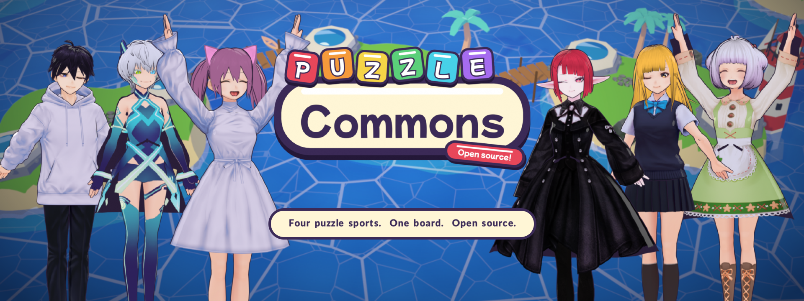
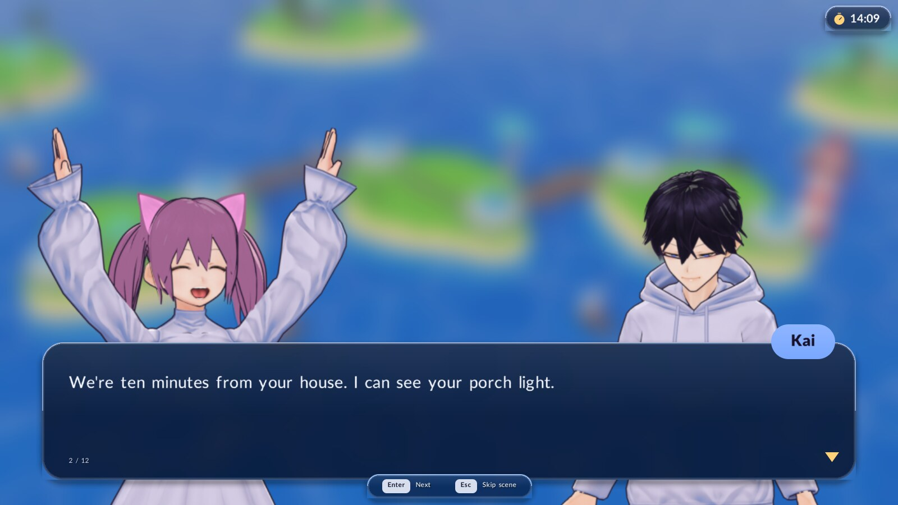
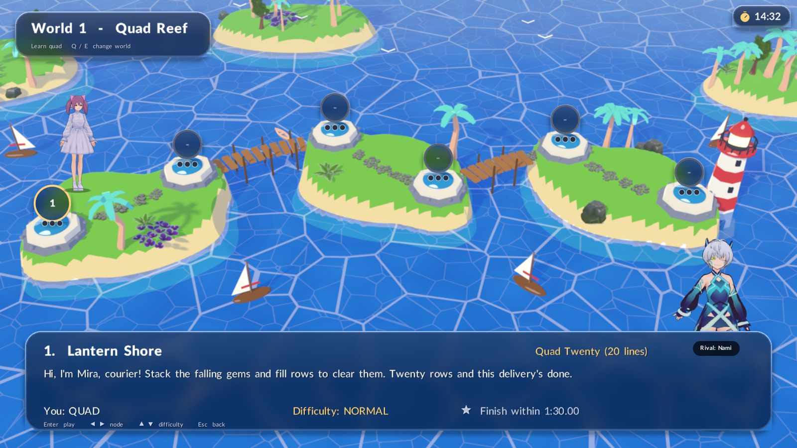
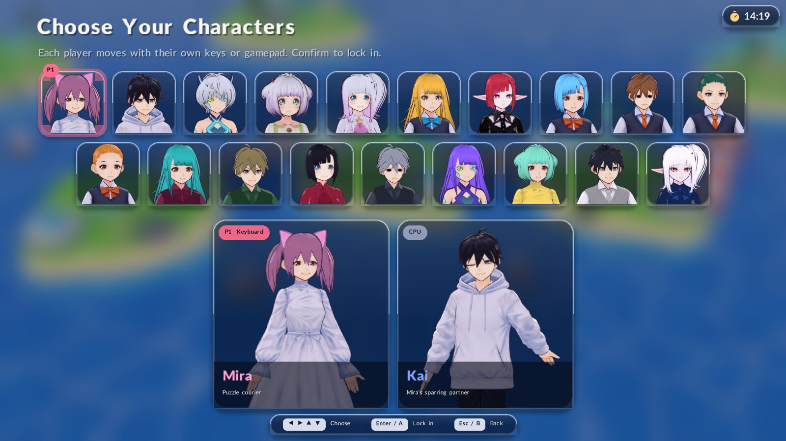
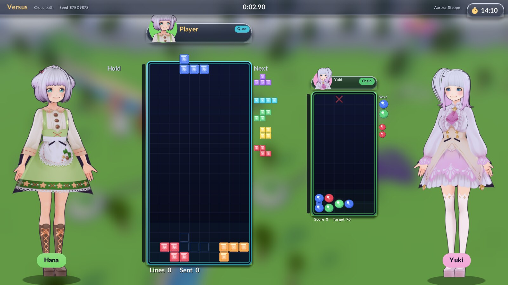
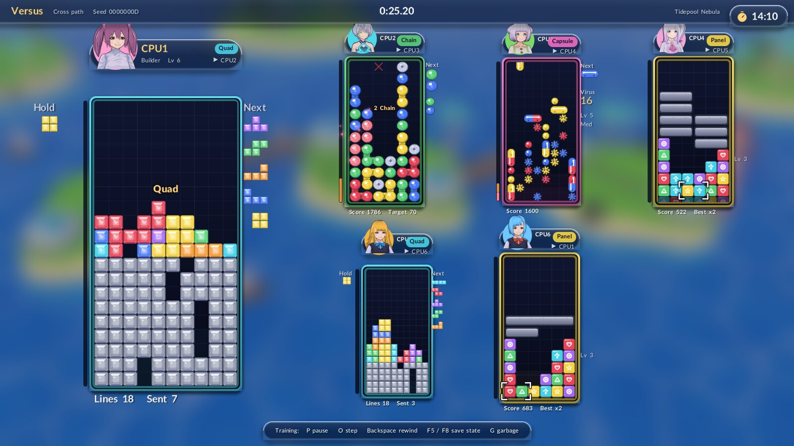
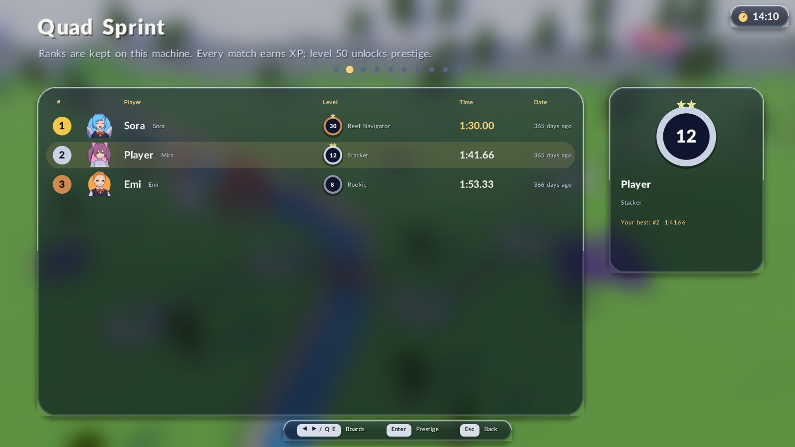
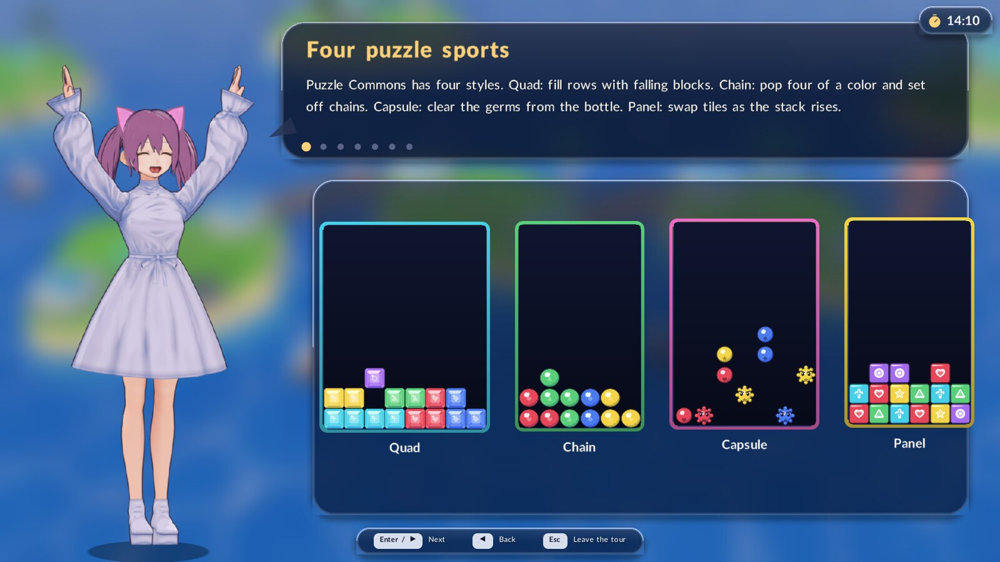
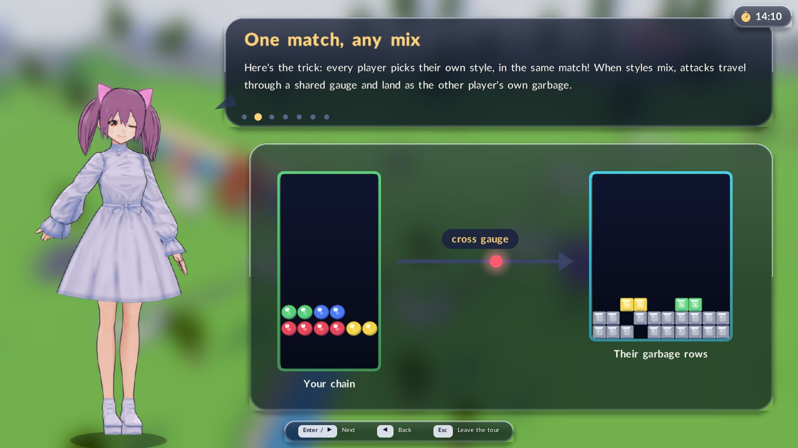
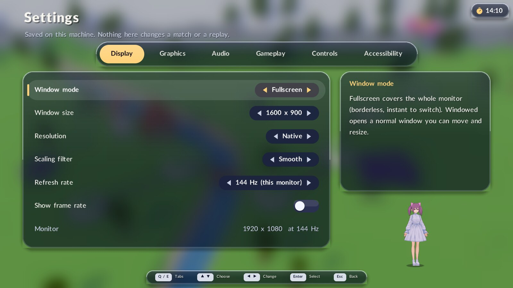

<p align="center">
  
</p>

<p align="center">
  <a href="https://github.com/premohq/puzzle-commons/actions/workflows/build.yml"></a>
  <a href="https://github.com/premohq/puzzle-commons/releases/latest"></a>
  
  
  
  
  
  <a href="LICENSE"></a>
</p>

<p align="center">
  <b>Puzzle Commons</b> is an open-source puzzle platform: four puzzle sports on one board.<br>
  <b>Quad</b> (fill rows with falling blocks), <b>Chain</b> (pop four of a color and set off chains), <b>Capsule</b>
  (clear the germs from the bottle) and <b>Panel</b> (swap tiles as the stack rises), and every player picks their own,
  <i>in the same match</i>: attacks travel through a shared gauge and land as each player's own garbage.<br>
  Up to six players on one machine, a story told across five 3D worlds by an anime cast, lessons with Mira,
  leaderboards with levels and prestige, and a custom engine written from scratch in Rust.<br>
  Made by <a href="https://github.com/premohq">premohq</a>.
</p>

<p align="center">
  <a href="https://github.com/premohq/puzzle-commons/releases/latest"><b>Download</b></a> ·
  <a href="#install">Install</a> ·
  <a href="#modes">Modes</a> ·
  <a href="#controls">Controls</a> ·
  <a href="#the-story">The story</a> ·
  <a href="#build-it-yourself">Build</a> ·
  <a href="#credits">Credits</a>
</p>

---

## What's inside

- **Four puzzle sports, one match:** when everyone plays the same style, the original rules and attack units
  are used (the *authentic path*). When styles mix, attacks pass through a common gauge and arrive as each
  player's own garbage (the *cross path*): your chains land on a Quad player as gray rows.
- **A story with a heart:** Mira, a puzzle courier, and her friend Kai cross five worlds to reopen the
  Commons, where every style used to play together. It's funny and cute, with a mystery underneath: why
  Queen Kaede split the worlds, what the gray garbage blocks really are, and what Mira carries in her
  puzzle box. Twenty-three visual-novel scenes play between the story's thirty matches, and the finale costs
  someone everything before everyone brings them back.
- **An anime cast, rendered in 3D:** nineteen characters, toon-shaded with an ink outline in Blender, eight
  expressions each, with rigged hands. They stand beside the boards and react to the match (always in the
  story, optional in versus), cheer on the results screen, and pick up the dialogue in every scene.
- **Character select:** each player moves their own cursor with their own keyboard half or gamepad.
- **Leaderboards, levels and prestige:** every match earns XP. Fifty levels with titles (Newcomer to Commons
  Legend), then ten prestige tiers (Bronze to Commons Crown), each with a badge and an XP bonus. Nine
  leaderboards for the solo modes, the arcade ladder, versus victories and lifetime XP.
- **Mira shows you around:** the first launch is a short setup (picture, controls, sound, who you play as)
  and a tour of the modes with diagrams. Mira also teaches every lesson in Training: the idea, why it works,
  a demo, a drill and the mistake to watch for.
- **Real display settings:** fullscreen or windowed, every resolution and refresh rate your monitor offers,
  smooth or sharp scaling. The renderer is resolution-independent and multi-threaded: every screen draws in
  under 6 ms at 2560x1440 on a laptop CPU, so 1440p holds well over 120 fps.
- **The arrow keys are enough:** left and right move, up rotates, down drops. Any gamepad works, found
  automatically through the SDL controller database. Two or three people can share one keyboard.
- **Deterministic and fair:** the sim runs at a fixed 60 ticks a second on integers, so every match can be
  saved as a tiny replay, watched, rewound, and taken over from any tick.

## Screenshots

| | |
|---|---|
|  |  |
|  |  |
|  |  |
|  |  |
|  | |

## Install

Builds for every platform come from GitHub Actions; tagged versions are on the
[Releases](https://github.com/premohq/puzzle-commons/releases) page. Each download is one self-contained
program (all the art is built in) plus its licenses.

- **Windows:** unzip `puzzle-commons-windows-x86_64.zip` and run `Puzzle Commons.exe`. SmartScreen may warn
  because the build is unsigned: choose *More info, Run anyway*.
- **macOS (Apple silicon and Intel, macOS 11+):** unzip `puzzle-commons-macos-universal.zip` and open
  `Puzzle Commons.app`. It is not notarized, so the first time right-click it and choose *Open*, or run
  `xattr -dr com.apple.quarantine "Puzzle Commons.app"`.
- **Linux (x86_64, X11 or XWayland):** `tar xzf puzzle-commons-linux-x86_64.tar.gz` and run `./puzzle-commons`.

## Modes

| Mode | What it is |
|---|---|
| **Story** | Five worlds, six matches each, a champion at the end of every world and a scene between the big moments. |
| **Versus** | Up to six seats, any mix of styles, teams or free for all, bots with personalities and eight strengths. |
| **Quick 1 vs 1** | You against a bot right away, through character select. |
| **Capsule race** | The original two-player Capsule game: first to clear every germ wins. |
| **Solo** | Quad Sprint (40 lines), Quad Twenty, Quad Marathon, Chain Endless, Capsule Level Run, Panel Endless. |
| **Arcade ladder** | Six rivals of rising strength, every style. |
| **Training** | Lessons for every style with Mira, a sandbox with rewind, frame advance, save states and garbage on demand, Panel puzzles, calculators and a seed browser. |
| **Ranks** | Your level and prestige, and the nine leaderboards. |
| **Replays** | Watch any saved match at 1x, 2x or 4x, or take it over from any tick. |

## Controls

| | Keyboard | Gamepad |
|---|---|---|
| Move | Left / Right | D-pad |
| Rotate | Up, or Z / X | A / B |
| Soft drop | Down | D-pad down |
| Hard drop | Space | D-pad up, RB |
| Hold (Panel: raise) | C | X, LB |
| Rotate 180 | A | Y |
| Pause | Esc | Start |

Every key can be rebound in **Settings > Controls**; the left and right keyboard layouts let two or three
people share one keyboard.

## The story

*No spoilers past the first world.* Once a year, every puzzle style used to meet at the Commons and play on one
huge board. Then Queen Kaede of Cinder Crown split the styles into five worlds and closed it. Mira, a courier
who signs off every delivery with "Signed, sealed, stacked!", sets out with Kai and a bag of his terrible snacks
to beat each world's champion and borrow their style. Nami keeps the lighthouse on Quad Reef lit every night,
for a ship. Mira's puzzle box hums when everyone is asleep. The story's bible is in
[docs/story/BIBLE.md](docs/story/BIBLE.md) (it contains every spoiler).

## Display

**Settings > Display:** fullscreen or windowed (720p to 4K window sizes), resolution (native, or any size your
monitor offers, scaled smoothly or sharply), and refresh rate (your monitor's rates, or unlimited).
`puzzle-commons --modes` prints what the game detects; `puzzle-commons --bench` times every screen at 720p,
1080p and 1440p.

## Build it yourself

Install Rust once ([rustup.rs](https://rustup.rs)), then from this folder:

```bash
cargo run --release -p purtris-client
```

The game is `target/release/puzzle-commons` (`.exe` on Windows). It embeds all art, so that single file can be
copied anywhere.

### Tests and tools

- `cargo run --release -p purtris-tools -- determinism` (and `puzzles`, `bench`, `soak`, `survive`): the sim's
  determinism, replay, puzzle-solvability and bot checks. CI runs `determinism`, `puzzles` and `bench` before
  every build.
- `cargo check -p purtris-client --features check_all` type-checks the Windows and macOS back ends from any OS.
- `puzzle-commons --shots DIR [WIDTH]` saves screenshots of every screen; `--banner FILE` renders the banner above.
- Live tests: `PC_SCRIPT=file PC_WINDOWED=1 XDG_CONFIG_HOME=/some/scratch/dir puzzle-commons` plays a script of
  timed key presses and screenshots (`<seconds> key Enter`, `hold Left 0.5`, `shot out.png`, `quit`) in the real
  window without touching your own settings.

### Rebuilding the art (optional, needs Blender 5)

`python3 tools/fetch_assets.py` downloads the CC0 Poly Haven sources; CC0 model packs go in `third_party/oga/`.
Then run the scripts in `tools/blender/` (`overworld.py`, `export_cast.py`, `font_atlas.py`, `icons.py`,
`logo.py`) with `blender -b --factory-startup --python <script> -- <args>`.

The cast: put the VRoid CC0 sample avatars (sources in `third_party/vroid_cc0/LICENSE.txt`) as `.vrm` files in
`third_party/vroid_cc0/vrm/`, then `blender -b --factory-startup --python tools/blender/cast3d.py -- <repo> cast`
renders every character in eight expressions (full body and portrait) into `assets/cast/`.

## Credits

All free licenses; the details are in each folder's license file.

- **Characters:** the VRoid Studio sample avatars by the VRoid Project / pixiv Inc., released under CC0
  (`third_party/vroid_cc0/LICENSE.txt`), posed, recolored and toon-rendered for this game; eight more cast
  members are built from the same CC0 parts (hairstyles moved between models, new colors). Names, roles and
  story are this game's own.
- **3D worlds:** Quaternius Stylized Nature MegaKit and Medieval Village MegaKit, Kenney Nature Kit, Poly Haven
  (all CC0).
- **Fonts:** Lato, M PLUS Rounded 1c, Mochiy Pop One (SIL OFL 1.1, `assets/fonts/`).
- **Icons and tile symbols:** Phosphor Icons (MIT).
- **Controller mappings:** SDL_GameControllerDB (zlib, `assets/input/`).

## License

Puzzle Commons is free software under the GNU General Public License v3.0 (see [LICENSE](LICENSE)). The art
it uses keeps its own licenses, listed above.
